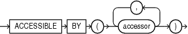
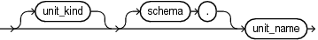
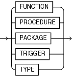

The `ACCESSIBLE BY` clause restricts access to a unit or subprogram by other units.

The accessor list explicitly lists those units which may have access. The accessor list can be defined on individual subprograms in a package. This list is checked in addition to the accessor list defined on the package itself (if any). This list may only restrict access to the subprogram – it cannot expand access. This code management feature is useful to prevent inadvertent use of internal subprograms. For example, it may not be convenient or feasible to reorganize a package into two packages: one for a small number of procedures requiring restricted access, and another one for the remaining units requiring public access.

The `ACCESSIBLE BY` clause may appear in the declarations of object types, object type bodies, packages, and subprograms.

Syntax

accessible\_by\_clause::=



> ```
> ACCESSIBLE BY ( accessor [, accessor ]... )
> ```
>
> [  
> Copyright © 1996, 2024, Oracle and/or its affiliates.](https://docs.oracle.com/en/database/oracle/oracle-database/dcommon/html/cpyr.htm)


accessor::=



> ```
> [ unit_kind ] [schema.]unit_name
> ```
>
> [  
> Copyright © 1996, 2024, Oracle and/or its affiliates.](https://docs.oracle.com/en/database/oracle/oracle-database/dcommon/html/cpyr.htm)


unit\_kind::=



> unit\_kind syntax diagram description.
>
> \[ FUNCTION | PROCEDURE | PACKAGE | TRIGGER | TYPE \]
>
> [  
> Copyright © 1996, 2024, Oracle and/or its affiliates.](https://docs.oracle.com/en/database/oracle/oracle-database/dcommon/html/cpyr.htm)


Semantics

accessible\_by\_clause

accessor

\[schema.\]unit\_name

Specifies a stored PL/SQL unit that can invoke the entity.

Each `accessor` specifies another PL/SQL entity that may access the entity which includes the `ACCESSIBLE BY` clause.

When an `ACCESSIBLE BY` clause appears, only entities named in the clause may access the entity in which the clause appears.

An `accessor` may appear more than once in the `ACCESSIBLE BY` clause.

The `ACCESSIBLE BY` clause can appear only once in the unit declaration.

An entity named in an `accessor` is not required to exist.

When an entity with an `ACCESSIBLE BY` clause is invoked, it imposes an additional access check after all other checks have been performed. These checks are:

- The invoked unit must include an `accessor` with the same unit\_name and unit\_kind as the invoking unit.
- If the `accessor` includes a schema, the invoking unit must be in that schema.
- If the `accessor` does not include a schema, the invoker must be from the same schema as the invoked entity.

unit\_kind

Specifies if the unit is a `FUNCTION`, `PACKAGE`, `PROCEDURE`, `TRIGGER`, or `TYPE`.

Usage Notes

The unit\_kind is optional, but it is recommended to specify it to avoid ambiguity when units have the same name. For example, it is possible to define a trigger with the same name as a function.

The `ACCESSIBLE BY` clause allows access only when the call is direct. The check will fail if the access is through static SQL, DBMS\_SQL, or dynamic SQL.

Any call to the initialization procedure of a package specification or package body will be checked against the accessor list of the package specification.

A unit can always access itself. An item in a unit can reference another item in the same unit.

RPC calls to a protected subprogram will always fail, since there is no context available to check the validity of the call, at either compile-time or run-time.

Calls to a protected subprogram from a conditional compilation directive will fail.

Examples

Example 14-1 Restricting Access to Top-Level Procedures in the Same Schema

This example shows that the top-level procedure top\_protected\_proc can only be called by procedure top\_trusted\_proc in the current schema. The user cannot call top\_proctected\_proc directly.

Live SQL:

You can view and run this example on Oracle Live SQL at [Restricting Access to Top-Level Procedures in the Same Schema](https://livesql.oracle.com/apex/livesql/docs/lnpls/accessible-by/whitelist1.html)

```
PROCEDURE top_protected_proc
  ACCESSIBLE BY (PROCEDURE top_trusted_proc)
AS
BEGIN
  DBMS_OUTPUT.PUT_LINE('Executed top_protected_proc.');
END;

PROCEDURE top_trusted_proc AS
BEGIN
  DBMS_OUTPUT.PUT_LINE('top_trusted_proc calls top_protected_proc');
  top_protected_proc;
END;

EXEC top_trusted_proc;
top_trusted_proc calls top_protected_proc
Executed top_protected_proc.

EXEC top_protected_proc;
BEGIN top_protected_proc; END;

PLS-00904: insufficient privilege to access object TOP_PROTECTED_PROC
```

Example 14-2 Restricting Access to a Unit Name of Any Kind

This example shows that if the PL/SQL unit\_kind is not specified in the `ACCESSIBLE BY` clause, then a call from any unit kind is allowed if the unit name matches. There is no compilation error if the unit\_kind specified in the `ACCESSIBLE BY` clause does not match any existing objects. It is possible to define a trigger with the same name as a function. It is recommended to specify the unit\_kind.

Live SQL:

You can view and run this example on Oracle Live SQL at [Restricting Access to a Unit Name of Any Kind](https://livesql.oracle.com/apex/livesql/docs/lnpls/accessible-by/whitelist2.html)

```
PROCEDURE protected_proc2
  ACCESSIBLE BY (top_trusted_f)
AS
BEGIN
  DBMS_OUTPUT.PUT_LINE('Executed protected_proc2.');
END;

FUNCTION top_protected_f RETURN NUMBER
ACCESSIBLE BY (TRIGGER top_trusted_f ) AS
BEGIN
   RETURN 0.5;
END top_protected_f;

FUNCTION top_trusted_f RETURN NUMBER AUTHID DEFINER IS
  FUNCTION g RETURN NUMBER DETERMINISTIC IS
  BEGIN
     RETURN 0.5;
  END g;
BEGIN
  protected_proc2;
  RETURN g() - DBMS_RANDOM.VALUE();
END top_trusted_f;

SELECT top_trusted_f FROM DUAL;
   .381773176

1 row selected.

Executed protected_proc2.
```

Example 14-3 Restricting Access to a Stored Procedure

This example shows a package procedure that can only be called by top\_trusted\_proc procedure. The `ACCESSIBLE BY` clause of a subprogram specification and body must match. A compilation error is raised if a call is made to an existing procedure with an `ACCESSIBLE BY` clause that does not include this procedure in its accessor list.

Live SQL:

You can view and run this example on Oracle Live SQL at [Restricting Access to a Stored Procedure](https://livesql.oracle.com/apex/livesql/docs/lnpls/accessible-by/whitelist3.html)

```
CREATE OR REPLACE PACKAGE protected_pkg
AS
  PROCEDURE public_proc;
  PROCEDURE private_proc ACCESSIBLE BY (PROCEDURE top_trusted_proc);
END;

CREATE OR REPLACE PACKAGE BODY protected_pkg
AS
  PROCEDURE public_proc AS
  BEGIN
    DBMS_OUTPUT.PUT_LINE('Executed protected_pkg.public_proc');
  END;
  PROCEDURE private_proc ACCESSIBLE BY (PROCEDURE top_trusted_proc) AS
  BEGIN
    DBMS_OUTPUT.PUT_LINE('Executed protected_pkg.private_proc');
  END;
END;

CREATE OR REPLACE PROCEDURE top_trusted_proc 
AS
  BEGIN
     DBMS_OUTPUT.PUT_LINE('top_trusted_proc calls protected_pkg.private_proc ');
     protected_pkg.private_proc;
  END;
    
Procedure created.

EXEC top_trusted_proc;
top_trusted_proc calls protected_pkg.private_proc
Executed protected_pkg.private_proc

EXEC protected_pkg.private_proc
PLS-00904: insufficient privilege to access object PRIVATE_PROC
```