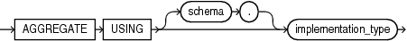

Identifies the function as an aggregate function, or one that evaluates a group of rows and returns a single row.

You can specify aggregate functions in the select list, `HAVING` clause, and `ORDER` `BY` clause.

When you specify a user-defined aggregate function in a query, you can treat it as an analytic function (one that operates on a query result set). To do so, use the `OVER` `analytic_clause` syntax available for SQL analytic functions.

The `AGGREGATE` clause can appear in the [CREATE FUNCTION Statement](CREATE-FUNCTION-statement.md).

Syntax

aggregate\_clause::=



> ```
> AGGREGATE USING [ schema. ] implementation_type
> ```
>
> [  
> Copyright © 1996, 2024, Oracle and/or its affiliates.](https://docs.oracle.com/en/database/oracle/oracle-database/dcommon/html/cpyr.htm)


Semantics

aggregate\_clause

AGGREGATE USING

Specify the name of the implementation type of the function.

\[schema.\] implementation\_type

The implementation type must be an ADT containing the implementation of the `ODCIAggregate` subprograms. If you do not specify `schema`, then the database assumes that the implementation type is in your schema.

Restriction on AGGREGATE USING

You cannot specify the aggregate\_clause for a nested function.

If you specify this clause, then you can specify only one input argument for the function.

Examples

- [Example 13-33](plsql-optimization-and-tuning.md), "Pipelined Table Function as Aggregate Function"