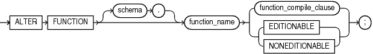
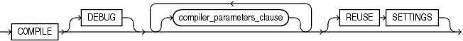

The `ALTER` `FUNCTION` statement explicitly recompiles a standalone function.

Explicit recompilation eliminates the need for implicit runtime recompilation and prevents associated runtime compilation errors and performance overhead.

Note:

This statement does not change the declaration or definition of an existing function. To redeclare or redefine a standalone function, use the " [CREATE FUNCTION Statement](CREATE-FUNCTION-statement.md) " with the `OR` `REPLACE` clause.

Topics

Prerequisites

If the function is in the `SYS` schema, you must be connected as `SYSDBA`. Otherwise, the function must be in your schema or you must have `ALTER` `ANY` `PROCEDURE` system privilege.

Syntax

alter\_function::=



> ```
> ALTER FUNCTION [ schema. ] function_name
>   { function_compile_clause | { EDITIONABLE | NONEDITIONABLE } } ;
> ```
>
> [  
> Copyright © 1996, 2024, Oracle and/or its affiliates.](https://docs.oracle.com/en/database/oracle/oracle-database/dcommon/html/cpyr.htm)


function\_compile\_clause::=



> ```
> COMPILE [ DEBUG ] [ compiler_parameters_clause ... ] [ REUSE SETTINGS ]
> ```
>
> [  
> Copyright © 1996, 2024, Oracle and/or its affiliates.](https://docs.oracle.com/en/database/oracle/oracle-database/dcommon/html/cpyr.htm)


([compiler\_parameters\_clause::=](COMPILE-clause.md))

Semantics

alter\_function

schema

Name of the schema containing the function. Default: your schema.

function\_name

Name of the function to be recompiled.

{ EDITIONABLE | NONEDITIONABLE }

Specifies whether the function becomes an editioned or noneditioned object if editioning is later enabled for the schema object type `FUNCTION` in `schema`. Default: `EDITIONABLE`. For information about altering editioned and noneditioned objects, see [Oracle Database Development Guide](https://docs.oracle.com/pls/topic/lookup?ctx=en/database/oracle/oracle-database/21/lnpls&id=ADFNS1287).

function\_compile\_clause

Recompiles the function, whether it is valid or invalid.

See [compile\_clause](COMPILE-clause.md) semantics.

See also [DEFAULT COLLATION Clause](DEFAULT-COLLATION-clause.md) compilation semantics.

Example

Example 15-1 Recompiling a Function

To explicitly recompile the function `get_bal` owned by the sample user `oe`, issue this statement:

```
ALTER FUNCTION oe.get_bal COMPILE;
```

If the database encounters no compilation errors while recompiling `get_bal`, then `get_bal` becomes valid. The database can subsequently run it without recompiling it at run time. If recompiling `get_bal` results in compilation errors, then the database returns an error, and `get_bal` remains invalid.

The database also invalidates all objects that depend upon `get_bal`. If you subsequently reference one of these objects without explicitly recompiling it first, then the database recompiles it implicitly at run time.