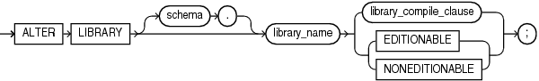

The `ALTER` `LIBRARY` statement explicitly recompiles a library.

Explicit recompilation eliminates the need for implicit runtime recompilation and prevents associated runtime compilation errors and performance overhead.

Note:

This statement does not change the declaration or definition of an existing library. To redeclare or redefine a library, use the " [CREATE LIBRARY Statement](CREATE-LIBRARY-statement.md) " with the `OR` `REPLACE` clause.

Topics

Prerequisites

If the library is in the `SYS` schema, you must be connected as `SYSDBA`. Otherwise, the library must be in your schema or you must have the `ALTER` `ANY` `LIBRARY` system privilege.

Syntax

alter\_library::=



> ```
> ALTER LIBRARY [ schema. ] library
>   { library_compile_clause | { EDITIONABLE | NONEDITIONABLE } } ;
> ```
>
> [  
> Copyright © 1996, 2024, Oracle and/or its affiliates.](https://docs.oracle.com/en/database/oracle/oracle-database/dcommon/html/cpyr.htm)


library\_compile\_clause::=


> ```
> COMPILE [ DEBUG ] [ compiler_parameters_clause ... ] [ REUSE SETTINGS ]
> ```
>
> [  
> Copyright © 1996, 2024, Oracle and/or its affiliates.](https://docs.oracle.com/en/database/oracle/oracle-database/dcommon/html/cpyr.htm)


([compiler\_parameters\_clause::=](COMPILE-clause.md))

Semantics

alter\_library

library\_name

Name of the library to be recompiled.

{ EDITIONABLE | NONEDITIONABLE }

Specifies whether the library becomes an editioned or noneditioned object if editioning is later enabled for the schema object type `LIBRARY` in `schema`. Default: `EDITIONABLE`. For information about altering editioned and noneditioned objects, see [Oracle Database Development Guide](https://docs.oracle.com/pls/topic/lookup?ctx=en/database/oracle/oracle-database/21/lnpls&id=ADFNS1287).

library\_compile\_clause

Recompiles the library.

See [compile\_clause](COMPILE-clause.md) and [compiler\_parameters\_clause](COMPILE-clause.md) semantics.

Example

Example 15-2 Recompiling a Library

To explicitly recompile the library `my_ext_lib` owned by the sample user `hr`, issue this statement:

```
ALTER LIBRARY hr.my_ext_lib COMPILE;
```

If the database encounters no compilation errors while recompiling `my_ext_lib`, then `my_ext_lib` becomes valid. The database can subsequently run it without recompiling it at run time. If recompiling `my_ext_lib` results in compilation errors, then the database returns an error, and `my_ext_lib` remains invalid.

The database also invalidates all objects that depend upon `my_ext_lib`. If you subsequently reference one of these objects without explicitly recompiling it first, then the database recompiles it implicitly at run time.