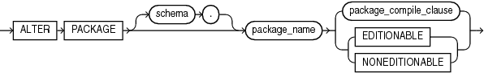
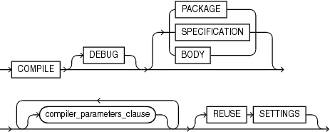

The `ALTER` `PACKAGE` statement explicitly recompiles a package specification, body, or both. Explicit recompilation eliminates the need for implicit runtime recompilation and prevents associated runtime compilation errors and performance overhead.

Because all objects in a package are stored as a unit, the `ALTER` `PACKAGE` statement recompiles all package objects. You cannot use the `ALTER` `PROCEDURE` statement or `ALTER` `FUNCTION` statement to recompile individually a procedure or function that is part of a package.

Note:

This statement does not change the declaration or definition of an existing package. To redeclare or redefine a package, use the " [CREATE PACKAGE Statement](CREATE-PACKAGE-statement.md) ", or the " [CREATE PACKAGE BODY Statement](CREATE-PACKAGE-BODY-statement.md) " with the `OR` `REPLACE` clause.

Topics

Prerequisites

If the package is in the `SYS` schema, you must be connected as `SYSDBA`. Otherwise, the package must be in your schema or you must have `ALTER` `ANY` `PROCEDURE` system privilege.

Syntax

alter\_package::=



> ```
> ALTER PACKAGE [ schema. ] package_name
>   { package_compile_clause | { EDITIONABLE | NONEDITIONABLE } } ;
> ```
>
> [  
> Copyright © 1996, 2024, Oracle and/or its affiliates.](https://docs.oracle.com/en/database/oracle/oracle-database/dcommon/html/cpyr.htm)


package\_compile\_clause::=



> ```
> COMPILE [ DEBUG ] [ compiler_parameters_clause ... ] [ REUSE SETTINGS ]
> ```
>
> [  
> Copyright © 1996, 2024, Oracle and/or its affiliates.](https://docs.oracle.com/en/database/oracle/oracle-database/dcommon/html/cpyr.htm)


([compiler\_parameters\_clause::=](COMPILE-clause.md))

Semantics

alter\_package

schema

Name of the schema containing the package. Default: your schema.

package\_name

Name of the package to be recompiled.

{ EDITIONABLE | NONEDITIONABLE }

Specifies whether the package becomes an editioned or noneditioned object if editioning is later enabled for the schema object type `PACKAGE` in `schema`. Default: `EDITIONABLE`. For information about altering editioned and noneditioned objects, see [Oracle Database Development Guide](https://docs.oracle.com/pls/topic/lookup?ctx=en/database/oracle/oracle-database/21/lnpls&id=ADFNS1287).

package\_compile\_clause

Recompiles the package specification, body, or both.

See [compile\_clause](COMPILE-clause.md) and [compiler\_parameters\_clause](COMPILE-clause.md) semantics.

Examples

Example 15-3 Recompiling a Package

This statement explicitly recompiles the specification and body of the `hr.emp_mgmt` package.

See " [CREATE PACKAGE Statement](CREATE-PACKAGE-statement.md) " for the example that creates this package.

```
ALTER PACKAGE emp_mgmt COMPILE PACKAGE;
```

If the database encounters no compilation errors while recompiling the `emp_mgmt` specification and body, then `emp_mgmt` becomes valid. The user `hr` can subsequently invoke or reference all package objects declared in the specification of `emp_mgmt` without runtime recompilation. If recompiling `emp_mgmt` results in compilation errors, then the database returns an error and `emp_mgmt` remains invalid.

The database also invalidates all objects that depend upon `emp_mgmt`. If you subsequently reference one of these objects without explicitly recompiling it first, then the database recompiles it implicitly at run time.

To recompile the body of the `emp_mgmt` package in the schema `hr`, issue this statement:

```
ALTER PACKAGE hr.emp_mgmt COMPILE BODY;
```

If the database encounters no compilation errors while recompiling the package body, then the body becomes valid. The user `hr` can subsequently invoke or reference all package objects declared in the specification of `emp_mgmt` without runtime recompilation. If recompiling the body results in compilation errors, then the database returns an error message and the body remains invalid.

Because this statement recompiles the body and not the specification of `emp_mgmt`, the database does not invalidate dependent objects.