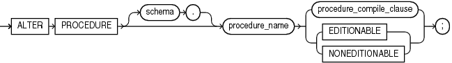

The `ALTER` `PROCEDURE` statement explicitly recompiles a standalone procedure.

Explicit recompilation eliminates the need for implicit runtime recompilation and prevents associated runtime compilation errors and performance overhead.

To recompile a procedure that is part of a package, recompile the entire package using the " [ALTER PACKAGE Statement](ALTER-PACKAGE-statement.md) ").

Note:

This statement does not change the declaration or definition of an existing procedure. To redeclare or redefine a standalone procedure, use the " [CREATE PROCEDURE Statement](CREATE-PROCEDURE-statement.md) " with the `OR` `REPLACE` clause.

The `ALTER` `PROCEDURE` statement is very similar to the `ALTER` `FUNCTION` statement. See " [ALTER FUNCTION Statement](ALTER-FUNCTION-statement.md) " for more information.

Topics

Prerequisites

If the procedure is in the `SYS` schema, you must be connected as `SYSDBA`. Otherwise, the procedure must be in your schema or you must have `ALTER` `ANY` `PROCEDURE` system privilege.

Syntax

alter\_procedure::=



> ```
> ALTER PROCEDURE [ schema. ] procedure_name
>   { procedure_compile_clause | { EDITIONABLE | NONEDITIONABLE } } ;
> ```
>
> [  
> Copyright © 1996, 2024, Oracle and/or its affiliates.](https://docs.oracle.com/en/database/oracle/oracle-database/dcommon/html/cpyr.htm)


procedure\_compile\_clause::=


> ```
> COMPILE [ DEBUG ] [ compiler_parameters_clause ... ] [ REUSE SETTINGS ]
> ```
>
> [  
> Copyright © 1996, 2024, Oracle and/or its affiliates.](https://docs.oracle.com/en/database/oracle/oracle-database/dcommon/html/cpyr.htm)


([compiler\_parameters\_clause::=](COMPILE-clause.md))

Semantics

alter\_procedure

schema

Name of the schema containing the procedure. Default: your schema.

procedure\_name

Name of the procedure to be recompiled.

{ EDITIONABLE | NONEDITIONABLE }

Specifies whether the procedure becomes an editioned or noneditioned object if editioning is later enabled for the schema object type `PROCEDURE` in `schema`. Default: `EDITIONABLE`. For information about altering editioned and noneditioned objects, see [Oracle Database Development Guide](https://docs.oracle.com/pls/topic/lookup?ctx=en/database/oracle/oracle-database/21/lnpls&id=ADFNS1287).

procedure\_compile\_clause

See [compile\_clause](COMPILE-clause.md) and [compiler\_parameters\_clause](COMPILE-clause.md) semantics.

Example

Example 15-4 Recompiling a Procedure

To explicitly recompile the procedure `remove_emp` owned by the user `hr`, issue this statement:

```
ALTER PROCEDURE hr.remove_emp COMPILE;
```

If the database encounters no compilation errors while recompiling `remove_emp`, then `remove_emp` becomes valid. The database can subsequently run it without recompiling it at run time. If recompiling `remove_emp` results in compilation errors, then the database returns an error and `remove_emp` remains invalid.

the database also invalidates all dependent objects. These objects include any procedures, functions, and package bodies that invoke `remove_emp`. If you subsequently reference one of these objects without first explicitly recompiling it, then the database recompiles it implicitly at run time.