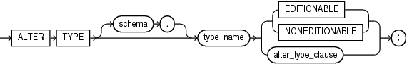
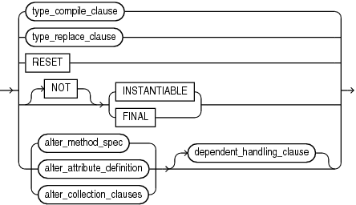
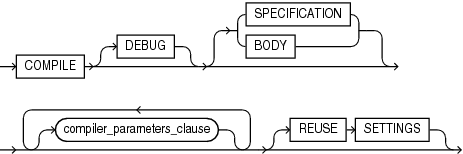
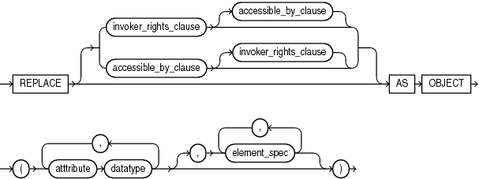
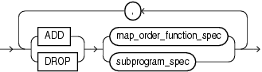
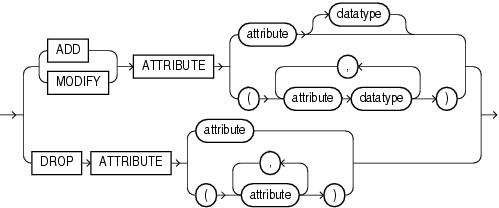
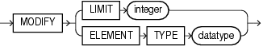

Use the ALTER TYPE statement to add or drop member attributes or methods. You can change the existing properties of an object type, and you can modify the scalar attributes of the type. You can also use this statement to recompile the specification or body of the type or to change the specification of an object type by adding new object member subprogram specifications.

The `ALTER` `TYPE` statement does one of the following to a type that was created with " [CREATE TYPE Statement](CREATE-TYPE-statement.md) " and " [CREATE TYPE BODY Statement](CREATE-TYPE-BODY-statement.md) ":

- Evolves the type; that is, adds or drops member attributes or methods.
	For more information about type evolution, see [Oracle Database Object-Relational Developer's Guide](https://docs.oracle.com/pls/topic/lookup?ctx=en/database/oracle/oracle-database/21/lnpls&id=ADOBJ00603).
- Changes the specification of the type by adding object member subprogram specifications.
- Recompiles the specification or body of the type.
- Resets the version of the type to 1, so that it is no longer considered to be evolved.

Topics

Prerequisites

If the type is in the `SYS` schema, you must be connected as `SYSDBA`. Otherwise, the type must be in your schema and you must have `CREATE` `TYPE` or `CREATE` `ANY` `TYPE` system privilege, or you must have `ALTER` `ANY` `TYPE` system privileges.

Syntax

alter\_type::=



> ```
> ALTER TYPE [ schema. ] type_name 
>   { { EDITIONABLE | NONEDITIONABLE } | alter_type_clause } ;
> ```
>
> [  
> Copyright © 1996, 2024, Oracle and/or its affiliates.](https://docs.oracle.com/en/database/oracle/oracle-database/dcommon/html/cpyr.htm)


alter\_type\_clause::=



> ```
> { type_compile_clause
> | type_replace_clause
> | RESET
> | [ NOT ] { INSTANTIABLE | FINAL }
> | { alter_method_spec
>   | alter_attribute_definition
>   | alter_collection_clauses
>   } [ dependent_handling_clause ]
> } ;
> ```
>
> [  
> Copyright © 1996, 2024, Oracle and/or its affiliates.](https://docs.oracle.com/en/database/oracle/oracle-database/dcommon/html/cpyr.htm)


( type\_compile\_clause::=, type\_replace\_clause::=, alter\_attribute\_definition::=, alter\_method\_spec::=, alter\_collections\_clauses::=, dependent\_handling\_clause::= )

type\_compile\_clause::=



> ```
> COMPILE [ DEBUG ] [ SPECIFICATION | BODY ]
>    [ compiler_parameters_clause ]... [ REUSE SETTINGS ]
> ```
>
> [  
> Copyright © 1996, 2024, Oracle and/or its affiliates.](https://docs.oracle.com/en/database/oracle/oracle-database/dcommon/html/cpyr.htm)


( [compiler\_parameters\_clause::=](COMPILE-clause.md) )

type\_replace\_clause::=



> ```
> REPLACE
> [ invoker_rights_clause [ accessible_by_clause ] |
>   accessible_by_clause | invoker_rights_clause ] ]
> AS OBJECT  ( attribute datatype [, attribute datatype ]...
> [, element_spec [, element_spec ]... ] )
> ```
>
> [  
> Copyright © 1996, 2024, Oracle and/or its affiliates.](https://docs.oracle.com/en/database/oracle/oracle-database/dcommon/html/cpyr.htm)


( [accessible\_by\_clause::=](ACCESSIBLE-BY-clause.md), [invoker\_rights\_clause::=](invokers_rights_clause.md), [element\_spec::=](element-specification.md))

alter\_method\_spec::=



> ```
> { ADD | DROP } { map_order_function_spec | subprogram_spec }
>   [, { ADD | DROP } { map_order_function_spec | subprogram_spec } ]...
> ```
>
> [  
> Copyright © 1996, 2024, Oracle and/or its affiliates.](https://docs.oracle.com/en/database/oracle/oracle-database/dcommon/html/cpyr.htm)


( [map\_order\_function\_spec::=](element-specification.md), [subprogram\_spec::=](element-specification.md) )

alter\_attribute\_definition::=



> ```
> { { ADD | MODIFY } ATTRIBUTE
>      { attribute [ datatype ]
>      | ( attribute datatype [, attribute datatype ]... )
>      }
> | DROP ATTRIBUTE
>      { attribute
>      | ( attribute [, attribute ]... )
>      }
> }
> ```
>
> [  
> Copyright © 1996, 2024, Oracle and/or its affiliates.](https://docs.oracle.com/en/database/oracle/oracle-database/dcommon/html/cpyr.htm)


alter\_collections\_clauses::=



> ```
> MODIFY { LIMIT integer | ELEMENT TYPE datatype }
> ```
>
> [  
> Copyright © 1996, 2024, Oracle and/or its affiliates.](https://docs.oracle.com/en/database/oracle/oracle-database/dcommon/html/cpyr.htm)


dependent\_handling\_clause::=


> ```
> { INVALIDATE
> | CASCADE [ { [ NOT ] INCLUDING TABLE DATA
>             | CONVERT TO SUBSTITUTABLE
>             }
>           ]
>      [ [FORCE ] exceptions_clause ]
> }
> ```
>
> [  
> Copyright © 1996, 2024, Oracle and/or its affiliates.](https://docs.oracle.com/en/database/oracle/oracle-database/dcommon/html/cpyr.htm)


exceptions\_clause::=


> ```
> EXCEPTIONS INTO [ schema. ] table
> ```
>
> [  
> Copyright © 1996, 2024, Oracle and/or its affiliates.](https://docs.oracle.com/en/database/oracle/oracle-database/dcommon/html/cpyr.htm)


Semantics

alter\_type

schema

Name of the schema containing the type. Default: your schema.

type\_name

Name of an ADT, `VARRAY` type, or nested table type.

Restriction on type\_name

You cannot evolve an editioned ADT.

The `ALTER` `TYPE` statement fails with ORA-22348 if either of the following is true:

- The type is an editioned ADT and the `ALTER` `TYPE` statement has no `type_compile_clause`.
	(You can use the `ALTER` `TYPE` statement to recompile an editioned object type, but not for any other purpose.)
- The type has a dependent that is an editioned ADT and the `ALTER` `TYPE` statement has a `CASCADE` clause.

An editioned object is a schema object that has an editionable object type and was created by a user for whom editions are enabled.

{ EDITIONABLE | NONEDITIONABLE }

Specifies whether the type becomes an editioned or noneditioned object if editioning is later enabled for the schema object type `TYPE` in `schema`. Default: `EDITIONABLE`. For information about altering editioned and noneditioned objects, see [Oracle Database Development Guide](https://docs.oracle.com/pls/topic/lookup?ctx=en/database/oracle/oracle-database/21/lnpls&id=ADFNS1287).

alter\_type\_clause

RESET

Resets the version of this type to 1, so that it is no longer considered to be evolved.

Note:

Resetting the version of this type to 1 invalidates all of its dependents.

`RESET` is intended for evolved ADTs that are preventing their owners from being editions-enabled. For information about enabling editions for users, see [Oracle Database Development Guide](https://docs.oracle.com/pls/topic/lookup?ctx=en/database/oracle/oracle-database/21/lnpls&id=ADFNS99878).

To see the version number of an ADT, select `VERSION#` from the static data dictionary view `*_TYPE_VERSIONS`. For example:

```
SELECT Version# 
FROM DBA_TYPE_VERSIONS
WHERE Owner = schema
AND Name = 'type_name'
AND Type = 'TYPE'
```

For an evolved ADT, the preceding query returns multiple rows with different version numbers. `RESET` deletes every row whose version number is less than the maximum version number, and resets the version number of the remaining rows to 1.

Restriction on RESET

You cannot specify `RESET` if the type has any table dependents (direct or indirect).

\[NOT\] INSTANTIABLE

Specify `INSTANTIABLE` if object instances of this type can be constructed.

Specify `NOT` `INSTANTIABLE` if no constructor (default or user-defined) exists for this type. You must specify these keywords for any type with noninstantiable methods and for any type that has no attributes (either inherited or specified in this statement).

Restriction on NOT INSTANTIABLE

You cannot change a user-defined type from `INSTANTIABLE` to `NOT` `INSTANTIABLE` if the type has any table dependents.

\[NOT\] FINAL

Specify `FINAL` if no further subtypes can be created for this type.

Specify `NOT` `FINAL` if further subtypes can be created under this type.

If you change the property from `FINAL` to `NOT` `FINAL`, or the reverse, then you must specify the `CASCADE` clause of the " dependent\_handling\_clause " to convert data in dependent columns and tables. Specifically:

- If you change a type from `NOT` `FINAL` to `FINAL`, then you must specify `CASCADE` \[`INCLUDING` `TABLE` `DATA`\]. You cannot defer data conversion with `CASCADE` `NOT` `INCLUDING` `TABLE` `DATA`.
- If you change a type from `FINAL` to `NOT` `FINAL`, then:
	- Specify `CASCADE` `INCLUDING` `TABLE` `DATA` if you want to create substitutable tables and columns of that type, but you are not concerned about the substitutability of the existing dependent tables and columns.
		The database marks all existing dependent columns and tables `NOT` `SUBSTITUTABLE` `AT` `ALL` `LEVELS`, so you cannot insert the subtype instances of the altered type into these existing columns and tables.
		- Specify `CASCADE` `CONVERT` `TO` `SUBSTITUTABLE` if you want to create substitutable tables and columns of the type and also store subtype instances of the altered type in existing dependent tables and columns.
		The database marks all existing dependent columns and tables `SUBSTITUTABLE` `AT` `ALL` `LEVELS` except those that are explicitly marked `NOT` `SUBSTITUTABLE` `AT` `ALL` `LEVELS`.
		See Also:
		[Oracle Database Object-Relational Developer's Guide](https://docs.oracle.com/pls/topic/lookup?ctx=en/database/oracle/oracle-database/21/lnpls&id=ADOBJ00603) for a full discussion of ADT evolution

Restriction on FINAL

You cannot change a user-defined type from `NOT` `FINAL` to `FINAL` if the type has any subtypes.

type\_compile\_clause

(Default) Recompiles the type specification and body.

See [compile\_clause](COMPILE-clause.md) and [compiler\_parameters\_clause](COMPILE-clause.md) semantics.

type\_replace\_clause

Starting with Oracle Database 12c Release 2 (12.2), the `type_replace_clause` is deprecated. Use the `alter_method_spec` clause instead. Alternatively, you can recreate the type using the `CREATE OR REPLACE TYPE` statement.

Adds member subprogram specifications.

Restriction on type\_replace\_clause

This clause is valid only for ADTs, not for nested tables or varrays.

attribute

Name of an object attribute. Attributes are data items with a name and a type specifier that form the structure of the object.

element\_spec

Specifies elements of the redefined object.

alter\_method\_spec

Adds a method to or drops a method from the type. The database disables any function-based indexes that depend on the type.

In one `ALTER` `TYPE` statement you can add or drop multiple methods, but you can reference each method only once.

ADD

When you add a method, its name must not conflict with any existing attributes in its type hierarchy.

DROP

When you drop a method, the database removes the method from the target type.

Restriction on DROP

You cannot drop from a subtype a method inherited from its supertype. Instead you must drop the method from the supertype.

alter\_attribute\_definition

Adds, drops, or modifies an attribute of an ADT. In one `ALTER` `TYPE` statement, you can add, drop, or modify multiple member attributes or methods, but you can reference each attribute or method only once.

ADD ATTRIBUTE

Name of the attribute must not conflict with existing attributes or methods in the type hierarchy. The database adds the attribute to the end of the locally defined attribute list.

If you add the attribute to a supertype, then it is inherited by all of its subtypes. In subtypes, inherited attributes always precede declared attributes. Therefore, you might need to update the mappings of the implicitly altered subtypes after adding an attribute to a supertype.

DROP ATTRIBUTE

When you drop an attribute from a type, the database drops the column corresponding to the dropped attribute and any indexes, statistics, and constraints referencing the dropped attribute.

You need not specify the data type of the attribute you are dropping.

Restrictions on DROP ATTRIBUTE

- You cannot drop an attribute inherited from a supertype. Instead you must drop the attribute from the supertype.
- You cannot drop an attribute that is part of a partitioning, subpartitioning, or cluster key.
	Caution:
	If you use the `INVALIDATE` option, then the compiler does not check dependents; therefore, this rule is not enforced. However, dropping such an attribute leaves the table in an unusable state.
- You cannot drop an attribute of a primary-key-based object identifier of an object table or a primary key of an index-organized table.
- You cannot drop all of the attributes of a root type. Instead you must drop the type. However, you can drop all of the locally declared attributes of a subtype.

MODIFY ATTRIBUTE

Modifies the data type of an existing scalar attribute. For example, you can increase the length of a `VARCHAR2` or `RAW` attribute, or you can increase the precision or scale of a numeric attribute.

Restriction on MODIFY ATTRIBUTE

You cannot expand the size of an attribute referenced in a function-based index, domain index, or cluster key.

alter\_collection\_clauses

These clauses are valid only for collection types.

MODIFY LIMIT integer

Increases the number of elements in a varray. It is not valid for nested tables. Specify an integer greater than the current maximum number of elements in the varray.

MODIFY ELEMENT TYPE datatype

Increases the precision, size, or length of a scalar data type of a varray or nested table. This clause is not valid for collections of ADTs.

- For a collection of `NUMBER`, you can increase the precision or scale.
- For a collection of `RAW`, you can increase the maximum size.
- For a collection of `VARCHAR2` or `NVARCHAR2`, you can increase the maximum length.

dependent\_handling\_clause

Specifies how the database is to handle objects that are dependent on the modified type. If you omit this clause, then the `ALTER` `TYPE` statement terminates if the type has any dependent type or table.

INVALIDATE

Invalidates all dependent objects without any checking mechanism. Starting with Oracle Database 12c Release 2 (12.2), the `INVALIDATE` command is deprecated. Oracle recommends that you use the `CASCADE` clause instead.

Caution:

The database does not validate the type change, so use this clause with caution. For example, if you drop an attribute that is a partitioning or cluster key, then the table becomes unusable.

CASCADE

Propagates the type change to dependent types and tables. The database terminates the statement if any errors are found in the dependent types or tables unless you also specify `FORCE`.

If you change the property of the type between `FINAL` and `NOT` `FINAL`, then you must specify this clause to convert data in dependent columns and tables.

INCLUDING TABLE DATA

(Default) Converts data stored in all user-defined columns to the most recent version of the column type.

Note:

You must specify this clause if your column data is in Oracle database version 8.0 image format. This clause is also required if you are changing the type property between `FINAL` and `NOT` `FINAL`

- For each attribute added to the column type, the database adds an attribute to the data and initializes it to null.
- For each attribute dropped from the referenced type, the database removes the corresponding attribute data from each row in the table.

If you specify `INCLUDING` `TABLE` `DATA`, then all of the tablespaces containing the table data must be in read/write mode.

If you specify `NOT` `INCLUDING` `TABLE` `DATA`, then the database upgrades the metadata of the column to reflect the changes to the type but does not scan the dependent column and update the data as part of this `ALTER` `TYPE` statement. However, the dependent column data remains accessible, and the results of subsequent queries of the data reflect the type modifications.

CONVERT TO SUBSTITUTABLE

Specify this clause if you are changing the type from `FINAL` to `NOT` `FINAL` and you want to create substitutable tables and columns of the type and also store subtype instances of the altered type in existing dependent tables and columns.

exceptions\_clause

FORCE

Specify `FORCE` if you want the database to ignore the errors from dependent tables and indexes and log all errors in the specified exception table. The exception table must have been created by running the `DBMS_UTILITY`.`CREATE_ALTER_TYPE_ERROR_TABLE` procedure.

Examples

See " [CREATE TYPE Statement](CREATE-TYPE-statement.md) " for examples creating the types referenced in these examples.

Example 15-7 Adding a Member Function

This example uses the ADT `data_typ1`.

A method is added to `data_typ1` and its type body is modified to correspond. The date formats are consistent with the `order_date` column of the `oe.orders` sample table.

```
ALTER TYPE data_typ1 
   ADD MEMBER FUNCTION qtr(der_qtr DATE) 
   RETURN CHAR CASCADE;

CREATE OR REPLACE TYPE BODY data_typ1 IS 
  MEMBER FUNCTION prod (invent NUMBER) RETURN NUMBER IS 
  BEGIN 
  RETURN (year + invent); 
  END; 
     MEMBER FUNCTION qtr(der_qtr DATE) RETURN CHAR IS 
     BEGIN 
       IF (der_qtr < TO_DATE('01-APR', 'DD-MON')) THEN 
         RETURN 'FIRST'; 
       ELSIF (der_qtr < TO_DATE('01-JUL', 'DD-MON')) THEN 
         RETURN 'SECOND'; 
       ELSIF (der_qtr < TO_DATE('01-OCT', 'DD-MON')) THEN 
         RETURN 'THIRD'; 
       ELSE 
         RETURN 'FOURTH'; 
       END IF; 
     END; 
   END;
/
```

Example 15-8 Adding a Collection Attribute

This example adds the `author` attribute to the `textdoc_tab` object column of the `text` table.

```
CREATE TABLE text (
   doc_id       NUMBER,
   description  textdoc_tab)
   NESTED TABLE description STORE AS text_store;

ALTER TYPE textdoc_typ 
   ADD ATTRIBUTE (author VARCHAR2) CASCADE;
```

The `CASCADE` keyword is required because both the `textdoc_tab` and `text` table are dependent on the `textdoc_typ` type.

Example 15-9 Increasing the Number of Elements of a Collection Type

This example increases the maximum number of elements in the varray `phone_list_typ_demo`.

```
ALTER TYPE phone_list_typ_demo
  MODIFY LIMIT 10 CASCADE;
```

Example 15-10 Increasing the Length of a Collection Type

This example increases the length of the varray element type `phone_list_typ`.

```
ALTER TYPE phone_list_typ
  MODIFY ELEMENT TYPE VARCHAR(64) CASCADE;
```

Example 15-11 Recompiling a Type

This example recompiles type `cust_address_typ` in the `hr` schema.

```
ALTER TYPE cust_address_typ2 COMPILE;
```

Example 15-12 Recompiling a Type Specification

This example compiles the type specification of `link2`.

```
CREATE TYPE link1 AS OBJECT
  (a NUMBER); 
/
CREATE TYPE link2 AS OBJECT
  (a NUMBER, 
   b link1, 
   MEMBER FUNCTION p(c1 NUMBER) RETURN NUMBER); 
/
CREATE TYPE BODY link2 AS
   MEMBER FUNCTION p(c1 NUMBER) RETURN NUMBER IS 
      BEGIN  
         dbms_output.put_line(c1);
         RETURN c1; 
      END; 
   END; 
/
```

In this example, both the specification and body of `link2` are invalidated because `link1`, which is an attribute of `link2`, is altered.

```
ALTER TYPE link1 ADD ATTRIBUTE (b NUMBER) INVALIDATE;
```

You must recompile the type by recompiling the specification and body in separate statements:

```
ALTER TYPE link2 COMPILE SPECIFICATION;
         
ALTER TYPE link2 COMPILE BODY;
```

Alternatively, you can compile both specification and body at the same time:

```
ALTER TYPE link2 COMPILE;
```

Example 15-13 Evolving and Resetting an ADT

This example creates an ADT in the schema `Usr`, evolves that ADT, and then tries to enable editions for `Usr`, which fails.

Then the example resets the version of the ADT to 1 and succeeds in enabling editions for `Usr`. To show the version numbers of the newly created, evolved, and reset ADT, the example uses the static data dictionary view `DBA_TYPE_VERSIONS`.

```
-- Create ADT in schema Usr:
create type Usr.My_ADT authid Definer is object(a1 number)

-- Show version number of ADT:
select Version#||Chr(10)||Text t
from DBA_Type_Versions
where Owner = 'USR'
and Type_Name = 'MY_ADT'
/
```

Result:

```
T
--------------------------------------------------------------------------------
1
type     My_ADT authid Definer is object(a1 number)

1 row selected.

-- Evolve ADT:
alter type Usr.My_ADT add attribute (a2 number)
/

-- Show version number of evolved ADT:
select Version#||Chr(10)||Text t
from DBA_Type_Versions
where Owner = 'USR'
and Type_Name = 'MY_ADT'
/
```

Result:

```
T
--------------------------------------------------------------------------------
1
type     My_ADT authid Definer is object(a1 number)

2
type     My_ADT authid Definer is object(a1 number)

2
 alter type     My_ADT add attribute (a2 number)

3 rows selected.

-- Try to enable editions for Usr:
alter user Usr enable editions
/
```

Result:

```
alter user Usr enable editions
*
ERROR at line 1:
ORA-38820: user has evolved object type

-- Reset version of ADT to 1:
alter type Usr.My_ADT reset
/

-- Show version number of reset ADT:
select Version#||Chr(10)||Text t
from DBA_Type_Versions
where Owner = 'USR'
and Type_Name = 'MY_ADT'
/
```

Result:

```
T
--------------------------------------------------------------------------------
1
type     My_ADT authid Definer is object(a1 number)

1
 alter type     My_ADT add attribute (a2 number)

2 rows selected.

-- Try to enable editions for Usr:
alter user Usr enable editions
/
```

Result:

```
User altered.
```

Related Topics

In this chapter:

- " [CREATE TYPE Statement](CREATE-TYPE-statement.md) "
- " [CREATE TYPE BODY Statement](CREATE-TYPE-BODY-statement.md) "
- " [DROP TYPE Statement](DROP-TYPE-statement.md) "

In other books:

- [Oracle Database Development Guide](https://docs.oracle.com/pls/topic/lookup?ctx=en/database/oracle/oracle-database/21/lnpls&id=ADFNS99923) for more information about editions
- [Oracle Database Development Guide](https://docs.oracle.com/pls/topic/lookup?ctx=en/database/oracle/oracle-database/21/lnpls&id=ADFNS007) for more information about pragmas
- [Oracle Database Object-Relational Developer's Guide](https://docs.oracle.com/pls/topic/lookup?ctx=en/database/oracle/oracle-database/21/lnpls&id=ADOBJ00603) for more information about the implications of not including table data when modifying type attribute