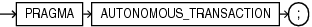

The `AUTONOMOUS_TRANSACTION` pragma marks a routine as autonomous; that is, independent of the main transaction.

In this context, a routine is one of these:

- Schema-level (not nested) anonymous PL/SQL block
- Standalone, package, or nested subprogram
- Method of an ADT
- Noncompound trigger

Topics

Syntax

autonomous\_trans\_pragma::=



> ```
> PRAGMA AUTONOMOUS_TRANSACTION ;
> ```
>
> [  
> Copyright © 1996, 2024, Oracle and/or its affiliates.](https://docs.oracle.com/en/database/oracle/oracle-database/dcommon/html/cpyr.htm)


Examples

- [Example 7-43](static-sql.md), "Declaring Autonomous Function in Package"
- [Example 7-44](static-sql.md), "Declaring Autonomous Standalone Procedure"
- [Example 7-45](static-sql.md), "Declaring Autonomous PL/SQL Block"
- [Example 7-46](static-sql.md), "Autonomous Trigger Logs INSERT Statements"
- [Example 7-47](static-sql.md), "Autonomous Trigger Uses Native Dynamic SQL for DDL"
- [Example 7-48](static-sql.md), "Invoking Autonomous Function"