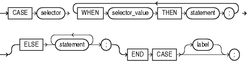
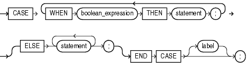

The `CASE` statement chooses from a sequence of conditions and runs a corresponding statement.

The simple `CASE` statement evaluates a single expression and compares it to several potential values.

The searched `CASE` statement evaluates multiple Boolean expressions and chooses the first one whose value is `TRUE`.

Topics

Syntax

simple\_case\_statement::=



> ```
> [ <<label>> ] CASE case_operand
>   WHEN boolean_expression THEN statement ;
>     [ WHEN boolean_expression THEN statement ; ]...
>       [ ELSE statement [ statement ]... ;
>         END CASE [ label ] ;
> ```
>
> [  
> Copyright © 1996, 2024, Oracle and/or its affiliates.](https://docs.oracle.com/en/database/oracle/oracle-database/dcommon/html/cpyr.htm)


searched\_case\_statement::=



> ```
> [ <<label>> ] CASE
>   WHEN boolean_expression THEN statement ;
>     [ WHEN boolean_expression THEN statement ; ]...
>       [ ELSE statement [ statement ]... ;
>         END CASE [ label ];
> ```
>
> [  
> Copyright © 1996, 2024, Oracle and/or its affiliates.](https://docs.oracle.com/en/database/oracle/oracle-database/dcommon/html/cpyr.htm)


([boolean\_expression::=](expression.md), [statement::=](block.md))

Semantics

simple\_case\_statement

selector

Expression whose value is evaluated once and used to select one of several alternatives. `selector` can have any PL/SQL data type except `BLOB`, `BFILE`, or a user-defined type.

WHEN selector\_value THEN statement

`selector_value` can be an expression of any PL/SQL type except `BLOB`, `BFILE`, or a user-defined type.

The `selector_value` s are evaluated sequentially. If the value of a `selector_value` equals the value of `selector`, then the `statement` associated with that `selector_value` runs, and the `CASE` statement ends. Subsequent `selector_value` s are not evaluated.

Caution:

A `statement` can modify the database and invoke nondeterministic functions. There is no fall-through mechanism, as there is in the C `switch` statement.

ELSE statement \[statement \]...

The `statement` s run if and only if no `selector_value` has the same value as `selector`.

Without the `ELSE` clause, if no `selector_value` has the same value as `selector`, the system raises the predefined exception `CASE_NOT_FOUND`.

label

A label that identifies the statement (see " [statement::=](block.md) " and " [label](block.md) ").

searched\_case\_statement

WHEN boolean\_expression THEN statement

The `boolean_expression` s are evaluated sequentially. If the value of a `boolean_expression` is `TRUE`, the `statement` associated with that `boolean_expression` runs, and the `CASE` statement ends. Subsequent `boolean_expression` s are not evaluated.

Caution:

A `statement` can modify the database and invoke nondeterministic functions. There is no fall-through mechanism, as there is in the C `switch` statement.

ELSE statement \[statement \]...

The `statement` s run if and only if no `boolean_expression` has the value `TRUE`.

Without the `ELSE` clause, if no `boolean_expression` has the value `TRUE`, the system raises the predefined exception `CASE_NOT_FOUND`.

label

A label that identifies the statement (see " [statement::=](block.md) " and " [label](block.md) ").

Examples

- [Example 4-2](plsql-data-types.md), "Printing BOOLEAN Values"
- [Example 5-6](plsql-control-statements.md), "Simple CASE Statement"
- [Example 5-7](plsql-control-statements.md), "Searched CASE Statement"

Related Topics

In this chapter:

- " [IF Statement](IF-statement.md) "

In other chapters:

- " [CASE Expressions](plsql-language-fundamentals.md) "
- " [Conditional Selection Statements](plsql-control-statements.md) "
- " [Simple CASE Statement](plsql-control-statements.md) "
- " [Searched CASE Statement](plsql-control-statements.md) "

See Also:

- [Oracle Database SQL Language Reference](https://docs.oracle.com/pls/topic/lookup?ctx=en/database/oracle/oracle-database/21/lnpls&id=SQLRF00681) for information about the `NULLIF` function
- [Oracle Database SQL Language Reference](https://docs.oracle.com/pls/topic/lookup?ctx=en/database/oracle/oracle-database/21/lnpls&id=SQLRF00617) for information about the `COALESCE` function