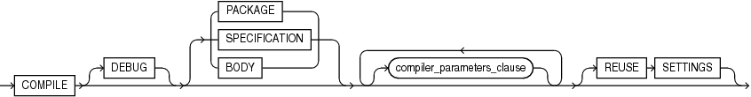

The compile clause explicitly recompiles a stored unit that has become invalid, thus eliminating the need for implicit runtime recompilation and preventing associated runtime compilation errors and performance overhead.

Syntax

compile\_clause::=



> ```
> COMPILE [ DEBUG ] [ PACKAGE | SPECIFICATION | BODY ] [ compiler_parameters_clause ... ] [ REUSE SETTINGS ]
> ```
>
> [  
> Copyright © 1996, 2024, Oracle and/or its affiliates.](https://docs.oracle.com/en/database/oracle/oracle-database/dcommon/html/cpyr.htm)


compiler\_parameters\_clause::=


> ```
> parameter_name = parameter_value
> ```
>
> [  
> Copyright © 1996, 2024, Oracle and/or its affiliates.](https://docs.oracle.com/en/database/oracle/oracle-database/dcommon/html/cpyr.htm)


Semantics

compile\_clause

COMPILE

Recompiles the PL/SQL unit, whether it is valid or invalid. The PL/SQL unit can be a library, package, package specification, package body, trigger, procedure, function, type, type specification, or type body.

First, if any of the objects upon which the unit depends are invalid, the database recompiles them.

The database also invalidates any local objects that depend upon the unit.

If the database recompiles the unit successfully, then the unit becomes valid. Otherwise, the database returns an error and the unit remains invalid. You can see the associated compiler error messages with the SQL\*Plus command `SHOW` `ERRORS`.

During recompilation, the database drops all persistent compiler switch settings, retrieves them again from the session, and stores them after compilation. To avoid this process, specify the `REUSE` `SETTINGS` clause.

DEBUG

Has the same effect as `PLSQL_OPTIMIZE_LEVEL=1` —instructs the PL/SQL compiler to generate and store the code for use by the PL/SQL debugger. Oracle recommends using `PLSQL_OPTIMIZE_LEVEL=1` instead of `DEBUG`.

PACKAGE

(Default) Recompiles both the package specification and (if it exists) the package body, whether they are valid or invalid. The recompilation of the package specification and body lead to the invalidation and recompilation of dependent objects as described for `SPECIFICATION` and `BODY`.

Restriction on `PACKAGE`

`PACKAGE` may only appear if compiling a package.

SPECIFICATION

Recompiles only the package or type specification, whether it is valid or invalid. You might want to recompile a package or type specification to check for compilation errors after modifying the specification.

When you recompile a specification, the database invalidates any local objects that depend on the specification, such as procedures that invoke procedures or functions in the package. The body of a package also depends on its specification. If you subsequently reference one of these dependent objects without first explicitly recompiling it, then the database recompiles it implicitly at run time.

Restriction on `SPECIFICATION`

`SPECIFICATION` may only appear if compiling a package or type specification.

BODY

Recompiles only the package or type body, whether it is valid or invalid. You might want to recompile a package or type body after modifying it. Recompiling a body does not invalidate objects that depend upon its specification.

When you recompile a package or type body, the database first recompiles the objects on which the body depends, if any of those objects are invalid. If the database recompiles the body successfully, then the body becomes valid.

Restriction on `BODY`

`BODY` may only appear if compiling a package or type body.

REUSE SETTINGS

Prevents Oracle Database from dropping and reacquiring compiler switch settings. With this clause, Oracle preserves the existing settings and uses them for the recompilation of any parameters for which values are not specified elsewhere in this statement.

See also [DEFAULT COLLATION Clause](DEFAULT-COLLATION-clause.md) compilation semantics.

compiler\_parameters\_clause

Specifies a value for a PL/SQL compilation parameter in [Table 2-2](overview.md). The compile-time value of each of these parameters is stored with the metadata of the PL/SQL unit being compiled.

You can specify each parameter only once in each statement. Each setting is valid only for the PL/SQL unit being compiled and does not affect other compilations in this session or system. To affect the entire session or system, you must set a value for the parameter using the `ALTER` `SESSION` or `ALTER` `SYSTEM` statement.

If you omit any parameter from this clause and you specify `REUSE` `SETTINGS`, then if a value was specified for the parameter in an earlier compilation of this PL/SQL unit, the database uses that earlier value. If you omit any parameter and either you do not specify `REUSE` `SETTINGS` or no value was specified for the parameter in an earlier compilation, then the database obtains the value for that parameter from the session environment.