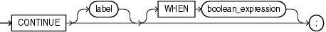

The `CONTINUE` statement exits the current iteration of a loop, either conditionally or unconditionally, and transfers control to the next iteration of either the current loop or an enclosing labeled loop.

If a `CONTINUE` statement exits a cursor `FOR` loop prematurely (for example, to exit an inner loop and transfer control to the next iteration of an outer loop), the cursor closes (in this context, `CONTINUE` works like `GOTO`).

The `CONTINUE` `WHEN` statement exits the current iteration of a loop when the condition in its `WHEN` clause is true, and transfers control to the next iteration of either the current loop or an enclosing labeled loop.

Each time control reaches the `CONTINUE` `WHEN` statement, the condition in its `WHEN` clause is evaluated. If the condition is not true, the `CONTINUE` `WHEN` statement does nothing.

Restrictions on CONTINUE Statement

- A `CONTINUE` statement must be inside a `LOOP` statement.
- A `CONTINUE` statement cannot cross a subprogram or method boundary.

Topics

Syntax

continue\_statement::=



> ```
> CONTINUE [ label ] [ WHEN boolean_expression ] ;
> ```
>
> [  
> Copyright © 1996, 2024, Oracle and/or its affiliates.](https://docs.oracle.com/en/database/oracle/oracle-database/dcommon/html/cpyr.htm)


([boolean\_expression::=](expression.md))

Semantics

continue\_statement

label

Name that identifies either the current loop or an enclosing loop.

Without `label`, the `CONTINUE` statement transfers control to the next iteration of the current loop. With `label`, the `CONTINUE` statement transfers control to the next iteration of the loop that `label` identifies.

WHEN boolean\_expression

Without this clause, the `CONTINUE` statement exits the current iteration of the loop unconditionally. With this clause, the `CONTINUE` statement exits the current iteration of the loop if and only if the value of `boolean_expression` is `TRUE`.

Examples

Example 14-7 CONTINUE Statement in Basic LOOP Statement

In this example, the `CONTINUE` statement inside the basic `LOOP` statement transfers control unconditionally to the next iteration of the current loop.

```
DECLARE
  x NUMBER := 0;
BEGIN
  LOOP -- After CONTINUE statement, control resumes here
    DBMS_OUTPUT.PUT_LINE ('Inside loop:  x = ' || TO_CHAR(x));
    x := x + 1;
    IF x < 3 THEN
      CONTINUE;
    END IF;
    DBMS_OUTPUT.PUT_LINE
      ('Inside loop, after CONTINUE:  x = ' || TO_CHAR(x));
    EXIT WHEN x = 5;
  END LOOP;
 
  DBMS_OUTPUT.PUT_LINE (' After loop:  x = ' || TO_CHAR(x));
END;
/
```

Result:

```
Inside loop:  x = 0
Inside loop:  x = 1
Inside loop:  x = 2
Inside loop, after CONTINUE:  x = 3
Inside loop:  x = 3
Inside loop, after CONTINUE:  x = 4
Inside loop:  x = 4
Inside loop, after CONTINUE:  x = 5
After loop:  x = 5
```

Example 14-8 CONTINUE WHEN Statement in Basic LOOP Statement

In this example, the `CONTINUE` `WHEN` statement inside the basic `LOOP` statement transfers control to the next iteration of the current loop when `x` is less than 3.

```
DECLARE
  x NUMBER := 0;
BEGIN
  LOOP -- After CONTINUE statement, control resumes here
    DBMS_OUTPUT.PUT_LINE ('Inside loop:  x = ' || TO_CHAR(x));
    x := x + 1;
    CONTINUE WHEN x < 3;
    DBMS_OUTPUT.PUT_LINE
      ('Inside loop, after CONTINUE:  x = ' || TO_CHAR(x));
    EXIT WHEN x = 5;
  END LOOP;
  DBMS_OUTPUT.PUT_LINE (' After loop:  x = ' || TO_CHAR(x));
END;
/
```

Result:

```
Inside loop:  x = 0
Inside loop:  x = 1
Inside loop:  x = 2
Inside loop, after CONTINUE:  x = 3
Inside loop:  x = 3
Inside loop, after CONTINUE:  x = 4
Inside loop:  x = 4
Inside loop, after CONTINUE:  x = 5
After loop:  x = 5
```