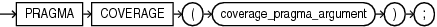
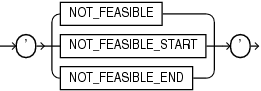

The `COVERAGE` pragma marks PL/SQL code which is infeasible to test for coverage. These marks improve coverage metric accuracy.

The `COVERAGE` pragma marks PL/SQL source code to indicate that the code may not be feasibly tested for coverage. The pragma marks a specific code section. Marking infeasible code improves the quality of coverage metrics used to assess how much testing has been achieved.

Syntax

coverage\_pragma::=



> coverage\_pragma syntax diagram description.
>
> coverage\_pragma =
>
> PRAGMA COVERAGE ( coverage\_pragma\_argument);
>
> [  
> Copyright © 1996, 2024, Oracle and/or its affiliates.](https://docs.oracle.com/en/database/oracle/oracle-database/dcommon/html/cpyr.htm)


coverage\_pragma\_argument::=



> Description of coverage\_pragma\_argument syntax diagram.
>
> ( 'NOT\_FEASIBLE' | 'NOT\_FEASIBLE\_START' | 'NOT\_FEASIBLE\_END' )
>
> [  
> Copyright © 1996, 2024, Oracle and/or its affiliates.](https://docs.oracle.com/en/database/oracle/oracle-database/dcommon/html/cpyr.htm)


Semantics

coverage\_pragma

The `COVERAGE` pragma may appear before any declaration or statement.

coverage\_pragma\_argument

The `COVERAGE` pragma argument must have one of these values:

- ‘NOT\_FEASIBLE’
- ‘NOT\_FEASIBLE\_START’
- ‘NOT\_FEASIBLE\_END’

When the `COVERAGE` pragma appear with the argument ‘NOT\_FEASIBLE’, it marks the entire basic block that includes the beginning of the first declaration or statement that follows the pragma.

A `COVERAGE` pragma with an argument of ’NOT\_FEASIBLE\_START’ may appear before any declaration or any statement. It must be followed by the `COVERAGE` pragma with an argument of ’NOT\_FEASIBLE\_END’. The second pragma may appear before any declaration or any statement. It must appear in the same PL/SQL block as the first pragma and not in any nested subprogram definition.

An associated pair of `COVERAGE` pragmas marks basic blocks infeasible from the beginning of the basic block that includes the beginning of the first statement or declaration that follows the first pragma to the end of the basic block that includes the first statement or declaration that follows the second pragma.

A `COVERAGE` pragma whose range includes the definition or declaration of an inner subprogram does not mark the blocks of that subprogram as infeasible.

Examples

Example 14-9 Marking a Single Basic Block as Infeasible to Test for Coverage

This example shows the placement of the pragma `COVERAGE` preceding the assignments to z and zl basic blocks. These two basic blocks will be ignored for coverage calculation. The first `COVERAGE` pragma (marked 1) marks the first assignment to z infeasible; the second (marked 2) marks the third assignment to z. In each case, the affected basic block runs from the identifier z to the following `END IF`.

```
IF (x>0) THEN
  y :=2;
ELSE
  PRAGMA COVERAGE (’NOT_FEASIBLE’);  -- 1
  z:=3;
END IF;
IF (y>0) THEN
  z :=2;
ELSE
  PRAGMA COVERAGE (’NOT_FEASIBLE’); -- 2
  z :=3;
END IF;
```

Example 14-10 Marking a Line Range as Infeasible to Test for Coverage

This examples shows marking the entire line range as not feasible. A line range may contain more than one basic block. A line range is marked as not feasible for coverage using a pragma `COVERAGE` with a ’NOT\_FEASIBLE\_START’ argument at the beginning of the range, and a pragma `COVERAGE` with a ’NOT\_FEASIBLE\_END’ at the end of the range. The range paired `COVERAGE` pragmas mark all the blocks as infeasible.

```
PRAGMA COVERAGE (’NOT_FEASIBLE_START’);
IF (x>0) THEN
  y :=2;
ELSE
  z:=3;
END IF;
IF (y>0) THEN
  z :=2;
ELSE
  z :=3;
END IF; 
PRAGMA COVERAGE (’NOT_FEASIBLE_END’);
```

Example 14-11 Marking Entire Units or Individual Subprograms as Infeasible to Test for Coverage

This example shows marking the entire procedure foo as not feasible for coverage. A subprogram is marked as completely infeasible by marking all of its body infeasible.

```
CREATE PROCEDURE foo IS
PRAGMA COVERAGE (’NOT_FEASIBLE_START’);
......

BEGIN
....
PRAGMA COVERAGE (’NOT_FEASIBLE_END’);
END;
/
```

Example 14-12 Marking Internal Subprogram as Infeasible to Test for Coverage

This example shows that the outer `COVERAGE` pragma pair has no effect on coverage inside procedure inner. The `COVERAGE` pragma (marked 1) inside the body of inner does mark the second assignment to x as infeasible. Notice that the entire body of procedure outer is marked infeasible even though the pragma with argument ‘NOT\_FEASIBLE\_END’ is not the last line. The pragma does mark the basic block that includes the statement that follows the pragma and that block does extend to the end of the procedure.

```
CREATE OR REPLACE PROCEDURE outer IS
   PRAGMA COVERAGE ('NOT_FEASIBLE_START');
   x NUMBER := 7;
   PROCEDURE inner IS
   BEGIN
     IF x < 6 THEN
        x := 19;
     ELSE
        PRAGMA COVERAGE ('NOT_FEASIBLE'); -- 1
        x := 203;
     END IF;
   END;
BEGIN
   DBMS_OUTPUT.PUT_LINE ('X= ');
   PRAGMA COVERAGE ('NOT_FEASIBLE_END');
   DBMS_OUTPUT.PUT_LINE (x);
END;
/
```