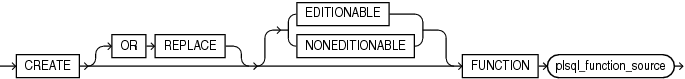
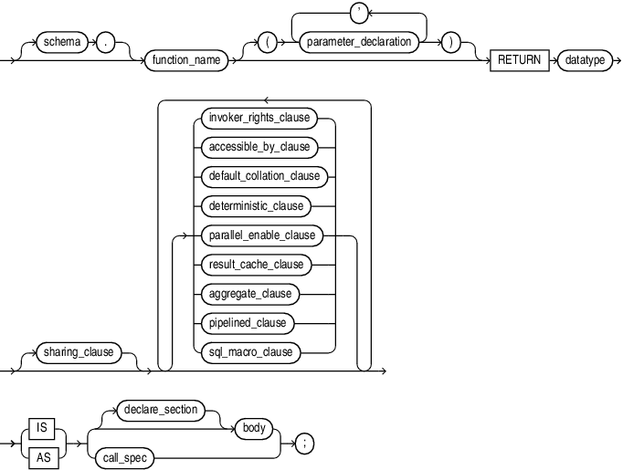

The `CREATE` `FUNCTION` statement creates or replaces a standalone function or a call specification.

A standalone function is a function (a subprogram that returns a single value) that is stored in the database.

Note:

A standalone function that you create with the `CREATE` `FUNCTION` statement differs from a function that you declare and define in a PL/SQL block or package. For more information, see " [Function Declaration and Definition](function-declaration-and-definition.md) " and [CREATE PACKAGE Statement](CREATE-PACKAGE-statement.md).

A call specification declares a Java method or a C function so that it can be invoked from PL/SQL. You can also use the SQL `CALL` statement to invoke such a method or subprogram. The call specification tells the database which Java method, or which named function in which shared library, to invoke when an invocation is made. It also tells the database what type conversions to make for the arguments and return value.

Note:

To be callable from SQL statements, a stored function must obey certain rules that control side effects. See " [Subprogram Side Effects](plsql-subprograms.md) ".

Topics

Prerequisites

To create or replace a standalone function in your schema, you must have the `CREATE` `PROCEDURE` system privilege.

To create or replace a standalone function in another user's schema, you must have the `CREATE` `ANY` `PROCEDURE` system privilege.

To invoke a call specification, you may need additional privileges, for example, `EXECUTE` privileges on a C library for a C call specification.

To embed a `CREATE` `FUNCTION` statement inside an Oracle precompiler program, you must terminate the statement with the keyword `END-EXEC` followed by the embedded SQL statement terminator for the specific language.

See Also:

For more information about such prerequisites:

- [Oracle Database Development Guide](https://docs.oracle.com/pls/topic/lookup?ctx=en/database/oracle/oracle-database/21/lnpls&id=ADFNS00906)
- [Oracle Database Java Developer's Guide](https://docs.oracle.com/pls/topic/lookup?ctx=en/database/oracle/oracle-database/21/lnpls&id=JJDEV-GUID-BCFBD7DC-40E3-4707-BD01-E47E3D0963B2)

Syntax

create\_function::=



> ```
> CREATE [ OR REPLACE ] [ EDITIONABLE | NONEDITIONABLE ]
>   FUNCTION plsql_function_source
> ```
>
> [  
> Copyright © 1996, 2024, Oracle and/or its affiliates.](https://docs.oracle.com/en/database/oracle/oracle-database/dcommon/html/cpyr.htm)


plsql\_function\_source::=



> ```
> [ schema. ] function_name
>   [ ( parameter_declaration [, parameter_declaration]... ) ] RETURN datatype 
> [ sharing_clause ]
>   [ { invoker_rights_clause
>     | accessible_by_clause
>     | default_collation_clause    
>     | deterministic_clause
>     | parallel_enable_clause
>     | result_cache_clause 
>     | aggregate_clause
>     | pipelined_clause
>     | sql_macro_clause
>        }...
>   ]
> { IS | AS } { [ declare_section ] body 
>               | call_spec
>             }
>   ;
> ```


( [sharing\_clause::=](SHARING-clause.md), [invoker\_rights\_clause::=](invokers_rights_clause.md), [accessible\_by\_clause::=](ACCESSIBLE-BY-clause.md), [default\_collation\_clause::=](DEFAULT-COLLATION-clause.md), [deterministic\_clause::=](DETERMINISTIC-clause.md), [parallel\_enable\_clause::=](PARALLEL_ENABLE-clause.md), [result\_cache\_clause::=](RESULT_CACHE-clause.md), [aggregate\_clause::=](AGGREGATE-clause.md), [pipelined\_clause::=](PIPELINED-clause.md), [sql\_macro\_clause::=](sql_macro-clause.md), [body::=](block.md), [call\_spec::=](call-specification.md), [datatype::=](datatype-attribute.md), [declare\_section::=](block.md), [parameter\_declaration::=](formal-parameter-declaration.md) )

Semantics

create\_function

OR REPLACE

Re-creates the function if it exists, and recompiles it.

Users who were granted privileges on the function before it was redefined can still access the function without being regranted the privileges.

If any function-based indexes depend on the function, then the database marks the indexes `DISABLED`.

\[ EDITIONABLE | NONEDITIONABLE \]

Specifies whether the function is an editioned or noneditioned object if editioning is enabled for the schema object type `FUNCTION` in `schema`. Default: `EDITIONABLE`. For information about editioned and noneditioned objects, see [Oracle Database Development Guide](https://docs.oracle.com/pls/topic/lookup?ctx=en/database/oracle/oracle-database/21/lnpls&id=ADFNS99923).

plsql\_function\_source

schema

Name of the schema containing the function. Default: your schema.

function\_name

Name of the function to be created.

Note:

If you plan to invoke a stored subprogram using a stub generated by SQL\*Module, then the stored subprogram name must also be a legal identifier in the invoking host 3GL language, such as Ada or C.

RETURN datatype

For `datatype`, specify the data type of the return value of the function. The return value can have any data type supported by PL/SQL.

Note:

Oracle SQL does not support invoking functions with `BOOLEAN` parameters or returns. Therefore, for SQL statements to invoke your user-defined functions, you must design them to return numbers (0 or 1) or character strings (' `TRUE` ' or ' `FALSE` ').

The data type cannot specify a length, precision, or scale. The database derives the length, precision, or scale of the return value from the environment from which the function is called.

If the return type is `ANYDATASET` and you intend to use the function in the `FROM` clause of a query, then you must also specify the `PIPELINED` clause and define a describe method (`ODCITableDescribe`) as part of the implementation type of the function.

You cannot constrain this data type (with `NOT` `NULL`, for example).

body

The required executable part of the function and, optionally, the exception-handling part of the function.

declare\_section

The optional declarative part of the function. Declarations are local to the function, can be referenced in body, and cease to exist when the function completes execution.

Examples

Example 15-14 Creating a Function

This statement creates the function `get_bal` on the sample table `oe.orders`.

```
CREATE FUNCTION get_bal(acc_no IN NUMBER) 
   RETURN NUMBER 
   IS acc_bal NUMBER(11,2);
   BEGIN 
      SELECT order_total 
      INTO acc_bal 
      FROM orders 
      WHERE customer_id = acc_no; 
      RETURN(acc_bal); 
    END;
/
```

The `get_bal` function returns the balance of a specified account.

When you invoke the function, you must specify the argument `acc_no`, the number of the account whose balance is sought. The data type of `acc_no` is `NUMBER`.

The function returns the account balance. The `RETURN` clause of the `CREATE` `FUNCTION` statement specifies the data type of the return value to be `NUMBER`.

The function uses a `SELECT` statement to select the `balance` column from the row identified by the argument `acc_no` in the `orders` table. The function uses a `RETURN` statement to return this value to the environment in which the function is called.

The function created in the preceding example can be used in a SQL statement. For example:

```
SELECT get_bal(165) FROM DUAL; 

GET_BAL(165)
------------
        2519
```

Example 15-15 Creating Aggregate Functions

The next statement creates an aggregate function called `SecondMax` to aggregate over number values. It assumes that the ADT `SecondMaxImpl` subprograms contains the implementations of the `ODCIAggregate` subprograms:

```
CREATE FUNCTION SecondMax (input NUMBER) RETURN NUMBER
    PARALLEL_ENABLE AGGREGATE USING SecondMaxImpl;
```

See Also:

[Oracle Database Data Cartridge Developer's Guide](https://docs.oracle.com/pls/topic/lookup?ctx=en/database/oracle/oracle-database/21/lnpls&id=ADDCI2120) for the complete implementation of type and type body for `SecondMaxImpl`

Use such an aggregate function in a query like this statement, which queries the sample table `hr.employees`:

```
SELECT SecondMax(salary) "SecondMax", department_id
      FROM employees
      GROUP BY department_id
      HAVING SecondMax(salary) > 9000
      ORDER BY "SecondMax", department_id;

SecondMax DEPARTMENT_ID
--------- -------------
      9450           100
  13670.74            50
     14175            80
   18742.5            90
```

Example 15-16 Package Procedure in a Function

This statement creates a function that uses a `DBMS_LOB.GETLENGTH` procedure to return the length of a `CLOB` column.

```
CREATE OR REPLACE FUNCTION text_length(a CLOB) 
   RETURN NUMBER DETERMINISTIC IS
BEGIN 
  RETURN DBMS_LOB.GETLENGTH(a);
END;
```

Related Topics

In this chapter:

- " [ALTER FUNCTION Statement](ALTER-FUNCTION-statement.md) "
- " [CREATE PROCEDURE Statement](CREATE-PROCEDURE-statement.md) "
- " [DROP FUNCTION Statement](DROP-FUNCTION-statement.md) "

In other chapters:

- [Overview of Polymorphic Table Functions](plsql-optimization-and-tuning.md)
- " [Function Declaration and Definition](function-declaration-and-definition.md) " for information about creating a function in a PL/SQL block
- " [Formal Parameter Declaration](formal-parameter-declaration.md) "
- " [PL/SQL Subprograms](plsql-subprograms.md) "

In other books:

- [Oracle Database SQL Language Reference](https://docs.oracle.com/pls/topic/lookup?ctx=en/database/oracle/oracle-database/21/lnpls&id=SQLRF01108) for information about the `CALL` statement
- [Oracle Database Development Guide](https://docs.oracle.com/pls/topic/lookup?ctx=en/database/oracle/oracle-database/21/lnpls&id=ADFNS00908) for information about restrictions on user-defined functions that are called from SQL statements
- [Oracle Database Development Guide](https://docs.oracle.com/pls/topic/lookup?ctx=en/database/oracle/oracle-database/21/lnpls&id=ADFNS010) for more information about call specifications
- [Oracle Database Data Cartridge Developer's Guide](https://docs.oracle.com/pls/topic/lookup?ctx=en/database/oracle/oracle-database/21/lnpls&id=ADDCI2140) for information about defining the `ODCITableDescribe` function