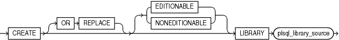
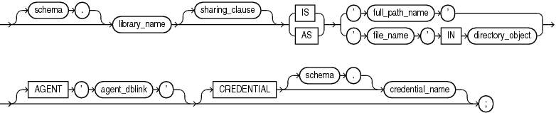

The `CREATE` `LIBRARY` statement creates a library, which is a schema object associated with an operating-system shared library.

Note:

The `CREATE` `LIBRARY` statement is valid only on platforms that support shared libraries and dynamic linking.

For instructions for creating an operating-system shared library, or DLL, see [Oracle Database Development Guide](https://docs.oracle.com/pls/topic/lookup?ctx=en/database/oracle/oracle-database/21/lnpls&id=ADFNS1404).

You can use the name of the library schema object in the `call_spec` of `CREATE` `FUNCTION` or `CREATE` `PROCEDURE` statements, or when declaring a function or procedure in a package or type, so that SQL and PL/SQL can invoke third-generation-language (3GL) functions and procedures.

Topics

Prerequisites

To create a library in your schema, you must have the `CREATE` `LIBRARY` system privilege. To create a library in another user's schema, you must have the `CREATE` `ANY` `LIBRARY` system privilege.

To create a library that is associated with a DLL in a directory object, you must have the `EXECUTE` object privilege on the directory object.

To create a library that is associated with a credential name, you must have the `EXECUTE` object privilege on the credential name.

To use the library in the `call_spec` of a `CREATE` `FUNCTION` statement, or when declaring a function in a package or type, you must have the `EXECUTE` object privilege on the library and the `CREATE` `FUNCTION` system privilege.

To use the library in the `call_spec` of a `CREATE` `PROCEDURE` statement, or when declaring a procedure in a package or type, you must have the `EXECUTE` object privilege on the library and the `CREATE` `PROCEDURE` system privilege.

To execute a procedure or function defined with the `call_spec` (including a procedure or function defined within a package or type), you must have the `EXECUTE` object privilege on the procedure or function (but you do not need the `EXECUTE` object privilege on the library).

Syntax

create\_library::=



> ```
> CREATE [ OR REPLACE ] [ EDITIONABLE | NONEDITIONABLE ]
>   LIBRARY plsql_library_source
> ```
>
> [  
> Copyright © 1996, 2024, Oracle and/or its affiliates.](https://docs.oracle.com/en/database/oracle/oracle-database/dcommon/html/cpyr.htm)


plsql\_library\_source::=



> ```
> [ schema.] library_name [ sharing_clause ] { IS | AS }
>   { 'full_path_name' | 'file_name' IN directory_object }
>   [ AGENT 'agent_dblink' ] [ CREDENTIAL [schema.]credential_name ] ;
> ```
>
> [  
> Copyright © 1996, 2024, Oracle and/or its affiliates.](https://docs.oracle.com/en/database/oracle/oracle-database/dcommon/html/cpyr.htm)


([sharing\_clause::=](SHARING-clause.md))

Semantics

create\_library

OR REPLACE

Re-creates the library if it exists, and recompiles it.

Users who were granted privileges on the library before it was redefined can still access it without being regranted the privileges.

\[ EDITIONABLE | NONEDITIONABLE \]

Specifies whether the library is an editioned or noneditioned object if editioning is enabled for the schema object type `LIBRARY` in `schema`. Default: `EDITIONABLE`. For information about editioned and noneditioned objects, see [Oracle Database Development Guide](https://docs.oracle.com/pls/topic/lookup?ctx=en/database/oracle/oracle-database/21/lnpls&id=ADFNS99923).

plsql\_library\_source

schema

Name of the schema containing the library. Default: your schema.

library\_name

Name that represents this library when a user declares a function or procedure with a `call_spec`.

'full\_path\_name'

String literal enclosed in single quotation marks, whose value your operating system recognizes as the full path name of a shared library.

The `full_path_name` is not interpreted during execution of the `CREATE` `LIBRARY` statement. The existence of the shared library is checked when someone invokes one of its subprograms.

'file\_name' IN directory\_object

The `file_name` is a string literal enclosed in single quotation marks, whose value is the name of a dynamic link library (DLL) in `directory_object`. The string literal cannot exceed 2,000 bytes and cannot contain path delimiters. The compiler ignores `file_name`, but at run time, `file_name` is checked for path delimiters.

`directory_object`

The `directory_object` is a directory object, created with the `CREATE` `DIRECTORY` statement (described in [Oracle Database SQL Language Reference](https://docs.oracle.com/pls/topic/lookup?ctx=en/database/oracle/oracle-database/21/lnpls&id=SQLRF01207)). If `directory_object` does not exist or you do not have the `EXECUTE` object privilege on `directory_object`, then the library is created with errors. If `directory_object` is subsequently created, then the library becomes invalid. Other reasons that the library can become invalid are:

- `directory_object` is dropped.
- `directory_object` becomes invalid.
- Your `EXECUTE` object privilege on `directory_object` is revoked.

If you create a library object in a PDB that has a predefined `PATH_PREFIX`, the library must use a directory object. The directory object will enforce the rules of `PATH_PREFIX` for the library object. Failure to use a directory object in the library object will raise a compilation error.

If a database is plugged into a CDB as a PDB with a predefined `PATH_PREFIX`, attempts to use a library object that does not use a directory object result in an ORA-65394 error. The library object will not be invalidated, but to make it usable, you must recreate it using a directory object. See [Oracle Multitenant Administrator’s Guide](https://docs.oracle.com/pls/topic/lookup?ctx=en/database/oracle/oracle-database/21/lnpls&id=MULTI-GUID-375E10F7-BCC4-4365-B1BD-DB87EF3ECCC3) for more information about CDB administration.

AGENT 'agent\_dblink'

Causes external procedures to run from a database link other than the server. Oracle Database uses the database link that `agent_dblink` specifies to run external procedures. If you omit this clause, then the default agent on the server (`extproc`) runs external procedures.

CREDENTIAL \[schema.\]credential\_name

Specifies the credentials of the operating system user that the `extproc` agent impersonates when running an external subprogram that specifies the library. Default: Owner of the Oracle Database installation.

If `credential_name` does not exist or you do not have the `EXECUTE` object privilege on `credential_name`, then the library is created with errors. If `credential_name` is subsequently created, then the library becomes invalid. Other reasons that the library can become invalid are:

- `credential_name` is dropped.
- `credential_name` becomes invalid.
- Your `EXECUTE` object privilege on `credential_name` is revoked.

For information about using credentials, see [Oracle Database Security Guide](https://docs.oracle.com/pls/topic/lookup?ctx=en/database/oracle/oracle-database/21/lnpls&id=DBSEG755).

Examples

Example 15-17 Creating a Library

The following statement creates library `ext_lib`, using a directory object:

```
CREATE LIBRARY ext_lib AS 'ddl_1' IN ddl_dir;
/
```

The following statement re-creates library `ext_lib`, using a directory object and a credential:

```
CREATE OR REPLACE LIBRARY ext_lib AS 'ddl_1' IN ddl_dir CREDENTIAL ddl_cred;
/
```

The following statement creates library `ext_lib`, using an explicit path:

```
CREATE LIBRARY ext_lib AS '/OR/lib/ext_lib.so';
/
```

The following statement re-creates library `ext_lib`, using an explicit path:

```
CREATE OR REPLACE LIBRARY ext_lib IS '/OR/newlib/ext_lib.so';
/
```

Example 15-18 Specifying an External Procedure Agent

The following example creates a library `app_lib` (using an explicit path) and specifies that external procedures run from the public database `sales.hq.example.com`:

```
CREATE LIBRARY app_lib as '${ORACLE_HOME}/lib/app_lib.so'
   AGENT 'sales.hq.example.com';
/
```

See Also:

[Oracle Database SQL Language Reference](https://docs.oracle.com/pls/topic/lookup?ctx=en/database/oracle/oracle-database/21/lnpls&id=SQLRF01205) for information about creating database links