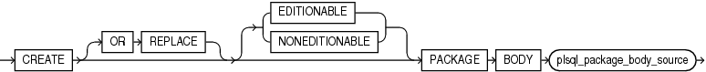
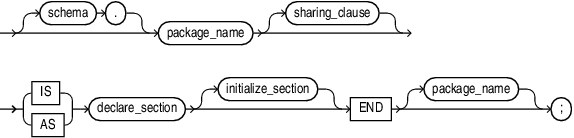
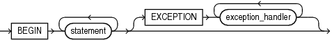

The `CREATE` `PACKAGE` `BODY` statement creates or replaces the body of a stored package, which is an encapsulated collection of related procedures, stored functions, and other program objects stored as a unit in the database.

The package body defines these objects. The package specification, defined in an earlier `CREATE` `PACKAGE` statement, declares these objects.

Packages are an alternative to creating procedures and functions as standalone schema objects.

Topics

Prerequisites

To create or replace a package in your schema, you must have the `CREATE` `PROCEDURE` system privilege. To create or replace a package in another user's schema, you must have the `CREATE` `ANY` `PROCEDURE` system privilege. In both cases, the package body must be created in the same schema as the package.

To embed a `CREATE` `PACKAGE` `BODY` statement inside an the database precompiler program, you must terminate the statement with the keyword `END-EXEC` followed by the embedded SQL statement terminator for the specific language.

Syntax

create\_package\_body::=



> ```
> CREATE [ OR REPLACE ] [ EDITIONABLE | NONEDITIONABLE ] PACKAGE BODY
>   plsql_package_body_source
> ```
>
> [  
> Copyright © 1996, 2024, Oracle and/or its affiliates.](https://docs.oracle.com/en/database/oracle/oracle-database/dcommon/html/cpyr.htm)


plsql\_package\_body\_source::=



> ```
> [ schema. ] package [ sharing_clause ]
> { IS | AS } declare_section [ initialize_section ]
>   END [ package_name ] ;
> ```
>
> [  
> Copyright © 1996, 2024, Oracle and/or its affiliates.](https://docs.oracle.com/en/database/oracle/oracle-database/dcommon/html/cpyr.htm)


([sharing\_clause::=](SHARING-clause.md), [declare\_section::=](block.md) )

initialize\_section::=



> ```
> BEGIN statement...
>   [ EXCEPTION exception_handler... ]
> ```
>
> [  
> Copyright © 1996, 2024, Oracle and/or its affiliates.](https://docs.oracle.com/en/database/oracle/oracle-database/dcommon/html/cpyr.htm)


( [statement::=](block.md), [exception\_handler::=](exception-handler.md) )

Semantics

create\_package\_body

OR REPLACE

Re-creates the package body if it exists, and recompiles it.

Users who were granted privileges on the package body before it was redefined can still access the package without being regranted the privileges.

\[ EDITIONABLE | NONEDITIONABLE \]

If you do not specify this property, then the package body inherits `EDITIONABLE` or `NONEDITIONABLE` from the package specification. If you do specify this property, then it must match that of the package specification.

plsql\_package\_body\_source

schema

Name of the schema containing the package. Default: your schema.

package\_name

Name of the package to be created.

declare\_section

Has a definition for every cursor and subprogram declaration in the package specification. The headings of corresponding subprogram declarations and definitions must match word for word, except for white space.

Can also declare and define private items that can be referenced only from inside the package.

Restriction on declare\_section

`PRAGMA` `AUTONOMOUS_TRANSACTION` cannot appear here.

initialize\_section

Initializes variables and does any other one-time setup steps.

Examples

Example 15-20 Creating the emp\_mgmt Package Body

This statement creates the body of the `emp_mgmt` package created in " [Example 15-19](CREATE-PACKAGE-statement.md) ".

```
CREATE OR REPLACE PACKAGE BODY emp_mgmt AS 
   tot_emps NUMBER; 
   tot_depts NUMBER; 
FUNCTION hire 
   (last_name VARCHAR2, job_id VARCHAR2, 
    manager_id NUMBER, salary NUMBER, 
    commission_pct NUMBER, department_id NUMBER) 
   RETURN NUMBER IS new_empno NUMBER; 
BEGIN 
   SELECT employees_seq.NEXTVAL 
      INTO new_empno 
      FROM DUAL; 
   INSERT INTO employees 
      VALUES (new_empno, 'First', 'Last','first.example@example.com',
              '(415)555-0100',
              TO_DATE('18-JUN-2002','DD-MON-YYYY'),
              'IT_PROG',90000000,00, 100,110);
      tot_emps := tot_emps + 1; 
   RETURN(new_empno); 
END; 
FUNCTION create_dept(department_id NUMBER, location_id NUMBER) 
   RETURN NUMBER IS 
      new_deptno NUMBER; 
   BEGIN 
      SELECT departments_seq.NEXTVAL 
         INTO new_deptno 
         FROM dual; 
      INSERT INTO departments 
         VALUES (new_deptno, 'department name', 100, 1700); 
      tot_depts := tot_depts + 1; 
      RETURN(new_deptno); 
   END; 
PROCEDURE remove_emp (employee_id NUMBER) IS 
   BEGIN 
      DELETE FROM employees 
      WHERE employees.employee_id = remove_emp.employee_id; 
      tot_emps := tot_emps - 1; 
   END; 
PROCEDURE remove_dept(department_id NUMBER) IS 
   BEGIN 
      DELETE FROM departments 
      WHERE departments.department_id = remove_dept.department_id; 
      tot_depts := tot_depts - 1; 
      SELECT COUNT(*) INTO tot_emps FROM employees; 
   END; 
PROCEDURE increase_sal(employee_id NUMBER, salary_incr NUMBER) IS 
   curr_sal NUMBER; 
   BEGIN 
      SELECT salary INTO curr_sal FROM employees 
      WHERE employees.employee_id = increase_sal.employee_id; 
      IF curr_sal IS NULL 
         THEN RAISE no_sal; 
      ELSE 
         UPDATE employees 
         SET salary = salary + salary_incr 
         WHERE employee_id = employee_id; 
      END IF; 
   END; 
PROCEDURE increase_comm(employee_id NUMBER, comm_incr NUMBER) IS 
   curr_comm NUMBER; 
   BEGIN 
      SELECT commission_pct 
      INTO curr_comm 
      FROM employees 
      WHERE employees.employee_id = increase_comm.employee_id; 
      IF curr_comm IS NULL 
         THEN RAISE no_comm; 
      ELSE 
         UPDATE employees 
         SET commission_pct = commission_pct + comm_incr; 
      END IF; 
   END; 
END emp_mgmt;
```

The package body defines the public program objects declared in the package specification:

- The functions `hire` and `create_dept`
- The procedures `remove_emp`, `remove_dept`, `increase_sal`, and `increase_comm`

These objects are declared in the package specification, so they can be called by application programs, procedures, and functions outside the package. For example, if you have access to the package, you can create a procedure `increase_all_comms` separate from the `emp_mgmt` package that invokes the `increase_comm` procedure.

These objects are defined in the package body, so you can change their definitions without causing the database to invalidate dependent schema objects. For example, if you subsequently change the definition of `hire`, then the database need not recompile `increase_all_comms` before running it.

The package body in this example also declares private program objects, the variables `tot_emps` and `tot_depts`. These objects are declared in the package body rather than the package specification, so they are accessible to other objects in the package, but they are not accessible outside the package. For example, you cannot develop an application that explicitly changes the value of the variable `tot_depts`. However, the function `create_dept` is part of the package, so `create_dept` can change the value of `tot_depts`.