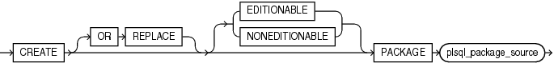
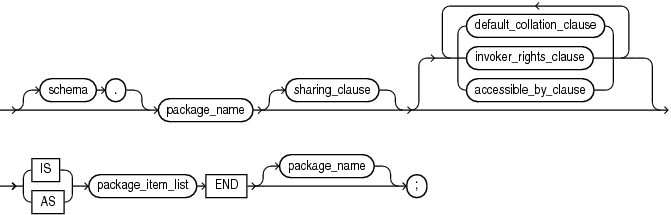
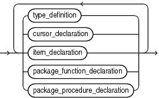
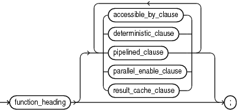
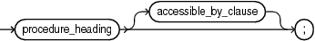

The `CREATE` `PACKAGE` statement creates or replaces the specification for a stored package, which is an encapsulated collection of related procedures, functions, and other program objects stored as a unit in the database.

The package specification declares these objects. The package body, specified subsequently, defines these objects.

Topics

Prerequisites

To create or replace a package in your schema, you must have the `CREATE` `PROCEDURE` system privilege. To create or replace a package in another user's schema, you must have the `CREATE` `ANY` `PROCEDURE` system privilege.

To embed a `CREATE` `PACKAGE` statement inside an Oracle database precompiler program, you must terminate the statement with the keyword `END-EXEC` followed by the embedded SQL statement terminator for the specific language.

Syntax

create\_package::=



> ```
> CREATE [ OR REPLACE ] [ EDITIONABLE | NONEDITIONABLE ]
>  PACKAGE plsql_package_source
> ```
>
> [  
> Copyright © 1996, 2024, Oracle and/or its affiliates.](https://docs.oracle.com/en/database/oracle/oracle-database/dcommon/html/cpyr.htm)


plsql\_package\_source::=



> ```
> [ schema. ] package_name [ sharing_clause ] [ { default_collation_clause | invoker_rights_clause | accessible_by_clause }... ]  
>      { IS | AS } package_item_list END [ package_name ] ;
> ```
>
> [  
> Copyright © 1996, 2024, Oracle and/or its affiliates.](https://docs.oracle.com/en/database/oracle/oracle-database/dcommon/html/cpyr.htm)


( [sharing\_clause::=](SHARING-clause.md), [default\_collation\_clause::=](DEFAULT-COLLATION-clause.md), [invoker\_rights\_clause::=](invokers_rights_clause.md), [accessible\_by\_clause::=](ACCESSIBLE-BY-clause.md), )

package\_item\_list::=



> ```
> { type_definition 
> | cursor_declaration 
> | item_declaration 
> | package_function_declaration 
> | package_procedure_declaration } 
> ...
> ```
>
> [  
> Copyright © 1996, 2024, Oracle and/or its affiliates.](https://docs.oracle.com/en/database/oracle/oracle-database/dcommon/html/cpyr.htm)


( [cursor\_declaration::=](explicit-cursor-declaration-and-definition.md), [item\_declaration::=](block.md), [type\_definition::=](block.md) )

package\_function\_declaration::=



> ```
> function_heading 
> [ accessible_by_clause 
> | determinitic_clause 
> | pipelined_clause 
> | parallel_enable_clause 
> | result_cache_clause ] ;
> ```
>
> [  
> Copyright © 1996, 2024, Oracle and/or its affiliates.](https://docs.oracle.com/en/database/oracle/oracle-database/dcommon/html/cpyr.htm)


( [function\_heading::=](function-declaration-and-definition.md), [accessible\_by\_clause::=](ACCESSIBLE-BY-clause.md), [deterministic\_clause::=](DETERMINISTIC-clause.md), [pipelined\_clause::=](PIPELINED-clause.md),[parallel\_enable\_clause::=](PARALLEL_ENABLE-clause.md),[result\_cache\_clause::=](RESULT_CACHE-clause.md))

package\_procedure\_declaration::=



> procedure\_heading \[accessible\_by\_clause\];
>
> [  
> Copyright © 1996, 2024, Oracle and/or its affiliates.](https://docs.oracle.com/en/database/oracle/oracle-database/dcommon/html/cpyr.htm)


( [procedure\_heading::=](procedure-declaration-and-definition.md), [accessible\_by\_clause::=](ACCESSIBLE-BY-clause.md))

Semantics

create\_package

OR REPLACE

Re-creates the package if it exists, and recompiles it.

Users who were granted privileges on the package before it was redefined can still access the package without being regranted the privileges.

If any function-based indexes depend on the package, then the database marks the indexes `DISABLED`.

\[ EDITIONABLE | NONEDITIONABLE \]

Specifies whether the package is an editioned or noneditioned object if editioning is enabled for the schema object type `PACKAGE` in `schema`. Default: `EDITIONABLE`. For information about editioned and noneditioned objects, see [Oracle Database Development Guide](https://docs.oracle.com/pls/topic/lookup?ctx=en/database/oracle/oracle-database/21/lnpls&id=ADFNS1284).

plsql\_package\_source

schema

Name of the schema containing the package. Default: your schema.

package\_name

A package stored in the database. For naming conventions, see " [Identifiers](plsql-language-fundamentals.md) ".

package\_item\_list

Defines every type in the package and declares every cursor and subprogram in the package. Except for polymorphic table functions, every declaration must have a corresponding definition in the package body. The headings of corresponding declarations and definitions must match word for word, except for white space. Package polymorphic table function must be declared in the same package as their implementation package.

Restriction on package\_item\_list

`PRAGMA` `AUTONOMOUS_TRANSACTION` cannot appear here.

Example

Example 15-19 Creating the Specification for the emp\_mgmt Package

This statement creates the specification of the `emp_mgmt` package.

```
CREATE OR REPLACE PACKAGE emp_mgmt AS 
   FUNCTION hire (last_name VARCHAR2, job_id VARCHAR2, 
      manager_id NUMBER, salary NUMBER, 
      commission_pct NUMBER, department_id NUMBER) 
      RETURN NUMBER; 
   FUNCTION create_dept(department_id NUMBER, location_id NUMBER) 
      RETURN NUMBER; 
   PROCEDURE remove_emp(employee_id NUMBER); 
   PROCEDURE remove_dept(department_id NUMBER); 
   PROCEDURE increase_sal(employee_id NUMBER, salary_incr NUMBER); 
   PROCEDURE increase_comm(employee_id NUMBER, comm_incr NUMBER); 
   no_comm EXCEPTION; 
   no_sal EXCEPTION; 
END emp_mgmt;
```

The specification for the `emp_mgmt` package declares these public program objects:

- The functions `hire` and `create_dept`
- The procedures `remove_emp`, `remove_dept`, `increase_sal`, and `increase_comm`
- The exceptions `no_comm` and `no_sal`

All of these objects are available to users who have access to the package. After creating the package, you can develop applications that invoke any of these public procedures or functions or raise any of the public exceptions of the package.

Before you can invoke this package's procedures and functions, you must define these procedures and functions in the package body. For an example of a `CREATE` `PACKAGE` `BODY` statement that creates the body of the `emp_mgmt` package, see " [CREATE PACKAGE BODY Statement](CREATE-PACKAGE-BODY-statement.md) ".

Related Topics

In this chapter:

- " [ALTER PACKAGE Statement](ALTER-PACKAGE-statement.md) "
- " CREATE PACKAGE Statement "
- " [CREATE PACKAGE BODY Statement](CREATE-PACKAGE-BODY-statement.md) "
- " [DROP PACKAGE Statement](DROP-PACKAGE-statement.md) "

In other chapters:

- " [PL/SQL Packages](plsql-packages.md) "
- " [Package Specification](plsql-packages.md) "
- " [Function Declaration and Definition](function-declaration-and-definition.md) "
- " [Procedure Declaration and Definition](procedure-declaration-and-definition.md) "