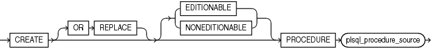
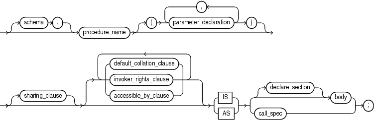

The `CREATE` `PROCEDURE` statement creates or replaces a standalone procedure or a call specification.

A standalone procedure is a procedure (a subprogram that performs a specific action) that is stored in the database.

Note:

A standalone procedure that you create with the `CREATE` `PROCEDURE` statement differs from a procedure that you declare and define in a PL/SQL block or package. For information, see " [Procedure Declaration and Definition](procedure-declaration-and-definition.md) " or " [CREATE PACKAGE Statement](CREATE-PACKAGE-statement.md) ".

A call specification declares a Java method or a C language procedure so that it can be called from PL/SQL. You can also use the SQL `CALL` statement to invoke such a method or subprogram. The call specification tells the database which Java method, or which named procedure in which shared library, to invoke when an invocation is made. It also tells the database what type conversions to make for the arguments and return value.

Topics

Prerequisites

To create or replace a standalone procedure in your schema, you must have the `CREATE` `PROCEDURE` system privilege. To create or replace a standalone procedure in another user's schema, you must have the `CREATE` `ANY` `PROCEDURE` system privilege.

To invoke a call specification, you may need additional privileges, for example, the `EXECUTE` object privilege on the C library for a C call specification.

To embed a `CREATE` `PROCEDURE` statement inside an Oracle precompiler program, you must terminate the statement with the keyword `END-EXEC` followed by the embedded SQL statement terminator for the specific language.

Syntax

create\_procedure::=



> ```
> CREATE [ OR REPLACE ] [ EDITIONABLE | NONEDITIONABLE ]
>    PROCEDURE plsql_procedure_source
> ```
>
> [  
> Copyright © 1996, 2024, Oracle and/or its affiliates.](https://docs.oracle.com/en/database/oracle/oracle-database/dcommon/html/cpyr.htm)


plsql\_procedure\_source::=



> ```
> [ schema. ] procedure_name
>    [ ( parameter_declaration [, parameter_declaration ]... ) ] [ sharing_clause ]
>    [ ( default_collation_option | invoker_rights_clause | accessible_by_clause)... ] 
>    { IS | AS } { [ declare_section ] body | call_spec } ;
> ```
>
> [  
> Copyright © 1996, 2024, Oracle and/or its affiliates.](https://docs.oracle.com/en/database/oracle/oracle-database/dcommon/html/cpyr.htm)


( [sharing\_clause::=](SHARING-clause.md), [default\_collation\_clause::=](DEFAULT-COLLATION-clause.md), [invoker\_rights\_clause::=](invokers_rights_clause.md), [accessible\_by\_clause::=](ACCESSIBLE-BY-clause.md), [call\_spec::=](call-specification.md), [body::=](block.md), [declare\_section::=](block.md), [parameter\_declaration::=](formal-parameter-declaration.md))

Semantics

create\_procedure

OR REPLACE

Re-creates the procedure if it exists, and recompiles it.

Users who were granted privileges on the procedure before it was redefined can still access the procedure without being regranted the privileges.

If any function-based indexes depend on the procedure, then the database marks the indexes `DISABLED`.

\[ EDITIONABLE | NONEDITIONABLE \]

Specifies whether the procedure is an editioned or noneditioned object if editioning is enabled for the schema object type `PROCEDURE` in `schema`. Default: `EDITIONABLE`. For information about editioned and noneditioned objects, see [Oracle Database Development Guide](https://docs.oracle.com/pls/topic/lookup?ctx=en/database/oracle/oracle-database/21/lnpls&id=ADFNS99923).

plsql\_procedure\_source

schema

Name of the schema containing the procedure. Default: your schema.

procedure\_name

Name of the procedure to be created.

Note:

If you plan to invoke a stored subprogram using a stub generated by SQL\*Module, then the stored subprogram name must also be a legal identifier in the invoking host 3GL language, such as Ada or C.

body

The required executable part of the procedure and, optionally, the exception-handling part of the procedure.

declare\_section

The optional declarative part of the procedure. Declarations are local to the procedure, can be referenced in `body`, and cease to exist when the procedure completes execution.

Examples

Example 15-21 Creating a Procedure

This statement creates the procedure `remove_emp` in the schema `hr`.

```
CREATE PROCEDURE remove_emp (employee_id NUMBER) AS
   tot_emps NUMBER;
   BEGIN
      DELETE FROM employees
      WHERE employees.employee_id = remove_emp.employee_id;
   tot_emps := tot_emps - 1;
   END;
/
```

The `remove_emp` procedure removes a specified employee. When you invoke the procedure, you must specify the `employee_id` of the employee to be removed.

The procedure uses a `DELETE` statement to remove from the `employee` s table the row of `employee_id`.

See Also:

" [CREATE PACKAGE BODY Statement](CREATE-PACKAGE-BODY-statement.md) " to see how to incorporate this procedure into a package

Example 15-22 Creating an External Procedure

In this example, external procedure `c_find_root` expects a pointer as a parameter. Procedure `find_root` passes the parameter by reference using the `BY` `REFERENCE` phrase.

```
CREATE PROCEDURE find_root
   ( x IN REAL ) 
   IS LANGUAGE C
      NAME c_find_root
      LIBRARY c_utils
      PARAMETERS ( x BY REFERENCE );
```

Related Topics

In this chapter:

- " [ALTER PROCEDURE Statement](ALTER-PROCEDURE-statement.md) "
- " [CREATE FUNCTION Statement](CREATE-FUNCTION-statement.md) "
- " [DROP PROCEDURE Statement](DROP-PROCEDURE-statement.md) "

In other chapters:

- " [Formal Parameter Declaration](formal-parameter-declaration.md) "
- " [Procedure Declaration and Definition](procedure-declaration-and-definition.md) "
- " [PL/SQL Subprograms](plsql-subprograms.md) "

In other books:

- [Oracle Database SQL Language Reference](https://docs.oracle.com/pls/topic/lookup?ctx=en/database/oracle/oracle-database/21/lnpls&id=SQLRF01108) for information about the `CALL` statement
- [Oracle Database Development Guide](https://docs.oracle.com/pls/topic/lookup?ctx=en/database/oracle/oracle-database/21/lnpls&id=ADFNS010) for more information about call specifications
- [Oracle Database Development Guide](https://docs.oracle.com/pls/topic/lookup?ctx=en/database/oracle/oracle-database/21/lnpls&id=ADFNS00906) for more information about invoking stored PL/SQL subprograms