The `CREATE` `TRIGGER` statement creates or replaces a database trigger, which is either of these:

- A stored PL/SQL block associated with a table, a view, a schema, or the database
- An anonymous PL/SQL block or an invocation of a procedure implemented in PL/SQL or Java

The database automatically runs a trigger when specified conditions occur.

Topics

Prerequisites

- To create a trigger in your schema on a table in your schema or on your schema (`SCHEMA`), you must have the `CREATE` `TRIGGER` system privilege.
- To create a trigger in any schema on a table in any schema, or on another user's schema (`schema`.`SCHEMA`), you must have the `CREATE` `ANY` `TRIGGER` system privilege.
- In addition to the preceding privileges, to create a trigger on `DATABASE`, you must have the `ADMINISTER` `DATABASE` `TRIGGER` system privilege.
- To create a trigger on a pluggable database (PDB), you must be connected to that PDB and have the `ADMINISTER` `DATABASE` `TRIGGER` system privilege. For information about PDBs, see [Oracle Database Administrator's Guide](https://docs.oracle.com/pls/topic/lookup?ctx=en/database/oracle/oracle-database/21/lnpls&id=ADMIN13508).
- In addition to the preceding privileges, to create a crossedition trigger, you must be enabled for editions. For information about enabling editions for a user, see [Oracle Database Development Guide](https://docs.oracle.com/pls/topic/lookup?ctx=en/database/oracle/oracle-database/21/lnpls&id=ADFNS99878).

If the trigger issues SQL statements or invokes procedures or functions, then the owner of the trigger must have the privileges necessary to perform these operations. These privileges must be granted directly to the owner rather than acquired through roles.

Syntax

create\_trigger::=

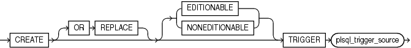

> ```
> CREATE [ OR REPLACE ] [ EDITIONABLE | NONEDITIONABLE ]
>   TRIGGER plsql_trigger_source
> ```
>
> [  
> Copyright © 1996, 2024, Oracle and/or its affiliates.](https://docs.oracle.com/en/database/oracle/oracle-database/dcommon/html/cpyr.htm)


plsql\_trigger\_source::=

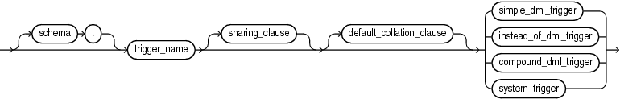

> ```
> [schema.] trigger_name
>  [ sharing_clause ] [ default_collation_clause ] 
>   { simple_dml_trigger
>   | instead_of_dml_trigger
>   | compound_dml_trigger
>   | system_trigger
>   }
> ```
>
> [  
> Copyright © 1996, 2024, Oracle and/or its affiliates.](https://docs.oracle.com/en/database/oracle/oracle-database/dcommon/html/cpyr.htm)


( [sharing\_clause::=](SHARING-clause.md), [default\_collation\_clause::=](DEFAULT-COLLATION-clause.md), compound\_dml\_trigger::=, instead\_of\_dml\_trigger::=, system\_trigger::= )

simple\_dml\_trigger::=

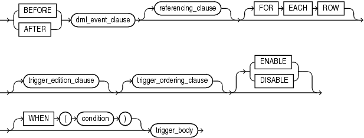

> ```
> { BEFORE | AFTER } dml_event_clause [ referencing_clause ] [ FOR EACH ROW ]
>   [ trigger_edition_clause ] [ trigger_ordering_clause ]
>     [ ENABLE | DISABLE ] [ WHEN ( condition ) ] trigger_body
> ```
>
> [  
> Copyright © 1996, 2024, Oracle and/or its affiliates.](https://docs.oracle.com/en/database/oracle/oracle-database/dcommon/html/cpyr.htm)


( dml\_event\_clause::=, referencing\_clause::=, trigger\_body::=, trigger\_edition\_clause::=, trigger\_ordering\_clause::= )

instead\_of\_dml\_trigger::=

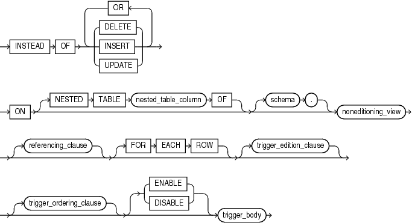

> ```
> INSTEAD OF { DELETE | INSERT | UPDATE } [ OR { DELETE | INSERT | UPDATE } ]...
> ON [ NESTED TABLE nested_table_column OF ] [ schema. ] noneditioning_view
> [ referencing_clause ] [ FOR EACH ROW ]
> [ trigger_edition_clause ] [ trigger_ordering_clause ]
> [ ENABLE | DISABLE ] trigger_body
> ```


( referencing\_clause::=, trigger\_body::=, trigger\_edition\_clause::=, trigger\_ordering\_clause::= )

compound\_dml\_trigger::=

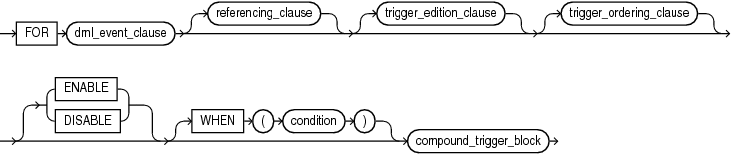

> ```
> FOR dml_event_clause [ referencing_clause ]
> [ trigger_edition_clause ] [ trigger_ordering_clause ]
> [ ENABLE | DISABLE ] [ WHEN ( condition ) ] compound_trigger_body
> ```
>
> [  
> Copyright © 1996, 2024, Oracle and/or its affiliates.](https://docs.oracle.com/en/database/oracle/oracle-database/dcommon/html/cpyr.htm)


( compound\_trigger\_block::=, dml\_event\_clause::=, referencing\_clause::=, trigger\_edition\_clause::=, trigger\_ordering\_clause::= )

system\_trigger::=

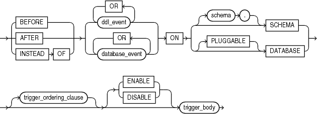

> ```
> { BEFORE | AFTER | INSTEAD OF }
> { ddl_event [OR ddl_event]... | database_event [OR database_event ]... }
> ON { [schema.] SCHEMA | [ PLUGGABLE ] DATABASE }
> [ trigger_ordering_clause ] [ ENABLE | DISABLE ] trigger_body
> ```
>
> [  
> Copyright © 1996, 2024, Oracle and/or its affiliates.](https://docs.oracle.com/en/database/oracle/oracle-database/dcommon/html/cpyr.htm)


( trigger\_body::=, trigger\_ordering\_clause::= )

dml\_event\_clause::=

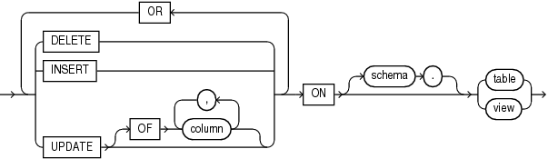

> ```
> { DELETE | INSERT | UPDATE [ OF column [, column ]... ] }
> [ OR { DELETE | INSERT | UPDATE [ OF column [, column]... ] }...
> ON [ schema.] { table | view }
> ```
>
> [  
> Copyright © 1996, 2024, Oracle and/or its affiliates.](https://docs.oracle.com/en/database/oracle/oracle-database/dcommon/html/cpyr.htm)


referencing\_clause::=

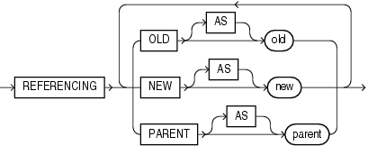

> ```
> REFERENCING
>  { OLD [ AS ] old
>  | NEW [ AS ] new
>  | PARENT [ AS ] parent
>  }...
> ```
>
> [  
> Copyright © 1996, 2024, Oracle and/or its affiliates.](https://docs.oracle.com/en/database/oracle/oracle-database/dcommon/html/cpyr.htm)


trigger\_edition\_clause::=

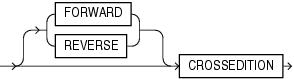

> ```
> { FORWARD | REVERSE } CROSSEDITION
> ```
>
> [  
> Copyright © 1996, 2024, Oracle and/or its affiliates.](https://docs.oracle.com/en/database/oracle/oracle-database/dcommon/html/cpyr.htm)


trigger\_ordering\_clause::=

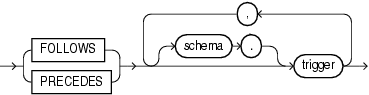

> ```
> { FOLLOWS | PRECEDES } [ schmema.] trigger [ , [ schmema.] trigger ]...
> ```
>
> [  
> Copyright © 1996, 2024, Oracle and/or its affiliates.](https://docs.oracle.com/en/database/oracle/oracle-database/dcommon/html/cpyr.htm)


trigger\_body::=

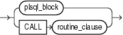

> ```
> { plsql_block | CALL routine_clause }
> ```
>
> [  
> Copyright © 1996, 2024, Oracle and/or its affiliates.](https://docs.oracle.com/en/database/oracle/oracle-database/dcommon/html/cpyr.htm)


( [plsql\_block::=](block.md),

`routine_clause` in [Oracle Database SQL Language Reference](https://docs.oracle.com/pls/topic/lookup?ctx=en/database/oracle/oracle-database/21/lnpls&id=SQLRF01108) )

compound\_trigger\_block::=

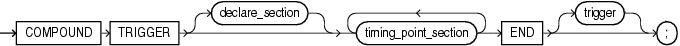

> ```
> COMPOUND TRIGGER [ declare_section ]
>   timing_point_section [ timing_point_section ]... END [ trigger ] ;
> ```
>
> [  
> Copyright © 1996, 2024, Oracle and/or its affiliates.](https://docs.oracle.com/en/database/oracle/oracle-database/dcommon/html/cpyr.htm)


( [declare\_section::=](block.md) )

timing\_point\_section::=

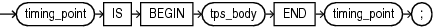

> ```
> timing_point IS BEGIN tps_body END timing_point ;
> ```
>
> [  
> Copyright © 1996, 2024, Oracle and/or its affiliates.](https://docs.oracle.com/en/database/oracle/oracle-database/dcommon/html/cpyr.htm)


timing\_point::=

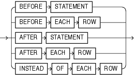

> ```
> { BEFORE STATEMENT | BEFORE EACH ROW | AFTER STATEMENT | AFTER EACH ROW |
>   INSTEAD OF EACH ROW }
> ```
>
> [  
> Copyright © 1996, 2024, Oracle and/or its affiliates.](https://docs.oracle.com/en/database/oracle/oracle-database/dcommon/html/cpyr.htm)


tps\_body::=

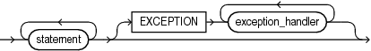

> ```
> statement ...
>   [ EXCEPTION exception_handler [ exception_handler ]... ]
> ```
>
> [  
> Copyright © 1996, 2024, Oracle and/or its affiliates.](https://docs.oracle.com/en/database/oracle/oracle-database/dcommon/html/cpyr.htm)


( [exception\_handler::=](exception-handler.md), [statement::=](block.md) )

Semantics

create\_trigger

OR REPLACE

Re-creates the trigger if it exists, and recompiles it.

Users who were granted privileges on the trigger before it was redefined can still access the procedure without being regranted the privileges.

\[ EDITIONABLE | NONEDITIONABLE \]

Specifies whether the trigger is an editioned or noneditioned object if editioning is enabled for the schema object type `TRIGGER` in `schema`. Default: `EDITIONABLE`. For information about editioned and noneditioned objects, see [Oracle Database Development Guide](https://docs.oracle.com/pls/topic/lookup?ctx=en/database/oracle/oracle-database/21/lnpls&id=ADFNS99923).

Restriction on NONEDITIONABLE

You cannot specify `NONEDITIONABLE` for a crossedition trigger.

Restrictions on create\_trigger

See " [Trigger Restrictions](plsql-triggers.md) ".

plsql\_trigger\_source

schema

Name of the schema for the trigger to be created. Default: your schema.

trigger

Name of the trigger to be created.

Triggers in the same schema cannot have the same names. Triggers can have the same names as other schema objects—for example, a table and a trigger can have the same name—however, to avoid confusion, this is not recommended.

If a trigger produces compilation errors, then it is still created, but it fails on execution. A trigger that fails on execution effectively blocks all triggering DML statements until it is disabled, replaced by a version without compilation errors, or dropped. You can see the associated compiler error messages with the SQL\*Plus command `SHOW` `ERRORS`.

Note:

If you create a trigger on a base table of a materialized view, then you must ensure that the trigger does not fire during a refresh of the materialized view. During refresh, the `DBMS_MVIEW` procedure `I_AM_A_REFRESH` returns `TRUE`.

simple\_dml\_trigger

Creates a simple DML trigger (described in " [DML Triggers](plsql-triggers.md) ").

BEFORE

Causes the database to fire the trigger before running the triggering event. For row triggers, the trigger fires before each affected row is changed.

Restrictions on BEFORE

- You cannot specify a `BEFORE` trigger on a view unless it is an editioning view.
- In a `BEFORE` statement trigger, the trigger body cannot read `:NEW` or `:OLD`. (In a `BEFORE` row trigger, the trigger body can read and write the `:OLD` and `:NEW` fields.)

AFTER

Causes the database to fire the trigger after running the triggering event. For row triggers, the trigger fires after each affected row is changed.

Restrictions on AFTER

- You cannot specify an `AFTER` trigger on a view unless it is an editioning view.
- In an `AFTER` statement trigger, the trigger body cannot read `:NEW` or `:OLD`. (In an `AFTER` row trigger, the trigger body can read but not write the `:OLD` and `:NEW` fields.)

Note:

When you create a materialized view log for a table, the database implicitly creates an `AFTER` row trigger on the table. This trigger inserts a row into the materialized view log whenever an `INSERT`, `UPDATE`, or `DELETE` statement modifies data in the associated table. You cannot control the order in which multiple row triggers fire. Therefore, do not write triggers intended to affect the content of the materialized view.

See Also:

- [Oracle Database SQL Language Reference](https://docs.oracle.com/pls/topic/lookup?ctx=en/database/oracle/oracle-database/21/lnpls&id=SQLRF01303) for more information about materialized view logs
- [Oracle Database Development Guide](https://docs.oracle.com/pls/topic/lookup?ctx=en/database/oracle/oracle-database/21/lnpls&id=ADFNS0202) for information about editioning views

FOR EACH ROW

Creates the trigger as a row trigger. The database fires a row trigger for each row that is affected by the triggering statement and meets the optional trigger constraint defined in the `WHEN` condition.

If you omit this clause, then the trigger is a statement trigger. The database fires a statement trigger only when the triggering statement is issued if the optional trigger constraint is met.

\[ ENABLE | DISABLE \]

Creates the trigger in an enabled (default) or disabled state. Creating a trigger in a disabled state lets you ensure that the trigger compiles without errors before you enable it.

Note:

`DISABLE` is especially useful if you are creating a crossedition trigger, which affects the online application being redefined if compilation errors occur.

WHEN (condition)

Specifies a SQL condition that the database evaluates for each row that the triggering statement affects. If the value of condition is `TRUE` for an affected row, then trigger\_body runs for that row; otherwise, trigger\_body does not run for that row. The triggering statement runs regardless of the value of condition.

The condition can contain correlation names (see " referencing\_clause::= ").

In `condition`, do not put a colon (:) before the correlation name `NEW`, `OLD`, or `PARENT` (in this context, it is not a placeholder for a bind variable).

See Also:

[Oracle Database SQL Language Reference](https://docs.oracle.com/pls/topic/lookup?ctx=en/database/oracle/oracle-database/21/lnpls&id=SQLRF005) for information about SQL conditions

Restrictions on WHEN (condition)

- If you specify this clause, then you must also specify `FOR` `EACH` `ROW`.
- The `condition` cannot include a subquery or a PL/SQL expression (for example, an invocation of a user-defined function).

trigger\_body

The PL/SQL block or `CALL` subprogram that the database runs to fire the trigger. A `CALL` subprogram is either a PL/SQL subprogram or a Java subprogram in a PL/SQL wrapper.

If trigger\_body is a PL/SQL block and it contains errors, then the `CREATE` \[`OR` `REPLACE`\] statement fails.

Restriction on trigger\_body

The declare\_section cannot declare variables of the data type `LONG` or `LONG` `RAW`.

instead\_of\_dml\_trigger

Creates an `INSTEAD` `OF` DML trigger (described in " [INSTEAD OF DML Triggers](plsql-triggers.md) ").

Restriction on INSTEAD OF

An `INSTEAD` `OF` trigger can read the `:OLD` and `:NEW` values, but cannot change them.

Note:

- If the view is inherently updatable and has `INSTEAD` `OF` triggers, the triggers take precedence: The database fires the triggers instead of performing DML on the view.
- If the view belongs to a hierarchy, then the subviews do not inherit the trigger.
- The `WITH` `CHECK` `OPTION` for views is not enforced when inserts or updates to the view are done using `INSTEAD` `OF` triggers. The `INSTEAD` `OF` trigger body must enforce the check. For information about `WITH` `CHECK` `OPTION`, see [Oracle Database SQL Language Reference](https://docs.oracle.com/pls/topic/lookup?ctx=en/database/oracle/oracle-database/21/lnpls&id=SQLRF54786).
- The database fine-grained access control lets you define row-level security policies on views. These policies enforce specified rules in response to DML operations. If an `INSTEAD` `OF` trigger is also defined on the view, then the database does not enforce the row-level security policies, because the database fires the `INSTEAD` `OF` trigger instead of running the DML on the view.

DELETE

If the trigger is created on a noneditioning view, then `DELETE` causes the database to fire the trigger whenever a `DELETE` statement removes a row from the table on which the noneditioning view is defined.

If the trigger is created on a nested table column of a noneditioning view, then `DELETE` causes the database to fire the trigger whenever a `DELETE` statement removes an element from the nested table.

INSERT

If the trigger is created on a noneditioning view, then `INSERT` causes the database to fire the trigger whenever an `INSERT` statement adds a row to the table on which the noneditioning view is defined.

If the trigger is created on a nested table column of a noneditioning view, then `INSERT` causes the database to fire the trigger whenever an `INSERT` statement adds an element to the nested table.

UPDATE

If the trigger is created on a noneditioning view, then `UPDATE` causes the database to fire the trigger whenever an `UPDATE` statement changes a value in a column of the table on which the noneditioning view is defined.

If the trigger is created on a nested table column of a noneditioning view, then `UPDATE` causes the database to fire the trigger whenever an `UPDATE` statement changes a value in a column of the nested table.

nested\_table\_column

Name of the `nested_table_column` on which the trigger is to be created. The trigger fires only if the DML operates on the elements of the nested table. Performing DML operations directly on nested table columns does not cause the database to fire triggers defined on the table containing the nested table column. For more information, see " [INSTEAD OF DML Triggers](plsql-triggers.md) ".

See Also:

`AS` `subquery` clause of [`CREATE` `VIEW`](https://docs.oracle.com/pls/topic/lookup?ctx=en/database/oracle/oracle-database/21/lnpls&id=SQLRF01504) in Oracle Database SQL Language Reference for a list of constructs that prevent inserts, updates, or deletes on a view

schema

Name of the schema containing the noneditioning view. Default: your schema.

noneditioning\_view

If you specify `nested_table_column`, then `noneditioning_view` is the name of the noneditioning view that includes `nested_table_column`. Otherwise, `noneditioning_view` is the name of the noneditioning view on which the trigger is to be created.

FOR EACH ROW

For documentation only, because an `INSTEAD OF` trigger is always a row trigger.

`ENABLE`

(Default) Creates the trigger in an enabled state.

`DISABLE`

Creates the trigger in a disabled state, which lets you ensure that the trigger compiles without errors before you enable it.

Note:

`DISABLE` is especially useful if you are creating a crossedition trigger, which affects the online application being redefined if compilation errors occur.

trigger\_body

The PL/SQL block or `CALL` subprogram that the database runs to fire the trigger. A `CALL` subprogram is either a PL/SQL subprogram or a Java subprogram in a PL/SQL wrapper.

If trigger\_body is a PL/SQL block and it contains errors, then the `CREATE` \[`OR` `REPLACE`\] statement fails.

Restriction on trigger\_body

The `declare_section` cannot declare variables of the data type `LONG` or `LONG` `RAW`.

compound\_dml\_trigger

Creates a compound DML trigger (described in " [Compound DML Triggers](plsql-triggers.md) ").

ENABLE

(Default) Creates the trigger in an enabled state.

DISABLE

Creates the trigger in a disabled state, which lets you ensure that the trigger compiles without errors before you enable it.

Note:

`DISABLE` is especially useful if you are creating a crossedition trigger, which affects the online application being redefined if compilation errors occur.

WHEN (condition)

Specifies a SQL condition that the database evaluates for each row that the triggering statement affects. If the value of condition is `TRUE` for an affected row, then tps\_body runs for that row; otherwise, tps\_body does not run for that row. The triggering statement runs regardless of the value of condition.

The condition can contain correlation names (see " referencing\_clause::= "). In condition, do not put a colon (:) before the correlation name `NEW`, `OLD`, or `PARENT` (in this context, it is not a placeholder for a bind variable).

See Also:

[Oracle Database SQL Language Reference](https://docs.oracle.com/pls/topic/lookup?ctx=en/database/oracle/oracle-database/21/lnpls&id=SQLRF005) for information about SQL conditions

Restrictions on WHEN (condition)

- If you specify this clause, then you must also specify at least one of these timing points:
	- `BEFORE` `EACH` `ROW`
		- `AFTER` `EACH` `ROW`
		- `INSTEAD` `OF` `EACH` `ROW`
- The `condition` cannot include a subquery or a PL/SQL expression (for example, an invocation of a user-defined function).

system\_trigger

Defines a system trigger (described in " [System Triggers](plsql-triggers.md) ").

BEFORE

Causes the database to fire the trigger before running the triggering event.

AFTER

Causes the database to fire the trigger after running the triggering event.

INSTEAD OF

Creates an `INSTEAD` `OF` trigger.

Restrictions on INSTEAD OF

- The triggering event must be a `CREATE` statement.
- You can create at most one `INSTEAD` `OF` DDL trigger (non\_dml\_trigger).
	For example, you can create an `INSTEAD` `OF` trigger on either the database or schema, but not on both the database and schema.

ddl\_event

One or more types of DDL SQL statements that can cause the trigger to fire.

You can create triggers for these events on `DATABASE` or `SCHEMA` unless otherwise noted. You can create `BEFORE` and `AFTER` triggers for any of these events, but you can create `INSTEAD` `OF` triggers only for `CREATE` events. The database fires the trigger in the existing user transaction.

Note:

Some objects are created, altered, and dropped using PL/SQL APIs (for example, scheduler jobs are maintained by subprograms in the `DBMS_SCHEDULER` package). Such PL/SQL subprograms do not fire DDL triggers.

The following ddl\_event values are valid:

- `ALTER`
	Causes the database to fire the trigger whenever an `ALTER` statement modifies a database object in the data dictionary. An `ALTER` `DATABASE` statement does not fire the trigger.
- `ANALYZE`
	Causes the database to fire the trigger whenever the database collects or deletes statistics or validates the structure of a database object.
	See Also:
	[Oracle Database SQL Language Reference](https://docs.oracle.com/pls/topic/lookup?ctx=en/database/oracle/oracle-database/21/lnpls&id=SQLRF01105) for information about using the SQL statement `ANALYZE` to collect statistics
- `ASSOCIATE` `STATISTICS`
	Causes the database to fire the trigger whenever the database associates a statistics type with a database object.
- `AUDIT`
	Causes the database to fire the trigger whenever an `AUDIT` statement is issued.