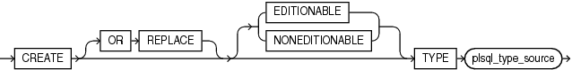
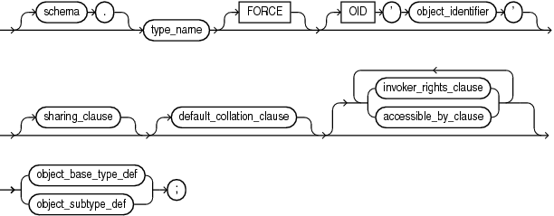
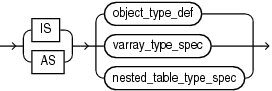
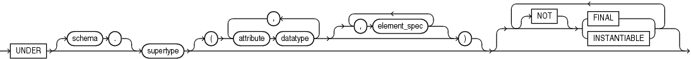
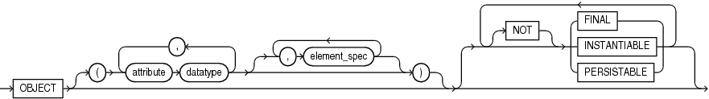
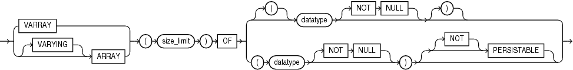
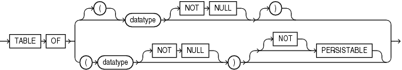

The `CREATE TYPE` statement specifies the name of the type and its attributes, methods, and other properties.

The `CREATE` `TYPE` statement creates or replaces the specification of one of these:

- Abstract Data Type (ADT)
- Standalone varying array (varray) type
- Standalone nested table type
- Incomplete object type
	An incomplete type is a type created by a forward type definition. It is called incomplete because it has a name but no attributes or methods. It can be referenced by other types, allowing you to define types that refer to each other. However, you must fully specify the type before you can use it to create a table or an object column or a column of a nested table type.

The `CREATE` `TYPE` `BODY` statement contains the code for the methods that implement the type.

Note:

- If you create a type whose specification declares only attributes but no methods, then you need not specify a type body.
- A standalone collection type that you create with the `CREATE` `TYPE` statement differs from a collection type that you define with the keyword `TYPE` in a PL/SQL block or package. For information about the latter, see " [Collection Variable Declaration](collection-variable.md) ".
- With the `CREATE` `TYPE` statement, you can create nested table and `VARRAY` types, but not associative arrays. In a PL/SQL block or package, you can define all three collection types.

Topics

Prerequisites

To create a type in your schema, you must have the `CREATE` `TYPE` system privilege. To create a type in another user's schema, you must have the `CREATE` `ANY` `TYPE` system privilege. You can acquire these privileges explicitly or be granted them through a role.

To create a subtype, you must have the `UNDER` `ANY` `TYPE` system privilege or the `UNDER` object privilege on the supertype.

The owner of the type must be explicitly granted the `EXECUTE` object privilege to access all other types referenced in the definition of the type, or the type owner must be granted the `EXECUTE` `ANY` `TYPE` system privilege. The owner cannot obtain these privileges through roles.

If the type owner intends to grant other users access to the type, then the owner must be granted the `EXECUTE` object privilege on the referenced types with the `GRANT` `OPTION` or the `EXECUTE` `ANY` `TYPE` system privilege with the `ADMIN` `OPTION`. Otherwise, the type owner has insufficient privileges to grant access on the type to other users.

Syntax

create\_type::=



> ```
> CREATE [OR REPLACE] [ EDITIONABLE | NONEDITIONABLE ] TYPE plsql_type_source
> ```
>
> [  
> Copyright © 1996, 2024, Oracle and/or its affiliates.](https://docs.oracle.com/en/database/oracle/oracle-database/dcommon/html/cpyr.htm)


plsql\_type\_source::=



> ```
> [ schema. ] type_name [ FORCE ] [ OID 'object_identifier' ] 
> [ sharing_clause ] [ default_collation_clause ] { [ invoker_rights_clause ] |  [ accessible_by_clause ] }... 
>   { object_base_type_def | object_subtype_def } ;
> ```
>
> [  
> Copyright © 1996, 2024, Oracle and/or its affiliates.](https://docs.oracle.com/en/database/oracle/oracle-database/dcommon/html/cpyr.htm)


([sharing\_clause::=](SHARING-clause.md), [default\_collation\_clause::=](DEFAULT-COLLATION-clause.md), [accessible\_by\_clause::=](ACCESSIBLE-BY-clause.md), [invoker\_rights\_clause::=](invokers_rights_clause.md), object\_base\_type\_def::=, object\_subtype\_def::=)

object\_base\_type\_def::=



> ```
> { IS | AS } { object_type_def | varray_type_spec | nested_table_type_spec }
> ```
>
> [  
> Copyright © 1996, 2024, Oracle and/or its affiliates.](https://docs.oracle.com/en/database/oracle/oracle-database/dcommon/html/cpyr.htm)


(object\_type\_def::=, nested\_table\_type\_spec::=, varray\_type\_spec::=)

object\_subtype\_def::=



> ```
> UNDER [schema.]supertype } 
> ( { attribute datatype [,] }  [ { , element_spec } ] )   
>  [ [NOT] { FINAL | INSTANTIABLE } ]...
> ```
>
> [  
> Copyright © 1996, 2024, Oracle and/or its affiliates.](https://docs.oracle.com/en/database/oracle/oracle-database/dcommon/html/cpyr.htm)


( [datatype::=](datatype-attribute.md), [element\_spec::=](element-specification.md))

object\_type\_def::=



> ```
> OBJECT  
> ( { attribute datatype [,] }  [ { , element_spec } ] )   
>  [ [NOT] { FINAL | INSTANTIABLE | PERSISTABLE } ]...
> ```
>
> [  
> Copyright © 1996, 2024, Oracle and/or its affiliates.](https://docs.oracle.com/en/database/oracle/oracle-database/dcommon/html/cpyr.htm)


( [datatype::=](datatype-attribute.md), [element\_spec::=](element-specification.md))

varray\_type\_spec::=



> ```
> { VARRAY | [ VARYING ] ARRAY } ( size_limit ) OF ( [(] datatype [ NOT NULL ] [)] | ( datatype [ NOT NULL ] ) [ [NOT] PERSISTABLE ] )
> ```
>
> [  
> Copyright © 1996, 2024, Oracle and/or its affiliates.](https://docs.oracle.com/en/database/oracle/oracle-database/dcommon/html/cpyr.htm)


([datatype::=](datatype-attribute.md))

nested\_table\_type\_spec::=



> ```
> TABLE OF ( [ ( ] datatype [ NOT NULL ] [ ) ] | (  datatype [ NOT NULL ] )  [ [ NOT ] PERSISTABLE ] )
> ```
>
> [  
> Copyright © 1996, 2024, Oracle and/or its affiliates.](https://docs.oracle.com/en/database/oracle/oracle-database/dcommon/html/cpyr.htm)


([datatype::=](datatype-attribute.md))

Semantics

create\_type

OR REPLACE

Re-creates the type if it exists, and recompiles it.

Users who were granted privileges on the type before it was redefined can still access the type without being regranted the privileges.

If any function-based indexes depend on the type, then the database marks the indexes `DISABLED`.

\[ EDITIONABLE | NONEDITIONABLE \]

Specifies whether the type is an editioned or noneditioned object if editioning is enabled for the schema object type `TYPE` in `schema`. Default: `EDITIONABLE`. For information about editioned and noneditioned objects, see [Oracle Database Development Guide](https://docs.oracle.com/pls/topic/lookup?ctx=en/database/oracle/oracle-database/21/lnpls&id=ADFNS99923).

plsql\_type\_source

schema

Name of the schema containing the type. Default: your schema.

type\_name

Name of an ADT, a nested table type, or a `VARRAY` type.

If creating the type results in compilation errors, then the database returns an error. You can see the associated compiler error messages with the SQL\*Plus command `SHOW` `ERRORS`.

The database implicitly defines a constructor method for each user-defined type that you create. A constructor is a system-supplied procedure that is used in SQL statements or in PL/SQL code to construct an instance of the type value. The name of the constructor method is the name of the user-defined type. You can also create a user-defined constructor using the `constructor_spec` syntax.

The parameters of the ADT constructor method are the data attributes of the ADT. They occur in the same order as the attribute definition order for the ADT. The parameters of a nested table or varray constructor are the elements of the nested table or the varray.

FORCE

If `type_name` exists and has type dependents, but not table dependents, `FORCE` forces the statement to replace the type. (If `type_name` has table dependents, the statement fails with or without `FORCE`.)

Note:

If type `t1` has type dependent `t2`, and type `t2` has table dependents, then type `t1` also has table dependents.

See Also:

[Oracle Database Object-Relational Developer's Guide](https://docs.oracle.com/pls/topic/lookup?ctx=en/database/oracle/oracle-database/21/lnpls&id=ADOBJ00402)

OID 'object\_identifier'

Establishes type equivalence of identical objects in multiple databases. See [Oracle Database Object-Relational Developer's Guide](https://docs.oracle.com/pls/topic/lookup?ctx=en/database/oracle/oracle-database/21/lnpls&id=ADOBJ00513) for information about this clause.

object\_base\_type\_def

Creates a schema-level ADT. Such ADTs are sometimes called root ADTs.

IS | AS

The keyword `IS` or `AS` is required when creating an ADT.

See Also:

" Example 15-23, ADT Examples"

object\_subtype\_def

Creates a subtype of an existing type.

UNDER supertype

The existing supertype must be an ADT. The subtype you create in this statement inherits the properties of its supertype. It must either override some of those properties or add properties to distinguish it from the supertype.

See Also:

" Example 15-24, Creating a Subtype" and " Example 15-25, Creating a Type Hierarchy"

attribute

Name of an ADT attribute. An ADT attribute is a data item with a name and a type specifier that forms the structure of the ADT. You must specify at least one attribute for each ADT. The name must be unique in the ADT, but can be used in other ADTs.

If you are creating a subtype, then the attribute name cannot be the same as any attribute or method name declared in the supertype chain.

datatype

The data type of an ADT attribute. This data type must be stored in the database; that is, either a predefined data type or a user-defined standalone collection type.

Restrictions on datatype

- You cannot impose the `NOT` `NULL` constraint on an attribute.
- You cannot specify attributes of type `ROWID`, `LONG`, or `LONG` `RAW`.
- You cannot specify a data type of `UROWID` for an ADT.
- If you specify an object of type `REF`, then the target object must have an object identifier.
- If you are creating a collection type for use as a nested table or varray column of a table, then you cannot specify attributes of type `ANYTYPE`, `ANYDATA`, or `ANYDATASET`.
- JSON cannot be an attribute of a user defined type (ADT).

object\_type\_def

Creates an ADT. The variables that form the data structure are called attributes. The member subprograms that define the behavior of the ADT are called methods.

OBJECT

The keyword `OBJECT` is required.

\[NOT\] FINAL, \[NOT\] INSTANTIABLE, \[NOT\] PERSISTABLE

At the schema level of the syntax, these clauses specify the inheritance attributes of the type.

\[NOT\] FINAL

Use the \[`NOT`\] `FINAL` clause to indicate whether any further subtypes can be created for this type:

- (Default) Specify `FINAL` if no further subtypes can be created for this type.
- Specify `NOT` `FINAL` if further subtypes can be created under this type.

\[NOT\] INSTANTIABLE

Use the \[`NOT`\] `INSTANTIABLE` clause to indicate whether any object instances of this type can be constructed:

- (Default) Specify `INSTANTIABLE` if object instances of this type can be constructed.
- Specify `NOT` `INSTANTIABLE` if no default or user-defined constructor exists for this ADT. You must specify these keywords for any type with noninstantiable methods and for any type that has no attributes, either inherited or specified in this statement.

\[NOT\] PERSISTABLE

Use \[`NOT`\] `PERSISTABLE` clause to indicate whether or not instances of the object type are persistable.

Only `PERSISTABLE` types can be stored in a table.

- (Default) You can specify `PERSISTABLE` if all the object type attributes are persistable. Creating a persistable object type with non-persistable attributes is not allowed.
- You can specify `NOT` `PERSISTABLE` if the object type attributes are persistable or non-persistable.
- Specify `NOT` `PERSISTABLE` if the ADT has a unique PL/SQL predefined types, such as BOOLEAN and PLS\_INTEGER.
Restrictions on \[NOT\] PERSISTABLE ADT

You cannot specify the `[NOT] PERSISTABLE` clause in a subtype definition. The persistance property of a subtype is inherited from its supertype.

Non-persistable ADTs with PL/SQL unique attributes are only allowed in the PL/SQL context.

See: Example 15-28, "Creating a Non-Persistable Object Type"

varray\_type\_spec

Creates the type as an ordered set of elements, each of which has the same data type.

Restrictions on varray\_type\_spec

You can create a `VARRAY` type of `XMLType` or of a LOB type for procedural purposes, for example, in PL/SQL or in view queries. However, database storage of such a varray is not supported, so you cannot create an object table or an column of such a `VARRAY` type.

See Also:

" Example 15-26, Creating a Varray Type"

\[NOT\] PERSISTABLE

( datatype \[NOT NULL\] )

The parentheses before and after the `datatype` \[`NOT NULL`\] clause are required when `PERSISTABLE` is specified. The parentheses are optional if `PERSISTABLE` is not specified.

Use \[`NOT`\] `PERSISTABLE` clause to indicate whether or not instances of the collection type (`VARRAY` or nested table) are persistable.
- (Default) A collection can be `PERSISTABLE` only if the collection element type is persistable. Creating a persistable collection type with non-persistable element type is not allowed.
- Specify `NOT` `PERSISTABLE` if any element type of the collection is not persistable. You can specify `NOT` `PERSISTABLE` for any collection, whether the element type is persistable or not.
- Specify `NOT` `PERSISTABLE` if the collection has a unique PL/SQL predefined types, such as BOOLEAN and PLS\_INTEGER.
Restrictions on \[NOT\] PERSISTABLE Varray and Nested Array

Non-persistable types with PL/SQL unique attributes are only allowed in the PL/SQL context.

See Example 15-27, "Creating a Non-Persistable Nested Array" and Example 15-29, "Creating a Non-Persistable Varray"

nested\_table\_type\_spec

Creates a named nested table of type `datatype`.

\[NOT\] PERSISTABLE

Same as for `VARRAY`, see " [\[NOT\] PERSISTABLE](https://docs.oracle.com/en/database/oracle/oracle-database/21/lnpls/CREATE-TYPE-statement.html#GUID-389D603D-FBD0-452A-8414-240BBBC57034__NOTPERSISTABLE-DC9DEF8B) "

See Also:

- " Example 15-30, Creating a Nested Table Type"
- " Example 15-31, Creating a Nested Table Type Containing a VARRAY"

Examples

Example 15-23 ADT Examples

This example shows how the sample type `customer_typ` was created for the sample Order Entry (`oe`) schema. A hypothetical name is given to the table so that you can duplicate this example in your test database:

```
CREATE TYPE customer_typ_demo AS OBJECT
    ( customer_id        NUMBER(6)
    , cust_first_name    VARCHAR2(20)
    , cust_last_name     VARCHAR2(20)
    , cust_address       CUST_ADDRESS_TYP
    , phone_numbers      PHONE_LIST_TYP
    , nls_language       VARCHAR2(3)
    , nls_territory      VARCHAR2(30)
    , credit_limit       NUMBER(9,2)
    , cust_email         VARCHAR2(30)
    , cust_orders        ORDER_LIST_TYP
    ) ;
```

In this example, the `data_typ1` ADT is created with one member function `prod`, which is implemented in the `CREATE` `TYPE` `BODY` statement:

```
CREATE TYPE data_typ1 AS OBJECT 
   ( year NUMBER, 
     MEMBER FUNCTION prod(invent NUMBER) RETURN NUMBER 
   ); 
/
 
CREATE TYPE BODY data_typ1 IS   
      MEMBER FUNCTION prod (invent NUMBER) RETURN NUMBER IS 
         BEGIN 
             RETURN (year + invent);
         END; 
      END;
```

Example 15-24 Creating a Subtype

This statement shows how the subtype `corporate_customer_typ` in the sample `oe` schema was created.

It is based on the `customer_typ` supertype created in the preceding example and adds the `account_mgr_id` attribute. A hypothetical name is given to the table so that you can duplicate this example in your test database:

```
CREATE TYPE corporate_customer_typ_demo UNDER customer_typ
    ( account_mgr_id     NUMBER(6)
    );
```

Example 15-25 Creating a Type Hierarchy

These statements create a type hierarchy.

Type `employee_t` inherits the `name` and `ssn` attributes from type `person_t` and in addition has `department_id` and `salary` attributes. Type `part_time_emp_t` inherits all of the attributes from `employee_t` and, through `employee_t`, those of `person_t` and in addition has a `num_hrs` attribute. Type `part_time_emp_t` is final by default, so no further subtypes can be created under it.

```
CREATE TYPE person_t AS OBJECT (name VARCHAR2(100), ssn NUMBER) 
   NOT FINAL;

CREATE TYPE employee_t UNDER person_t 
   (department_id NUMBER, salary NUMBER) NOT FINAL;

CREATE TYPE part_time_emp_t UNDER employee_t (num_hrs NUMBER);
```

You can use type hierarchies to create substitutable tables and tables with substitutable columns.

Example 15-26 Creating a Varray Type

This statement shows how the `phone_list_typ` `VARRAY` type with five elements in the sample `oe` schema was created.

A hypothetical name is given to the table so that you can duplicate this example in your test database:

```
CREATE TYPE phone_list_typ_demo AS VARRAY(5) OF VARCHAR2(25);
```

Example 15-27 Creating a Non-Persistable Nested Array

This example shows how to create a PL/SQL nested array with unique PL/SQL predefined type `PLS_INTEGER` that is not persistable and can only be used in your PL/SQL programs.

```
CREATE TYPE varr_int AS VARRAY(10) OF (PLS_INTEGER) NOT PERSISTABLE;
```

Example 15-28 Creating a Non-Persistable Object Type

This example shows how to create a PL/SQL object type with unique PL/SQL predefined type `PLS_INTEGER` that is not persistable and can only be used in your PL/SQL programs.

```
CREATE TYPE plsint AS OBJECT (I PLS_INTEGER) NOT PERSISTABLE;
```

Example 15-29 Creating a Non-Persistable Varray

This example shows how to create a PL/SQL varray with unique PL/SQL predefined type `BOOLEAN` that is not persistable and can only be used in your PL/SQL programs.

```
CREATE TYPE tab_bool AS TABLE OF (BOOLEAN) NOT PERSISTABLE;
```

Example 15-30 Creating a Nested Table Type

This example from the sample schema `pm` creates the table type `textdoc_tab` of type `textdoc_typ`:

```
CREATE TYPE textdoc_typ AS OBJECT
    ( document_typ      VARCHAR2(32)
    , formatted_doc     BLOB
    ) ;

CREATE TYPE textdoc_tab AS TABLE OF textdoc_typ;
```

Example 15-31 Creating a Nested Table Type Containing a Varray

This example of multilevel collections is a variation of the sample table `oe.customers`.

In this example, the `cust_address` object column becomes a nested table column with the `phone_list_typ` varray column embedded in it. The phone\_list\_typ\_demo type was created in " Example 15-26 ".

```
CREATE TYPE cust_address_typ2 AS OBJECT
       ( street_address     VARCHAR2(40)
       , postal_code        VARCHAR2(10)
       , city               VARCHAR2(30)
       , state_province     VARCHAR2(10)
       , country_id         CHAR(2)
       , phone              phone_list_typ_demo
       );

CREATE TYPE cust_nt_address_typ
   AS TABLE OF cust_address_typ2;
```

Example 15-32 Constructor Example

This example invokes the system-defined constructor to construct the `demo_typ` object and insert it into the `demo_tab` table.

```
CREATE TYPE demo_typ1 AS OBJECT (a1 NUMBER, a2 NUMBER);

CREATE TABLE demo_tab1 (b1 NUMBER, b2 demo_typ1);

INSERT INTO demo_tab1 VALUES (1, demo_typ1(2,3));
```

Example 15-33 Creating a Member Method

This example invokes method constructor `col.get_square`.

First the type is created:

```
CREATE TYPE demo_typ2 AS OBJECT (a1 NUMBER, 
   MEMBER FUNCTION get_square RETURN NUMBER);
```

Next a table is created with an ADT column and some data is inserted into the table:

```
CREATE TABLE demo_tab2(col demo_typ2); 

INSERT INTO demo_tab2 VALUES (demo_typ2(2));
```

The type body is created to define the member function, and the member method is invoked:

```
CREATE TYPE BODY demo_typ2 IS
   MEMBER FUNCTION get_square
   RETURN NUMBER
   IS x NUMBER;
   BEGIN
      SELECT c.col.a1*c.col.a1 INTO x
      FROM demo_tab2 c;
      RETURN (x);
   END;
END;
 
SELECT t.col.get_square() FROM demo_tab2 t;

T.COL.GET_SQUARE()
------------------
                 4
```

Unlike function invocations, method invocations require parentheses, even when the methods do not have additional arguments.

Example 15-34 Creating a Static Method

This example changes the definition of the `employee_t` type to associate it with the `construct_emp` function.

The example first creates an ADT `department_t` and then an ADT `employee_t` containing an attribute of type `department_t`:

```
CREATE OR REPLACE TYPE department_t AS OBJECT (
   deptno number(10),
   dname CHAR(30));

CREATE OR REPLACE TYPE employee_t AS OBJECT(
   empid RAW(16),
   ename CHAR(31),
   dept REF department_t,
      STATIC function construct_emp
      (name VARCHAR2, dept REF department_t)
      RETURN employee_t
);
```

This statement requires this type body statement.

```
CREATE OR REPLACE TYPE BODY employee_t IS
   STATIC FUNCTION construct_emp
   (name varchar2, dept REF department_t)
   RETURN employee_t IS
      BEGIN
         return employee_t(SYS_GUID(),name,dept);
      END;
END;
```

Next create an object table and insert into the table:

```
CREATE TABLE emptab OF employee_t;
INSERT INTO emptab
   VALUES (employee_t.construct_emp('John Smith', NULL));
```

Related Topics

- [ALTER TYPE Statement](ALTER-TYPE-statement.md)
- [CREATE TYPE BODY Statement](CREATE-TYPE-BODY-statement.md)
- [DROP TYPE Statement](DROP-TYPE-statement.md)
- [Abstract Data Types](overview.md)
- [Conditional Compilation Directive Restrictions](plsql-language-fundamentals.md)
- [Collection Variable Declaration](collection-variable.md)
- [Collection Types](plsql-collections-and-records.md) for information about user-defined standalone collection types
- [PL/SQL Data Types](plsql-data-types.md)
- [Oracle Database Object-Relational Developer's Guide](https://docs.oracle.com/pls/topic/lookup?ctx=en/database/oracle/oracle-database/21/lnpls&id=ADOBJ001) for more information about objects, incomplete types, varrays, and nested tables
- [Oracle Database Object-Relational Developer's Guide](https://docs.oracle.com/pls/topic/lookup?ctx=en/database/oracle/oracle-database/21/lnpls&id=ADOBJ006) for more information about constructors