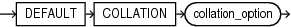
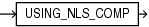

Collation (also called sort ordering) determines if a character string equals, precedes, or follows another string when the two strings are compared and sorted. Oracle Database collations order strings following rules for sorted text used in different languages.

Prerequisites

The `COMPATIBLE` initialization parameter must be set to at least 12.2.0, and `MAX_STRING_SIZE` must be set to `EXTENDED` for collation declarations to be allowed in these SQL statements.

Syntax

default\_collation\_clause::=

> Description of default\_collation\_clause syntax diagram.
>
> DEFAULT COLLATION "collation\_option"
>
> [  
> Copyright © 1996, 2024, Oracle and/or its affiliates.](https://docs.oracle.com/en/database/oracle/oracle-database/dcommon/html/cpyr.htm)

collation\_option::=

> List of valid pseudo\_collation names.
>
> USING\_NLS\_COMP
>
> [  
> Copyright © 1996, 2024, Oracle and/or its affiliates.](https://docs.oracle.com/en/database/oracle/oracle-database/dcommon/html/cpyr.htm)

Semantics

default\_collation\_clause

The default\_collation\_clause can appear in a package specification, a standalone type specification, and in standalone subprograms.

collation\_option

The default collation of a procedure, function, package, type, or trigger must be `USING_NLS_COMP`. The default\_collation\_clause explicitly declares the default collation of a PL/SQL unit to be `USING_NLS_COMP`. Without this clause, the unit inherits its default collation from the effective schema default collation. If the effective schema default collation is not `USING_NLS_COMP`, the unit is invalid.

The effective schema default collation is determined as follows:
- If the session parameter `DEFAULT_COLLATION` is set, the effective schema default collation is the value of this parameter. The value of the parameter can be checked by querying `SYS_CONTEXT('USERENV', 'SESSION_DEFAULT_COLLATION')`. The function returns `NULL` if `DEFAULT_COLLATION` is not set. The value of the parameter `DEFAULT_COLLATION` can be set with the statement: `ALTER SESSION SET DEFAULT_COLLATION` = collation\_option;
- If the session parameter `DEFAULT_COLLATION` is not set, the effective schema default collation is the declared default collation of the schema in which you create the PL/SQL unit. The default collation of a schema can be found in the static data dictionary \*\_USERS views. It can be set with the DDL statements ` CREATE USER` and `ALTER USER`.

The session parameter `DEFAULT_COLLATION` can be unset with the statement: `ALTER SESSION SET DEFAULT_COLLATION = NONE; `

Package body and type body use the default collation of the corresponding specification. All character data containers and attributes in procedures, functions and methods, including parameters and return values, behave as if their data-bound collation were the pseudo-collation `USING_NLS_COMP`.

Restrictions on `DEFAULT COLLATION`

It cannot be specified for nested or packaged subprograms or for type methods.

Compilation Semantics

If the resulting default object collation is different from `USING_NLS_COMP`, the database object is created as invalid with a compilation error.

If the `ALTER COMPILE` statement is issued for a PL/SQL unit with the `REUSE SETTINGS` clause, the stored default collation of the database object being compiled is not changed.

If an `ALTER COMPILE` statement is issued without the `REUSE SETTINGS` clause, the stored default collation of the database object being compiled is discarded and the effective schema default collation for the object owner at the time of execution of the statement is stored as the default collation of the object, unless the PL/SQL unit contains the `DEFAULT COLLATION` clause. If the resulting default collation is not `USING_NLS_COMP`, a compilation error is raised.

An `ALTER COMPILE` statement for a package or type body references the stored collation of the corresponding specification.