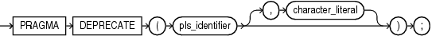

The `DEPRECATE` pragma marks a PL/SQL element as deprecated. The compiler issues warnings for uses of pragma `DEPRECATE` or of deprecated elements.

The associated warnings tell users of a deprecated element that other code may need to be changed to account for the deprecation.

Syntax

deprecate\_pragma::=



> PRAGMA DEPRECATE Syntax Diagram Description
>
> PRAGMA DEPRECATE ( “pls\_identifier” \[, “character\_literal”\] )
>
> [  
> Copyright © 1996, 2024, Oracle and/or its affiliates.](https://docs.oracle.com/en/database/oracle/oracle-database/dcommon/html/cpyr.htm)


Semantics

deprecate\_pragma

The `DEPRECATE` pragma may only appear in the declaration sections of a package specification, an object specification, a top level procedure, or a top level function.

PL/SQL elements of these kinds may be deprecated:
- Subprograms
- Packages
- Variables
- Constants
- Types
- Subtypes
- Exceptions
- Cursors

The `DEPRECATE` pragma may only appear in the declaration section of a PL/SQL unit. It must appear immediately after the declaration of an item to be deprecated.

The `DEPRECATE` pragma applies to the PL/SQL element named in the declaration which precedes the pragma.

When the `DEPRECATE` pragma applies to a package specification, object specification, or subprogram, the pragma must appear immediately after the keyword `IS` or `AS` that terminates the declaration portion of the definition.

When the `DEPRECATE` pragma applies to a package or object specification, references to all the elements (of the kinds that can be deprecated) that are declared in the specification are also deprecated.

If the `DEPRECATE` pragma applies to a subprogram declaration, only that subprogram is affected; other overloads with the same name are not deprecated.

If the optional custom message appears in a use of the `DEPRECATE` pragma, the custom message will be added to the warning issued for any reference to the deprecated element.

The identifier in a `DEPRECATE` pragma must name the element in the declaration to which it applies.

Deprecation is inherited during type derivation. A child object type whose parent is deprecated is not deprecated. Only the attributes and methods that are inherited are deprecated.

When the base type is not deprecated but individual methods or attributes are deprecated, and when a type is derived from this type and the deprecated type or method is inherited, then references to these through the derived type will cause the compiler to issue a warning.

A reference to a deprecated element appearing anywhere except in the unit with the deprecation pragma or its body, will cause the PL/SQL compiler to issue a warning for the referenced elements. A reference to a deprecated element in an anonymous block will not cause the compiler to issue a warning; only references in named entities will draw a warning.

When a deprecated entity is referenced in the definition of another deprecated entity then no warning will be issued.

When an older client code refers to a deprecated entity, it is invalidated and recompiled. No warning is issued.

There is no effect when SQL code directly references a deprecated element.

A reference to a deprecated element in a PL/SQL static SQL statement may cause the PL/SQL compiler to issue a warning. However, such references may not be detectable.

pls\_identifier

Identifier of the PL/SQL element being deprecated.

character\_literal

An optional compile-time warning message.

DEPRECATE Pragma Compilation Warnings

The PL/SQL compiler issues warnings when the `DEPRECATE` pragma is used and when deprecated items are referenced.

- 6019 — The entity was deprecated and could be removed in a future release. Do not use the deprecated entity.
- 6020 — The referenced entity was deprecated and could be removed in a future release. Do not use the deprecated entity. Follow the specific instructions in the warning if any are given.
- 6021 — Misplaced pragma. The pragma `DEPRECATE` should follow immediately after the declaration of the entity that is being deprecated. Place the pragma immediately after the declaration of the entity that is being deprecated.
- 6022 — This entity cannot be deprecated. Deprecation only applies to entities that may be declared in a package or type specification as well as to top-level procedure and function definitions. Remove the pragma.

The `DEPRECATE` pragma warnings may be managed with the `PLSQL_WARNINGS` parameter or with the DBMS\_WARNING package.

Examples

Example 14-13 Enabling the Deprecation Warnings

This example shows how to set the PLSQL\_WARNINGS parameter to enable these warnings in a session.

Live SQL:

You can view and run this example on Oracle Live SQL at [Restricting Access to Top-Level Procedures in the Same Schema](https://livesql.oracle.com/apex/livesql/docs/lnpls/accessible-by/whitelist1.html)

```
ALTER SESSION SET PLSQL_WARNINGS='ENABLE:(6019,6020,6021,6022)';
```

Example 14-14 Deprecation of a PL/SQL Package

This example shows the deprecation of a PL/SQL package as a whole. Warnings will be issued for any reference to package pack1, and to the procedures foo and bar when used outside of the package and its body.

Live SQL:

You can view and run this example on Oracle Live SQL at [Deprecation of a PL/SQL Package](https://livesql.oracle.com/apex/livesql/docs/lnpls/deprecate/package.html)

```
PACKAGE pack1 AS
PRAGMA DEPRECATE(pack1);
 PROCEDURE foo;
 PROCEDURE bar;
END pack1;
```

Example 14-15 Deprecation of a PL/SQL Package with a Custom Warning

This example shows the deprecation of a PL/SQL package. The compiler issues a custom warning message when a reference in another unit for the deprecated procedure foo is compiled.

Live SQL:

You can view and run this example on Oracle Live SQL at [Deprecation of a PL/SQL Package with a Custom Warning](https://livesql.oracle.com/apex/livesql/docs/lnpls/deprecate/package-custom-warning.html)

```
PACKAGE pack5 AUTHID DEFINER AS
PRAGMA DEPRECATE(pack5 , ’Package pack5 has been deprecated, use new_pack5 instead.’);
 PROCEDURE foo;
 PROCEDURE bar;
END pack5;
```

A reference to procedure pack5.foo in another unit would draw a warning like this.

```
SP2-0810: Package Body created with compilation warnings

Errors for PACKAGE BODY PACK6:
4/10     PLW-06020: reference to a deprecated entity: PACK5 declared in unit PACK5[1,9].  
         Package pack5 has been deprecated, use new_pack5 instead
```

Example 14-16 Deprecation of a PL/SQL Procedure

This example shows the deprecation of a single PL/SQL procedure foo in package pack7.

Live SQL:

You can view and run this example on Oracle Live SQL at [Deprecation of a PL/SQL Procedure](https://livesql.oracle.com/apex/livesql/docs/lnpls/deprecate/procedure.html)

```
PACKAGE pack7 AUTHID DEFINER AS
  PROCEDURE foo;
  PRAGMA DEPRECATE (foo, ’pack7.foo is deprecated, use pack7.bar instead.’);
  PROCEDURE bar;
END pack7;
```

Example 14-17 Deprecation of an Overloaded Procedure

This example shows the `DEPRECATE` pragma applies only to a specific overload of a procedure name. Only the second declaration of proc1 is deprecated.

Live SQL:

You can view and run this example on Oracle Live SQL at [Deprecation of an Overloaded Procedure](https://livesql.oracle.com/apex/livesql/docs/lnpls/deprecate/overloaded-procedure.html)

```
PACKAGE pack2 AS
  PROCEDURE proc1(n1 NUMBER, n2 NUMBER, n3 NUMBER);
  -- Only the overloaded procedure with 2 arguments is deprecated
  PROCEDURE proc1(n1 NUMBER, n2 NUMBER);
      PRAGMA DEPRECATE(proc1);
 END pack2;
```

Example 14-18 Deprecation of a Constant and of an Exception

Live SQL:

You can view and run this example on Oracle Live SQL at [Deprecation of a Constant and of an Exception](https://livesql.oracle.com/apex/livesql/docs/lnpls/deprecate/constant-exception.html)

This example shows the deprecation of a constant and of an exception.

```
PACKAGE trans_data AUTHID DEFINER AS
   TYPE Transrec IS RECORD (
     accounttype VARCHAR2(30) ,
     ownername VARCHAR2(30) ,
     balance REAL
   );
   min_balance constant real := 10.0;
   PRAGMA DEPRECATE(min_balance , ’Minimum balance requirement has been removed.’);
   insufficient_funds EXCEPTION;
   PRAGMA DEPRECATE (insufficient_funds , ’Exception no longer raised.’);
END trans_data;
```

Example 14-19 Using Conditional Compilation to Deprecate Entities in Some Database Releases

This example shows the deprecation of procedure proc1 if the database release version is greater than 11.

Live SQL:

You can view and run this example on Oracle Live SQL at [Using Conditional Compilation to Deprecate Entities in Some Database Releases](https://livesql.oracle.com/apex/livesql/docs/lnpls/deprecate/conditional-deprecation-in-a-release.html)

```
CREATE PACKAGE pack11 AUTHID DEFINER AS
 $IF DBMS_DB_VERSION.VER_LE_11 
 $THEN
    PROCEDURE proc1;
 $ELSE
    PROCEDURE proc1;
    PRAGMA DEPRECATE(proc1);
 $END
 PROCEDURE proc2;
 PROCEDURE proc3;
END pack11;
```

Example 14-20 Deprecation of an Object Type

This example shows the deprecation of an entire object type.

```
TYPE type01 AS OBJECT(
   PRAGMA DEPRECATE (type01), 
   y NUMBER, 
   MEMBER PROCEDURE proc(x NUMBER), 
   MEMBER PROCEDURE proc2(x NUMBER) 
);
```

Example 14-21 Deprecation of a Member Function in an Object Type Specification

This example shows the deprecation of member function add2 in an object type specification.

Live SQL:

You can view and run this example on Oracle Live SQL at [Deprecation of a Member Function in an Object Type Specification](https://livesql.oracle.com/apex/livesql/docs/lnpls/deprecate/member-function.html)

```
TYPE objdata AS OBJECT(
  n1 NUMBER ,
  n2 NUMBER ,
  n3 NUMBER ,
  MEMBER FUNCTION add2 RETURN NUMBER ,
   PRAGMA DEPRECATE (add2),
  MEMBER FUNCTION add_all RETURN NUMBER
 );
```

Example 14-22 Deprecation of Inherited Object Types

This example shows that a reference to a deprecated entity x declared in unit type15\_basetype type body will cause the compiler to issue a warning.

Live SQL:

You can view and run this example on Oracle Live SQL at [Deprecation of Inherited Object Types](https://livesql.oracle.com/apex/livesql/docs/lnpls/deprecate/inherited-object-type.html)

```
TYPE type15_basetype AS OBJECT 
( 
  x1 NUMBER, 
  x  NUMBER, 
  PRAGMA DEPRECATE (x), 
  MEMBER PROCEDURE f0 , 
  PRAGMA DEPRECATE (f0), 
  MEMBER PROCEDURE f1 ,
  PRAGMA DEPRECATE (f1),
  MEMBER PROCEDURE f2 ,
  PRAGMA DEPRECATE (f2),
  MEMBER PROCEDURE f3) NOT FINAL;
```
```
TYPE BODY type15_basetype AS 
   MEMBER PROCEDURE f0 
   IS 
   BEGIN 
     x := 1; 
   END; 
   MEMBER PROCEDURE f1 
   IS 
   BEGIN 
     x := 1; 
   END; 

   MEMBER PROCEDURE f2
   IS
   BEGIN
     x := 1;
   END;

   MEMBER PROCEDURE f3
   IS
   BEGIN
     x := 1;
   END;
END;
```

References to the deprecated entities x, f0, and f2 in type15\_basetype type body will cause the compiler to issue a warning.

```
TYPE type15_subtype UNDER type15_basetype ( 
  y NUMBER , 
  MEMBER PROCEDURE f1(z NUMBER), 
  MEMBER PROCEDURE f1(z NUMBER , m1 NUMBER), 
  PRAGMA DEPRECATE(f1), 
  OVERRIDING MEMBER PROCEDURE f2 
);
```
```
TYPE BODY type15_subtype AS 
   MEMBER PROCEDURE f1(z NUMBER)
IS 
BEGIN 
  -- deprecation attribute inherited in derived type. 
  x := 1;
  x1:= 2; 
  SELF.f0; 
END; 

   MEMBER PROCEDURE f1(z  NUMBER , 
                    m1 NUMBER) 
   IS 
   BEGIN 
     NULL; 
   END; 
   OVERRIDING MEMBER PROCEDURE f2 
   IS 
   BEGIN 
     /* refer to deprecated f2 in supertype */ 
     (SELF AS type15_basetype).f2; 
     /* No warning for a reference to a not deprecated data member in the supertype */ 
     x1 := 1; 
   END; 
END;
```

References to deprecated entities x, f1, and f0 in unit type15\_basetype will cause the compiler to issue a warning.

```
PROCEDURE test_types3 
AS 
  e type15_subtype ; 
  d type15_basetype ; 
BEGIN 
  e := type15_subtype (1 ,1 ,1); 
  d := type15_basetype (1, 1); 
  d.x := 2; -- warning issued 
  d.f1;     -- warning issued 
  e.f1 (4); -- overloaded in derived type. no warning. not deprecated in the derived type. 
  e.f1 (1); -- no warning  
  e.f0;     -- f0 is deprecated in base type. deprecation is inherited. warning issued 
            -- warning issued for deprecated x in d.x and e.x 

  DBMS_OUTPUT.PUT_LINE(to_char(e.x) || to_char(' ') || to_char(d.x)); 

END;
```

Example 14-23 Deprecation Only Applies to Top Level Subprogram

This examples shows that the `DEPRECATE` pragma may not be used to deprecate a nested procedure. The compiler issues a warning about the misuse of the pragma on the entity. The pragma has no effect.

Live SQL:

You can view and run this example on Oracle Live SQL at [Deprecation Only Applies to Top Level Subprogram](https://livesql.oracle.com/apex/livesql/docs/lnpls/deprecate/misuse-pragma.html)

```
PROCEDURE foo
IS
   PROCEDURE inner_foo
   IS
   PRAGMA DEPRECATE (inner_foo, 'procedure inner_foo is deprecated');
   BEGIN
     DBMS_OUTPUT.PUT_LINE('Executing inner_foo');
   END;
BEGIN
  DBMS_OUTPUT.PUT_LINE('Executing foo');
END;
```

Example 14-24 Misplaced DEPRECATE Pragma

The `DEPRECATE` pragma must appear immediately after the declaration of the deprecated item. A warning about the misplaced pragma will be issued and the pragma will have no effect.

Live SQL:

You can view and run this example on Oracle Live SQL at [Misplaced DEPRECATE Pragma](https://livesql.oracle.com/apex/livesql/docs/lnpls/deprecate/misplaced-pragma.html)

```
PROCEDURE bar
IS
BEGIN
   PRAGMA DEPRECATE(bar);
   DBMS_OUTPUT.PUT_LINE('Executing bar.');
END;
```

Example 14-25 Mismatch of the Element Name and the DEPRECATE Pragma Argument

This example shows that if the argument for the pragma does not match the name in the declaration, the pragma is ignored and the compiler does not issue a warning.

Live SQL:

You can view and run this example on Oracle Live SQL at [Mismatch of the Element Name and the DEPRECATE Pragma Argument](https://livesql.oracle.com/apex/livesql/docs/lnpls/deprecate/mismatch-pragma.html)

```
PACKAGE pkg13
AS
  PRAGMA DEPRECATE ('pkg13', 'Package pkg13 is deprecated, use pkg03');
  Y NUMBER;
END pkg13;
```

If an identifier is applied with a mismatched name, then the compiler issues a warning about the pragma being misplaced. The pragma has no effect.

```
CREATE PACKAGE pkg17
IS
  PRAGMA DEPRECATE ("pkg17");
END pkg17;
```