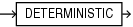

The deterministic option marks a function that returns predictable results and has no side effects.

Function-based indexes, virtual column definitions that use PL/SQL functions, and materialized views that have query-rewrite enabled require special function properties. The `DETERMINISTIC` clause asserts that a function has those properties.

The DETERMINISTIC option can appear in the following statements:

- [Function Declaration and Definition](function-declaration-and-definition.md)
- [CREATE FUNCTION Statement](CREATE-FUNCTION-statement.md)
- [CREATE PACKAGE Statement](CREATE-PACKAGE-statement.md)
- [CREATE TYPE BODY Statement](CREATE-TYPE-BODY-statement.md)

Syntax

deterministic\_clause::=



> ```
> DETERMINISTIC
> ```
>
> [  
> Copyright © 1996, 2024, Oracle and/or its affiliates.](https://docs.oracle.com/en/database/oracle/oracle-database/dcommon/html/cpyr.htm)


Semantics

deterministic\_clause

DETERMINISTIC

A function is deterministic if the `DETERMINISTIC` clause appears in either a declaration or the definition of the function.

The `DETERMINISTIC` clause may appear at most once in a function declaration and at most once in a function definition.

A deterministic function must return the same value on two distinct invocations if the arguments provided to the two invocations are the same.

A `DETERMINISTIC` function may not have side effects.

A `DETERMINISTIC` function may not raise an unhandled exception.

If a function with a `DETERMINISTIC` clause violates any of these semantic rules, the results of its invocation, its value, and the effect on its invoker are all undefined.

Usage Notes

The `DETERMINISTIC` clause is an assertion that the function obeys the semantic rules. If the function does not, neither the compiler, SQL execution, or PL/SQL execution may diagnose the problem and wrong results may be silently produced.

You must specify this keyword if you intend to invoke the function in the expression of a function-based index, in a virtual column definition, or from the query of a materialized view that is marked `REFRESH` `FAST` or `ENABLE` `QUERY` `REWRITE`. When the database encounters a deterministic function, it tries to use previously calculated results when possible rather than reexecuting the function. If you change the function, then you must manually rebuild all dependent function-based indexes and materialized views.

Do not specify `DETERMINISTIC` for a function whose result depends on the state of session variables or schema objects, because results might vary across invocations.

Do not specify this clause to define a function that uses package variables or that accesses the database in any way that might affect the return result of the function.

Specifying this clause for polymorphic table function is not allowed.

When the `DETERMINISTIC` option appears, the compiler may use the mark to improve the performance of the execution of the function.

It is good programming practice to make functions that fall into these categories `DETERMINISTIC`:

- Functions used in a `WHERE`, `ORDER` `BY`, or `GROUP` `BY` clause
- Functions that `MAP` or `ORDER` methods of a SQL type
- Functions that help determine whether or where a row appears in a result set