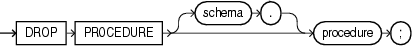

The `DROP` `PROCEDURE` statement drops a standalone procedure from the database.

Note:

Do not use this statement to remove a procedure that is part of a package. Instead, either drop the entire package using the " [DROP PACKAGE Statement](DROP-PACKAGE-statement.md) ", or redefine the package without the procedure using the " [CREATE PACKAGE Statement](CREATE-PACKAGE-statement.md) " with the `OR` `REPLACE` clause.

Topics

Prerequisites

The procedure must be in your schema or you must have the `DROP` `ANY` `PROCEDURE` system privilege.

Syntax

drop\_procedure::=



> ```
> DROP PROCEDURE [ schema. ] procedure ;
> ```
>
> [  
> Copyright © 1996, 2024, Oracle and/or its affiliates.](https://docs.oracle.com/en/database/oracle/oracle-database/dcommon/html/cpyr.htm)


Semantics

schema

Name of the schema containing the procedure. Default: your schema.

procedure

Name of the procedure to be dropped.

When you drop a procedure, the database invalidates any local objects that depend upon the dropped procedure. If you subsequently reference one of these objects, then the database tries to recompile the object and returns an error message if you have not re-created the dropped procedure.

Example

Example 15-38 Dropping a Procedure

This statement drops the procedure `remove_emp` owned by the user `hr` and invalidates all objects that depend upon `remove_emp`:

```
DROP PROCEDURE hr.remove_emp;
```