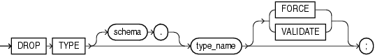

The `DROP` `TYPE` statement drops the specification and body of an ADT, `VARRAY` type, or nested table type.

Topics

Prerequisites

The ADT, `VARRAY` type, or nested table type must be in your schema or you must have the `DROP` `ANY` `TYPE` system privilege.

Syntax

drop\_type::=



> ```
> DROP TYPE [ schema. ] type_name [ FORCE | VALIDATE ] ;
> ```
>
> [  
> Copyright © 1996, 2024, Oracle and/or its affiliates.](https://docs.oracle.com/en/database/oracle/oracle-database/dcommon/html/cpyr.htm)


Semantics

schema

Name of the schema containing the type. Default: your schema.

type\_name

Name of the object, varray, or nested table type to be dropped. You can drop only types with no type or table dependencies.

If `type_name` is a supertype, then this statement fails unless you also specify `FORCE`. If you specify `FORCE`, then the database invalidates all subtypes depending on this supertype.

If `type_name` is a statistics type, then this statement fails unless you also specify `FORCE`. If you specify `FORCE`, then the database first disassociates all objects that are associated with `type_name` and then drops `type_name`.

See Also:

- [Oracle Database SQL Language Reference](https://docs.oracle.com/pls/topic/lookup?ctx=en/database/oracle/oracle-database/21/lnpls&id=SQLRF01106) for information about the `ASSOCIATE` `STATISTICS` statement
- [Oracle Database SQL Language Reference](https://docs.oracle.com/pls/topic/lookup?ctx=en/database/oracle/oracle-database/21/lnpls&id=SQLRF01507) for information about the `DISASSOCIATE` `STATISTICS` statement

If `type_name` is an ADT that is associated with a statistics type, then the database first tries to disassociate `type_name` from the statistics type and then drops `type_name`. However, if statistics have been collected using the statistics type, then the database cannot disassociate `type_name` from the statistics type, and this statement fails.

If `type_name` is an implementation type for an index type, then the index type is marked `INVALID`.

If `type_name` has a public synonym defined on it, then the database also drops the synonym.

Unless you specify `FORCE`, you can drop only types that are standalone schema objects with no dependencies. This is the default behavior.

See Also:

[Oracle Database SQL Language Reference](https://docs.oracle.com/pls/topic/lookup?ctx=en/database/oracle/oracle-database/21/lnpls&id=SQLRF01210) for information about the `CREATE` `INDEXTYPE` statement

FORCE

Drops the type even if it has dependent database objects. The database marks `UNUSED` all columns dependent on the type to be dropped, and those columns become inaccessible.

Note:

Oracle recommends against specifying `FORCE` to drop object types with dependencies. This operation is not recoverable and might make the data in the dependent tables or columns inaccessible.

VALIDATE

Causes the database to check for stored instances of this type in substitutable columns of any of its supertypes. If no such instances are found, then the database completes the drop operation.

This clause is meaningful only for subtypes. Oracle recommends the use of this option to safely drop subtypes that do not have any explicit type or table dependencies.

Example

Example 15-40 Dropping an ADT

This statement removes the ADT `person_t`. See " [CREATE TYPE Statement](CREATE-TYPE-statement.md) " for the example that creates this ADT. Any columns that are dependent on `person_t` are marked `UNUSED` and become inaccessible.

```
DROP TYPE person_t FORCE;
```