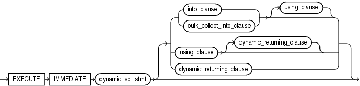

The `EXECUTE` `IMMEDIATE` statement builds and runs a dynamic SQL statement in a single operation.

Native dynamic SQL uses the `EXECUTE` `IMMEDIATE` statement to process most dynamic SQL statements.

Caution:

When using dynamic SQL, beware of SQL injection, a security risk. For more information about SQL injection, see " [SQL Injection](dynamic-sql.md) ".

Topics

Syntax

execute\_immediate\_statement::=



> ```
> EXECUTE IMMEDIATE dynamic_sql_stmt
>   [ { into_clause | bulk_collect_into_clause } [ using_clause ]
>   | using_clause [ dynamic_returning_clause ]
>   | dynamic_returning_clause
>   ] ;
> ```
>
> [  
> Copyright © 1996, 2024, Oracle and/or its affiliates.](https://docs.oracle.com/en/database/oracle/oracle-database/dcommon/html/cpyr.htm)


([bulk\_collect\_into\_clause::=](RETURNING-INTO-clause.md), [dynamic\_returning\_clause::=](RETURNING-INTO-clause.md), [into\_clause::=](RETURNING-INTO-clause.md))

using\_clause::=


> ```
> USING [ IN | OUT | IN OUT ] bind_argument
>   [ [,] [ [ IN | OUT | IN OUT ] bind_argument ]...
> ```
>
> [  
> Copyright © 1996, 2024, Oracle and/or its affiliates.](https://docs.oracle.com/en/database/oracle/oracle-database/dcommon/html/cpyr.htm)


Semantics

execute\_immediate\_statement

dynamic\_sql\_stmt

String literal, string variable, or string expression that represents a SQL statement. Its type must be either `CHAR`, `VARCHAR2`, or `CLOB`.

Note:

If `dynamic_sql_statement` is a `SELECT` statement, and you omit both `into_clause` and `bulk_collect_into_clause`, then `execute_immediate_statement` never executes.

For example, this statement never increments the sequence:

```
EXECUTE IMMEDIATE 'SELECT S.NEXTVAL FROM DUAL'
```

into\_clause

Specifies the variables or record in which to store the column values that the statement returns. For more information about this clause, see " [RETURNING INTO Clause](RETURNING-INTO-clause.md) ".

Restriction on into\_clause

Use if and only if `dynamic_sql_stmt` returns a single row.

bulk\_collect\_into\_clause

Specifies one or more collections in which to store the rows that the statement returns. For more information about this clause, see " [RETURNING INTO Clause](RETURNING-INTO-clause.md) ".

Restriction on bulk\_collect\_into\_clause

Use if and only if `dynamic_sql_stmt` can return multiple rows.

dynamic\_returning\_clause

Returns the column values of the rows affected by the dynamic SQL statement, in either individual variables or records. For more information about this clause, see " [RETURNING INTO Clause](RETURNING-INTO-clause.md) ".

Restriction on dynamic\_returning\_clause

Use if and only if `dynamic_sql_stmt` has a `RETURNING` `INTO` clause.

using\_clause

Specifies bind variables, using positional notation.

Note:

If you repeat placeholder names in `dynamic_sql_statement`, be aware that the way placeholders are associated with bind variables depends on the kind of dynamic SQL statement. For details, see " [Repeated Placeholder Names in Dynamic SQL Statements](dynamic-sql.md)."

Restrictions on using\_clause

- Use if and only if `dynamic_sql_stmt` includes placeholders for bind variables.
- If `dynamic_sql_stmt` has a `RETURNING` `INTO` clause (`static_returning_clause`), then `using_clause` can contain only `IN` bind variables. The bind variables in the `RETURNING` `INTO` clause are `OUT` bind variables by definition.

IN, OUT, IN OUT

Parameter modes of bind variables. An `IN` bind variable passes its value to `dynamic_sql_stmt`. An `OUT` bind variable stores a value that `dynamic_sql_stmt` returns. An `IN` `OUT` bind variable passes its initial value to `dynamic_sql_stmt` and stores a value that `dynamic_sql_stmt` returns. Default: `IN`.

For DML a statement with a `RETURNING` clause, you can place `OUT` bind variables in the `RETURNING` `INTO` clause without specifying the parameter mode, which is always `OUT`.

bind\_argument

An expression whose value replaces its corresponding placeholder in `dynamic_sql_stmt` at run time.

Every placeholder in `dynamic_sql_stmt` must be associated with a `bind_argument` in the `USING` clause or `RETURNING` `INTO` clause (or both) or with a define variable in the `INTO` clause.

You can run `dynamic_sql_stmt` repeatedly using different values for the bind variables. You incur some overhead, because `EXECUTE` `IMMEDIATE` prepares the dynamic string before every execution.

Note:

Bind variables can be evaluated in any order. If a program determines order of evaluation, then at the point where the program does so, its behavior is undefined.

Restrictions on bind\_argument

- `bind_argument` cannot be an associative array indexed by string.
- `bind_argument` cannot be the reserved word `NULL`.
	To pass the value `NULL` to the dynamic SQL statement, use an uninitialized variable where you want to use `NULL`, as in [Example 8-7](dynamic-sql.md).

Examples

- [Example 8-1](dynamic-sql.md), "Invoking Subprogram from Dynamic PL/SQL Block"
- [Example 8-7](dynamic-sql.md), "Uninitialized Variable Represents NULL in USING Clause"
- [Example 8-10](dynamic-sql.md), "Repeated Placeholder Names in Dynamic PL/SQL Block"