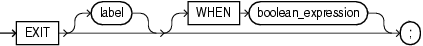

The `EXIT` statement exits the current iteration of a loop, either conditionally or unconditionally, and transfers control to the end of either the current loop or an enclosing labeled loop.

The `EXIT` `WHEN` statement exits the current iteration of a loop when the condition in its `WHEN` clause is true, and transfers control to the end of either the current loop or an enclosing labeled loop.

Each time control reaches the `EXIT` `WHEN` statement, the condition in its `WHEN` clause is evaluated. If the condition is not true, the `EXIT` `WHEN` statement does nothing. To prevent an infinite loop, a statement inside the loop must make the condition true.

Restriction on EXIT Statement

An `EXIT` statement must be inside a `LOOP` statement.

Topics

Syntax

exit\_statement::=



> ```
> EXIT [ label ] [ WHEN boolean_expression ] ;
> ```
>
> [  
> Copyright © 1996, 2024, Oracle and/or its affiliates.](https://docs.oracle.com/en/database/oracle/oracle-database/dcommon/html/cpyr.htm)


([boolean\_expression::=](expression.md))

Semantics

exit\_statement

label

Name that identifies either the current loop or an enclosing loop.

Without `label`, the `EXIT` statement transfers control to the end of the current loop. With `label`, the `EXIT` statement transfers control to the end of the loop that `label` identifies.

WHEN boolean\_expression

Without this clause, the `EXIT` statement exits the current iteration of the loop unconditionally. With this clause, the `EXIT` statement exits the current iteration of the loop if and only if the value of `boolean_expression` is `TRUE`.

Examples

Example 14-26 Basic LOOP Statement with EXIT Statement

In this example, the `EXIT` statement inside the basic `LOOP` statement transfers control unconditionally to the end of the current loop.

```
DECLARE
  x NUMBER := 0;
BEGIN
  LOOP
    DBMS_OUTPUT.PUT_LINE ('Inside loop:  x = ' || TO_CHAR(x));
    x := x + 1;
    IF x > 3 THEN
      EXIT;
    END IF;
  END LOOP;
  -- After EXIT, control resumes here
  DBMS_OUTPUT.PUT_LINE(' After loop:  x = ' || TO_CHAR(x));
END;
/
```

Result:

```
Inside loop:  x = 0
Inside loop:  x = 1
Inside loop:  x = 2
Inside loop:  x = 3
After loop:  x = 4
```

Example 14-27 Basic LOOP Statement with EXIT WHEN Statement

In this example, the `EXIT` `WHEN` statement inside the basic `LOOP` statement transfers control to the end of the current loop when `x` is greater than 3.

```
DECLARE
  x NUMBER := 0;
BEGIN
  LOOP
    DBMS_OUTPUT.PUT_LINE('Inside loop:  x = ' || TO_CHAR(x));
    x := x + 1;  -- prevents infinite loop
    EXIT WHEN x > 3;
  END LOOP;
  -- After EXIT statement, control resumes here
  DBMS_OUTPUT.PUT_LINE('After loop:  x = ' || TO_CHAR(x));
END;
/
```

Result:

```
Inside loop:  x = 0
Inside loop:  x = 1
Inside loop:  x = 2
Inside loop:  x = 3
After loop:  x = 4
```