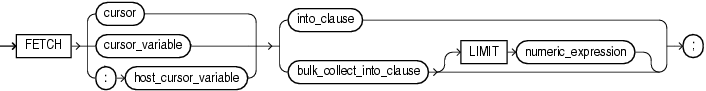

The `FETCH` statement retrieves rows of data from the result set of a multiple-row query—one row at a time, several rows at a time, or all rows at once—and stores the data in variables, records, or collections.

Topics

Syntax

fetch\_statement::=



> ```
> FETCH { cursor | cursor_variable | :host_cursor_variable }
>   { into_clause | bulk_collect_into_clause [ LIMIT numeric_expression ] } ;
> ```
>
> [  
> Copyright © 1996, 2024, Oracle and/or its affiliates.](https://docs.oracle.com/en/database/oracle/oracle-database/dcommon/html/cpyr.htm)


([bulk\_collect\_into\_clause::=](RETURNING-INTO-clause.md), [into\_clause::=](RETURNING-INTO-clause.md), [numeric\_expression::=](expression.md))

Semantics

fetch\_statement

cursor

Name of an open explicit cursor. To open an explicit cursor, use the " [OPEN Statement](OPEN-statement.md) ".

If you try to fetch from an explicit cursor before opening it or after closing it, PL/SQL raises the predefined exception `INVALID_CURSOR`.

cursor\_variable

Name of an open cursor variable. To open a cursor variable, use the " [OPEN FOR Statement](OPEN-FOR-statement.md) ". The cursor variable can be a formal subprogram parameter (see " [Cursor Variables as Subprogram Parameters](static-sql.md) ").

If you try to fetch from a cursor variable before opening it or after closing it, PL/SQL raises the predefined exception `INVALID_CURSOR`.

:host\_cursor\_variable

Name of a cursor variable declared in a PL/SQL host environment, passed to PL/SQL as a bind variable, and then opened. To open a host cursor variable, use the " [OPEN FOR Statement](OPEN-FOR-statement.md) ". Do not put space between the colon (:) and `host_cursor_variable`.

The data type of a host cursor variable is compatible with the return type of any PL/SQL cursor variable.

into\_clause

To have the `FETCH` statement retrieve one row at a time, use this clause to specify the variables or record in which to store the column values of a row that the cursor returns. For more information about `into_clause`, see " [into\_clause::=](RETURNING-INTO-clause.md) ".

bulk\_collect\_into\_clause \[ LIMIT numeric\_expression \]

Use `bulk_collect_into_clause` to specify one or more collections in which to store the rows that the `FETCH` statement returns. For more information about `bulk_collect_into_clause`, see " [bulk\_collect\_into\_clause::=](RETURNING-INTO-clause.md) ".

To have the `FETCH` statement retrieve all rows at once, omit `LIMIT` `numeric_expression`.

To limit the number of rows that the `FETCH` statement retrieves at once, specify `LIMIT` `numeric_expression`.

Restrictions on bulk\_collect\_into\_clause

- You cannot use `bulk_collect_into_clause` in client programs.
- When the `FETCH` statement requires implicit data type conversions, `bulk_collect_into_clause` can have only one `collection` or `host_array`.

Examples

- [Example 6-57](plsql-collections-and-records.md), "FETCH Assigns Values to Record that Function Returns"
- [Example 7-6](static-sql.md), "FETCH Statements Inside LOOP Statements"
- [Example 7-7](static-sql.md), "Fetching Same Explicit Cursor into Different Variables"
- [Example 7-26](static-sql.md), "Fetching Data with Cursor Variables"
- [Example 7-27](static-sql.md), "Fetching from Cursor Variable into Collections"
- [Example 7-41](static-sql.md), " FETCH with FOR UPDATE Cursor After COMMIT Statement"
- [Example 8-8](dynamic-sql.md), "Native Dynamic SQL with OPEN FOR, FETCH, and CLOSE Statements"
- [Example 13-22](plsql-optimization-and-tuning.md), "Bulk-Fetching into Two Nested Tables"
- [Example 13-23](plsql-optimization-and-tuning.md), "Bulk-Fetching into Nested Table of Records"
- [Example 13-24](plsql-optimization-and-tuning.md), "Limiting Bulk FETCH with LIMIT"

Related Topics

In this chapter:

- " [Assignment Statement](assignment-statement.md) "
- " [CLOSE Statement](CLOSE-statement.md) "
- " [Cursor Variable Declaration](cursor-variable-declaration.md) "
- " [Explicit Cursor Declaration and Definition](explicit-cursor-declaration-and-definition.md) "
- " [OPEN Statement](OPEN-statement.md) "
- " [OPEN FOR Statement](OPEN-FOR-statement.md) "
- " [RETURNING INTO Clause](RETURNING-INTO-clause.md) "
- " [%ROWTYPE Attribute](ROWTYPE-attribute.md) "
- " [SELECT INTO Statement](SELECT-INTO-statement.md) "
- " [%TYPE Attribute](TYPE-attribute.md) "

In other chapters:

- " [Using FETCH to Assign a Row to a Record Variable](plsql-collections-and-records.md) "
- " [Fetching Data with Explicit Cursors](static-sql.md) "
- " [Processing Query Result Sets With Cursor FOR LOOP Statements](static-sql.md) "
- " [Fetching Data with Cursor Variables](static-sql.md) "
- " [OPEN FOR, FETCH, and CLOSE Statements](dynamic-sql.md) "
- " [FETCH Statement with BULK COLLECT Clause](plsql-optimization-and-tuning.md) "
- " [Fetching from Results of Pipelined Table Functions](plsql-optimization-and-tuning.md) "