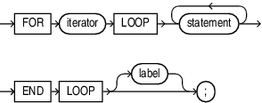

With each iteration of the `FOR` `LOOP` statement, its statements run, its index is either incremented or decremented, and control returns to the top of the loop.

The `FOR` `LOOP` statement ends when its index reaches a specified value, or when a statement inside the loop transfers control outside the loop or raises an exception. An index is also called an iterand. Statements outside the loop cannot reference the iterand. After the `FOR LOOP` statement runs, the iterand is undefined.

Topics

Syntax

for\_loop\_statement::=



> ```
> FOR iterator 
>     LOOP statement... 
> END LOOP [ label ] ;
> ```
>
> [  
> Copyright © 1996, 2024, Oracle and/or its affiliates.](https://docs.oracle.com/en/database/oracle/oracle-database/dcommon/html/cpyr.htm)


([Iterator](iterator.md), [statement::=](block.md))

Semantics

for\_loop\_statement

iterator

See [iterator](iterator.md)

statement

An `EXIT`, `EXIT` `WHEN`, `CONTINUE`, or `CONTINUE` `WHEN` in the `statements` can cause the loop or the current iteration of the loop to end early. See " [statement::=](block.md) " for the list of all possible statements.

label

A label that identifies `for_loop_statement` (see " [label](block.md) "). `CONTINUE`, `EXIT`, and `GOTO` statements can reference this label.

Labels improve readability, especially when `LOOP` statements are nested, but only if you ensure that the label in the `END` `LOOP` statement matches a label at the beginning of the same `LOOP` statement (the compiler does not check).

Examples

- [Example 5-19](plsql-control-statements.md), "Simple Step Filter Using FOR LOOP Stepped Range Iterator"
- [Example 5-15](plsql-control-statements.md), "FOR LOOP Statement Range Iteration Control"
- [Example 5-16](plsql-control-statements.md), "Reverse FOR LOOP Statement Range Iteration Control"
- [Example 5-27](plsql-control-statements.md), "Using FOR LOOP Stopping Predicate Clause"
- [Example 5-28](plsql-control-statements.md), "Using FOR LOOP Skipping Predicate Clause"
- [Example 5-10](plsql-control-statements.md), "Outside Statement References FOR LOOP Statement Index"
- [Example 5-11](plsql-control-statements.md), "FOR LOOP Statement Index with Same Name as Variable"
- [Example 5-12](plsql-control-statements.md), "FOR LOOP Statement References Variable with Same Name as Index"
- [Example 5-13](plsql-control-statements.md), "Nested FOR LOOP Statements with Same Index Name"

Example 14-28 EXIT WHEN Statement in FOR LOOP Statement

Suppose that you must exit a `FOR` `LOOP` statement immediately if a certain condition arises. You can put the condition in an `EXIT` `WHEN` statement inside the `FOR` `LOOP` statement.

In this example, the `FOR` `LOOP` statement executes 10 times unless the `FETCH` statement inside it fails to return a row, in which case it ends immediately.

```
DECLARE
  v_employees employees%ROWTYPE;
  CURSOR c1 is SELECT * FROM employees;
BEGIN
  OPEN c1;
  -- Fetch entire row into v_employees record:
  FOR i IN 1..10 LOOP
    FETCH c1 INTO v_employees;
    EXIT WHEN c1%NOTFOUND;
    -- Process data here
  END LOOP;
  CLOSE c1;
END;
/
```

Example 14-29 EXIT WHEN Statement in Inner FOR LOOP Statement

Now suppose that the `FOR` `LOOP` statement that you must exit early is nested inside another `FOR` `LOOP` statement. If, when you exit the inner loop early, you also want to exit the outer loop, then label the outer loop and specify its name in the `EXIT` `WHEN` statement.

```
DECLARE
  v_employees employees%ROWTYPE;
  CURSOR c1 is SELECT * FROM employees;
BEGIN
  OPEN c1;
  
  -- Fetch entire row into v_employees record:
  <<outer_loop>>
  FOR i IN 1..10 LOOP
    -- Process data here
    FOR j IN 1..10 LOOP
      FETCH c1 INTO v_employees;
      EXIT outer_loop WHEN c1%NOTFOUND;
      -- Process data here
    END LOOP;
  END LOOP outer_loop;
 
  CLOSE c1;
END;
/
```

Example 14-30 CONTINUE WHEN Statement in Inner FOR LOOP Statement

If you want to exit the inner loop early but complete the current iteration of the outer loop, then label the outer loop and specify its name in the `CONTINUE` `WHEN` statement.

```
DECLARE
  v_employees employees%ROWTYPE;
  CURSOR c1 is SELECT * FROM employees;
BEGIN
  OPEN c1;
  
  -- Fetch entire row into v_employees record:
  <<outer_loop>>
  FOR i IN 1..10 LOOP
    -- Process data here
    FOR j IN 1..10 LOOP
      FETCH c1 INTO v_employees;
      CONTINUE outer_loop WHEN c1%NOTFOUND;
      -- Process data here
    END LOOP;
  END LOOP outer_loop;
 
  CLOSE c1;
END;
/
```

Related Topics

- " [FOR LOOP Iterand](plsql-control-statements.md) "
- " [FOR LOOP Statement Overview](plsql-control-statements.md) " for more conceptual information
- " [Basic LOOP Statement](basic-LOOP-statement.md) "
- " [CONTINUE Statement](CONTINUE-statement.md) "
- " [Cursor FOR LOOP Statement](cursor-FOR-LOOP-statement.md) "
- " [EXIT Statement](EXIT-statement.md) "
- " [FETCH Statement](FETCH-statement.md) "
- " [FORALL Statement](FORALL-statement.md) "
- " [OPEN Statement](OPEN-statement.md) "
- " [WHILE LOOP Statement](WHILE-LOOP-statement.md) "
- " [Overview of Exception Handling](plsql-error-handling.md) " for information about exceptions, which can also cause a loop to end immediately if a certain condition arises