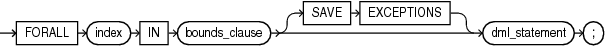
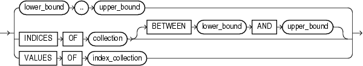

The `FORALL` statement runs one DML statement multiple times, with different values in the `VALUES` and `WHERE` clauses.

The different values come from existing, populated collections or host arrays. The `FORALL` statement is usually much faster than an equivalent `FOR` `LOOP` statement.

Note:

You can use the `FORALL` statement only in server programs, not in client programs.

Topics

Syntax

forall\_statement::=



> ```
> FORALL index IN bounds_clause [ SAVE EXCEPTIONS ] dml_statement;
> ```
>
> [  
> Copyright © 1996, 2024, Oracle and/or its affiliates.](https://docs.oracle.com/en/database/oracle/oracle-database/dcommon/html/cpyr.htm)


bounds\_clause::=



> ```
> { lower_bound .. upper_bound
> | INDICES OF collection [ BETWEEN lower_bound AND upper_bound ]
> | VALUES OF index_collection
> }
> ```
>
> [  
> Copyright © 1996, 2024, Oracle and/or its affiliates.](https://docs.oracle.com/en/database/oracle/oracle-database/dcommon/html/cpyr.htm)


Semantics

forall\_statement

index

Name for the implicitly declared integer variable that is local to the `FORALL` statement. Statements outside the `FORALL` statement cannot reference `index`. Statements inside the `FORALL` statement can reference `index` as an index variable, but cannot use it in expressions or change its value. After the `FORALL` statement runs, `index` is undefined.

dml\_statement

A static or dynamic `INSERT`, `UPDATE`, `DELETE`, or `MERGE` statement that references at least one collection in its `VALUES` or `WHERE` clause. Performance benefits apply only to collection references that use `index` as an index.

Every collection that `dml_statement` references must have indexes that match the values of `index`. If you apply the `DELETE`, `EXTEND`, or `TRIM` method to one collection, apply it to the other collections also, so that all collections have the same set of indexes. If any collection lacks a referenced element, PL/SQL raises an exception.

Restriction on dml\_statement

If `dml_statement` is a dynamic SQL statement, then values in the `USING` clause (bind variables for the dynamic SQL statement) must be simple references to the collection, not expressions. For example, `collection` `(``i``)` is valid, but `UPPER(``collection` `(``i``))` is invalid.

SAVE EXCEPTIONS

Lets the `FORALL` statement continue even if some of its DML statements fail. For more information, see " [Handling FORALL Exceptions After FORALL Statement Completes](plsql-optimization-and-tuning.md) ".

bounds\_clause

Specifies the collection element indexes that provide values for the variable `index`. For each value, the SQL engine runs `dml_statement` once.

lower\_bound.. upper\_bound

Both `lower_bound` and `upper_bound` are numeric expressions that PL/SQL evaluates once, when the `FORALL` statement is entered, and rounds to the nearest integer if necessary. The resulting integers must be the lower and upper bounds of a valid range of consecutive index numbers. If an element in the range is missing or was deleted, PL/SQL raises an exception.

INDICES OF collection \[ BETWEEN lower\_bound AND upper\_bound \]

Specifies that the values of `index` correspond to the indexes of the elements of `collection`. The indexes need not be consecutive.

Both `lower_bound` and `upper_bound` are numeric expressions that PL/SQL evaluates once, when the `FORALL` statement is entered, and rounds to the nearest integer if necessary. The resulting integers are the lower and upper bounds of a valid range of index numbers, which need not be consecutive.

Restriction on collection

If `collection` is an associative array, it must be indexed by `PLS_INTEGER`.

VALUES OF index\_collection

Specifies that the values of `index` are the elements of `index_collection`, a collection of `PLS_INTEGER` elements that is indexed by `PLS_INTEGER`. The indexes of `index_collection` need not be consecutive. If `index_collection` is empty, PL/SQL raises an exception and the `FORALL` statement does not run.

Examples

- [Example 13-8](plsql-optimization-and-tuning.md), "DELETE Statement in FORALL Statement"
- [Example 13-9](plsql-optimization-and-tuning.md), "Time Difference for INSERT Statement in FOR LOOP and FORALL Statements"
- [Example 13-10](plsql-optimization-and-tuning.md), "FORALL Statement for Subset of Collection"
- [Example 13-11](plsql-optimization-and-tuning.md), "FORALL Statements for Sparse Collection and Its Subsets"
- [Example 13-12](plsql-optimization-and-tuning.md), "Handling FORALL Exceptions Immediately"
- [Example 13-13](plsql-optimization-and-tuning.md), "Handling FORALL Exceptions After FORALL Statement Completes"
- [Example 13-26](plsql-optimization-and-tuning.md), "DELETE with RETURN BULK COLLECT INTO in FORALL Statement"
- [Example 13-28](plsql-optimization-and-tuning.md), "Anonymous Block Bulk-Binds Input Host Array"