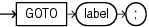

The `GOTO` statement transfers control to a labeled block or statement.

Restrictions on GOTO Statement

If a `GOTO` statement exits a cursor `FOR` `LOOP` statement prematurely, the cursor closes.

- A `GOTO` statement cannot transfer control into an `IF` statement, `CASE` statement, `LOOP` statement, or sub-block.
- A `GOTO` statement cannot transfer control from one `IF` statement clause to another, or from one `CASE` statement `WHEN` clause to another.
- A `GOTO` statement cannot transfer control out of a subprogram.
- A `GOTO` statement cannot transfer control into an exception handler.
- A `GOTO` statement cannot transfer control from an exception handler back into the current block (but it can transfer control from an exception handler into an enclosing block).

Topics

Syntax

goto\_statement::=



> ```
> GOTO label ;
> ```
>
> [  
> Copyright © 1996, 2024, Oracle and/or its affiliates.](https://docs.oracle.com/en/database/oracle/oracle-database/dcommon/html/cpyr.htm)


Semantics

goto\_statement

label

Identifies either a block or a statement (see " [plsql\_block::=](block.md) ", " [statement::=](block.md) ", and " [label](block.md) ").

If `label` is not in the current block, then the `GOTO` statement transfers control to the first enclosing block in which `label` appears.

Examples

Example 14-31 GOTO Statement

A label can appear before a statement.

```
DECLARE
  p  VARCHAR2(30);
  n  PLS_INTEGER := 37;
BEGIN
  FOR j in 2..ROUND(SQRT(n)) LOOP
    IF n MOD j = 0 THEN
      p := ' is not a prime number';
      GOTO print_now;
    END IF;
  END LOOP;

  p := ' is a prime number';
 
  <<print_now>>
  DBMS_OUTPUT.PUT_LINE(TO_CHAR(n) || p);
END;
/
```

Result:

```
37 is a prime number
```

Example 14-32 Incorrect Label Placement

A label can only appear before a block or before a statement.

```
DECLARE
  done  BOOLEAN;
BEGIN
  FOR i IN 1..50 LOOP
    IF done THEN
       GOTO end_loop;
    END IF;
    <<end_loop>>
  END LOOP;
END;
/
```

Result:

```
END LOOP;
  *
ERROR at line 9:
ORA-06550: line 9, column 3:
PLS-00103: Encountered the symbol "END" when expecting one of the following:
( begin case declare exit for goto if loop mod null raise
return select update while with <an identifier>
<a double-quoted delimited-identifier> <a bind variable> <<
continue close current delete fetch lock insert open rollback
savepoint set sql run commit forall merge pipe purge
```

Example 14-33 GOTO Statement Goes to Labeled NULL Statement

A label can appear before a `NULL` statement.

```
DECLARE
  done  BOOLEAN;
BEGIN
  FOR i IN 1..50 LOOP
    IF done THEN
      GOTO end_loop;
    END IF;
    <<end_loop>>
    NULL;
  END LOOP;
END;
/
```

Example 14-34 GOTO Statement Transfers Control to Enclosing Block

A `GOTO` statement can transfer control to an enclosing block from the current block.

```
DECLARE
  v_last_name  VARCHAR2(25);
  v_emp_id     NUMBER(6) := 120;
BEGIN
  <<get_name>>
  SELECT last_name INTO v_last_name
  FROM employees
  WHERE employee_id = v_emp_id;
  
  BEGIN
    DBMS_OUTPUT.PUT_LINE (v_last_name);
    v_emp_id := v_emp_id + 5;
 
    IF v_emp_id < 120 THEN
      GOTO get_name;
    END IF;
  END;
END;
/
```

Result:

```
Weiss
```

Example 14-35 GOTO Statement Cannot Transfer Control into IF Statement

The `GOTO` statement transfers control into an `IF` statement, causing an error.

```
DECLARE
  valid BOOLEAN := TRUE;
BEGIN
  GOTO update_row;
  
  IF valid THEN
  <<update_row>>
    NULL;
  END IF;
END;
/
```

Result:

```
GOTO update_row;
  *
ERROR at line 4:
ORA-06550: line 4, column 3:
PLS-00375: illegal GOTO statement; this GOTO cannot transfer control to label
'UPDATE_ROW'
ORA-06550: line 6, column 12:
PL/SQL: Statement ignored
```