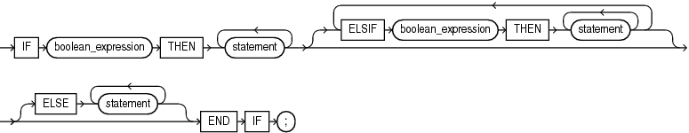

The `IF` statement either runs or skips a sequence of one or more statements, depending on the value of a `BOOLEAN` expression.

Topics

Syntax

if\_statement::=



> ```
> IF boolean_expression THEN statement [ statement ]...
>  [ ELSIF boolean_expression THEN statement [ statement ]... ]...
>    [ ELSE statement [ statement ]... ] END IF ;
> ```
>
> [  
> Copyright © 1996, 2024, Oracle and/or its affiliates.](https://docs.oracle.com/en/database/oracle/oracle-database/dcommon/html/cpyr.htm)


( [boolean\_expression::=](expression.md), [statement::=](block.md) )

Semantics

boolean\_expression

Expression whose value is `TRUE`, `FALSE`, or `NULL`.

The first `boolean_expression` is always evaluated. Each other `boolean_expression` is evaluated only if the values of the preceding expressions are `FALSE`.

If a `boolean_expression` is evaluated and its value is `TRUE`, the statements after the corresponding `THEN` run. The succeeding expressions are not evaluated, and the statements associated with them do not run.

ELSE

If no `boolean_expression` has the value `TRUE`, the statements after `ELSE` run.