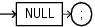

The `NULL` statement is a ''no-op" (no operation)—it only passes control to the next statement.

Note:

The `NULL` statement and the `BOOLEAN` value `NULL` are not related.

Topics

Syntax

null\_statement::=



> ```
> NULL ;
> ```
>
> [  
> Copyright © 1996, 2024, Oracle and/or its affiliates.](https://docs.oracle.com/en/database/oracle/oracle-database/dcommon/html/cpyr.htm)


Examples

- [Example 5-29](plsql-control-statements.md), "NULL Statement Showing No Action"
- [Example 5-30](plsql-control-statements.md), "NULL Statement as Placeholder During Subprogram Creation"