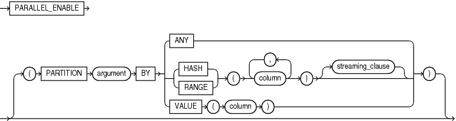
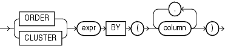

Enables the function for parallel execution, making it safe for use in concurrent sessions of parallel DML evaluations.

Indicates that the function can run from a parallel execution server of a parallel query operation.

The `PARALLEL_ENABLE` clause can appear in the following SQL statements:

Syntax

parallel\_enable\_clause::=



> ```
> PARALLEL_ENABLE
> [ (PARTITION argument BY
>     { ANY
>     | { HASH | RANGE } (column [, column ]...) [ streaming_clause ]
>     | VALUE (column)
>     }
>   )
> ```
>
> [  
> Copyright © 1996, 2024, Oracle and/or its affiliates.](https://docs.oracle.com/en/database/oracle/oracle-database/dcommon/html/cpyr.htm)


streaming\_clause::=



> ```
> { ORDER | CLUSTER } expr BY (column [, column ]...)
> ```
>
> [  
> Copyright © 1996, 2024, Oracle and/or its affiliates.](https://docs.oracle.com/en/database/oracle/oracle-database/dcommon/html/cpyr.htm)


Semantics

parallel\_enable\_clause

The parallel\_enable\_clause can appear only once in the function.

The function must not use session state, such as package variables, because those variables are not necessarily shared among the parallel execution servers.

Use the optional `PARTITION` `argument` `BY` clause only with a function that has a `REF` `CURSOR` data type. This clause lets you define the partitioning of the inputs to the function from the `REF` `CURSOR` argument. Partitioning the inputs to the function affects the way the query is parallelized when the function is used as a table function in the `FROM` clause of the query.

ANY

Indicates that the data can be partitioned randomly among the parallel execution servers

Note:

You can partition weak cursor variable arguments to table functions only with `ANY`, not with `RANGE`, `HASH`, or `VALUE`.

RANGE or HASH

Partitions data into specified columns that are returned by the `REF` `CURSOR` argument of the function.

streaming\_clause

The optional `streaming_clause` lets you order or cluster the parallel processing.

ORDER BY | CLUSTER BY

`ORDER` `BY` or `CLUSTER` `BY` indicates that the rows on a parallel execution server must be locally ordered and have the same key values as specified by the `column` list.

VALUE

Specifies direct-key partitioning, which is intended for table functions used when executing MapReduce workloads. The `column` must be of data type `NUMBER`. `VALUE` distributes row processing uniformly over the available reducers.

If the column has more reducer numbers than there are available reducers, then PL/SQL uses a modulus operation to map the reducer numbers in the column into the correct range.

When calculating the number of the reducer to process the corresponding row, PL/SQL treats a negative value as zero and rounds a positive fractional value to the nearest integer.

See Also:

[Oracle Database Data Cartridge Developer's Guide](https://docs.oracle.com/pls/topic/lookup?ctx=en/database/oracle/oracle-database/21/lnpls&id=ADDCI2140) for information about using parallel table functions

expr

expr identifies the `REF` `CURSOR` parameter name of the table function on which partitioning was specified, and on whose columns you are specifying ordering or clustering for each concurrent session in a parallel query execution.

Restriction on parallel\_enable\_clause

You cannot specify the parallel\_enable\_clause for a nested function or SQL macro.