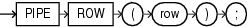

The `PIPE` `ROW` statement, which can appear only in the body of a pipelined table function, returns a table row (but not control) to the invoker of the function.

Note:

- If a pipelined table function is part of an autonomous transaction, then it must `COMMIT` or `ROLLBACK` before each `PIPE` `ROW` statement, to avoid an error in the invoking subprogram.
- To improve performance, the PL/SQL runtime system delivers the piped rows to the invoker in batches.

Topics

Syntax

pipe\_row\_statement::=



> ```
> PIPE ROW ( row ) ;
> ```
>
> [  
> Copyright © 1996, 2024, Oracle and/or its affiliates.](https://docs.oracle.com/en/database/oracle/oracle-database/dcommon/html/cpyr.htm)


Semantics

pipe\_row\_statement

row

Row (table element) that the function returns to its invoker, represented by an expression whose type is that of the table element.

If the expression is a record variable, it must be explicitly declared with the data type of the table element. It cannot be declared with a data type that is only structurally identical to the element type. For example, if the element type has a name, then the record variable cannot be declared explicitly with `%TYPE` or `%ROWTYPE` or implicitly with `%ROWTYPE` in a cursor `FOR` `LOOP` statement.

Examples

- [Example 13-29](plsql-optimization-and-tuning.md), "Creating and Invoking Pipelined Table Function"
- [Example 13-30](plsql-optimization-and-tuning.md), "Pipelined Table Function Transforms Each Row to Two Rows"
- [Example 13-32](plsql-optimization-and-tuning.md), "Pipelined Table Function with Two Cursor Variable Parameters"
- [Example 13-33](plsql-optimization-and-tuning.md), "Pipelined Table Function as Aggregate Function"
- [Example 13-34](plsql-optimization-and-tuning.md), "Pipelined Table Function Does Not Handle NO\_DATA\_NEEDED"
- [Example 13-35](plsql-optimization-and-tuning.md), "Pipelined Table Function Handles NO\_DATA\_NEEDED"