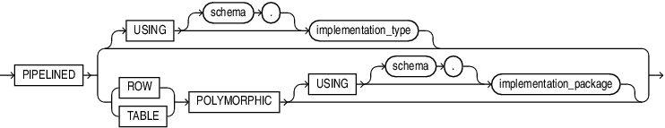

Instructs the database to iteratively return the results of a table function or polymorphic table function.

Use only with a table function, to specify that it is pipelined. A pipelined table function returns a row to its invoker immediately after processing that row and continues to process rows. To return a row (but not control) to the invoker, the function uses the " [PIPE ROW Statement](PIPE-ROW-statement.md) ".

A table function returns a collection type.

A polymorphic table function is a table function whose return type is determined by the arguments.

You query both kinds of table functions by using the `TABLE` keyword before the function name in the `FROM` clause of the query. For example:

```
SELECT * FROM TABLE(function_name(...))
```

The `TABLE` operator is optional when the table function arguments list or empty list () appears. For example:

```
SELECT * FROM function_name()
```

the database then returns rows as they are produced by the function.

The PIPELINED option can appear in the following SQL statements:

- [CREATE FUNCTION Statement](CREATE-FUNCTION-statement.md)
- [CREATE PACKAGE Statement](CREATE-PACKAGE-statement.md)
- [CREATE PACKAGE BODY Statement](CREATE-PACKAGE-BODY-statement.md)

Syntax

pipelined\_clause::=



> ```
> PIPELINED
> { [ USING [schema.] implementation_type ]
> | { ROW | TABLE } POLYMORPHIC [ USING [schema.] implementation_package ]
> }
> ```
>
> [  
> Copyright © 1996, 2024, Oracle and/or its affiliates.](https://docs.oracle.com/en/database/oracle/oracle-database/dcommon/html/cpyr.htm)


Semantics

pipelined\_clause

The pipelined\_clause can appear only once in the function.

PIPELINED

To make a pipelined function, include the pipelined\_clause in the function definition. If you declare the pipelined function before defining it, you must specify the `PIPELINED` option in the function declaration.

{ IS | USING }

- If you specify the keyword `PIPELINED` alone (`PIPELINED` `IS`...), then the PL/SQL function body must use the `PIPE` keyword. This keyword instructs the database to return single elements of the collection out of the function, instead of returning the whole collection as a single value.
- You can specify the `PIPELINED` `USING` `implementation_type` clause to predefine an interface containing the start, fetch, and close operations. The implementation type must implement the `ODCITable` interface and must exist at the time the table function is created. This clause is useful for table functions implemented in external languages such as C++ and Java.
	If the return type of the function is `ANYDATASET`, then you must also define a describe method (`ODCITableDescribe`) as part of the implementation type of the function.

\[schema.\] implementation\_type

The implementation type must be an ADT containing the implementation of the `ODCIAggregate` subprograms. If you do not specify `schema`, then the database assumes that the implementation type is in your schema.

Restriction on PIPELINED

You cannot specify `PIPELINED` for a nested function or a SQL macro.

Note:

You cannot run a pipelined table function over a database link. The reason is that the return type of a pipelined table function is a SQL user-defined type, which can be used only in a single database (as explained in [Oracle Database Object-Relational Developer's Guide](https://docs.oracle.com/pls/topic/lookup?ctx=en/database/oracle/oracle-database/21/lnpls&id=ADOBJ7083)). Although the return type of a pipelined table function might appear to be a PL/SQL type, the database actually converts that PL/SQL type to a corresponding SQL user-defined type.

PIPELINED \[ ROW | TABLE \] POLYMORPHIC \[ USING \[schema.\] implementation\_package \]

The polymorphic table function elaborator can appear in standalone function declaration or package function declaration.

PIPELINED

Required when defining a polymorphic table function.

ROW

Specify `ROW` when a single input argument of type `TABLE` determines new columns using any single row.

TABLE

Specify `TABLE` when a single input argument of type `TABLE` determines the new columns using the current row and operates on an entire table or a logical partition of a table.

POLYMORPHIC

Restrictions on `POLYMORPHIC`

The following are not allowed for `POLYMORPHIC` table functions:
- PARALLEL\_ENABLE clause
- RESULT\_CACHE clause
- DETERMINISTIC option
- AUTHID property (Invoker’s Rights and Definer’s Rights Clause)

\[USING \[schema.\] implementation\_package\]

References the polymorphic table function (PTF) implementation package. The specification must include `DESCRIBE` method. The specification of `OPEN`, `FETCH_ROWS` and `CLOSE` methods is optional. The specification for the implementation package must already exist (unless the PTF and its implementation reside in the same package).

If a polymorphic table function and its implementation methods are defined in the same package, then the `USING` clause is optional.

Examples

- [Examples](PIPE-ROW-statement.md) for PIPE ROW statement examples
- [Skip\_col Polymorphic Table Function Example](plsql-optimization-and-tuning.md)
- [To\_doc Polymorphic Table Function Example](plsql-optimization-and-tuning.md)
- [Implicit\_echo Polymorphic Table Function Example](plsql-optimization-and-tuning.md)
- [Oracle Database PL/SQL Packages and Types Reference](https://docs.oracle.com/pls/topic/lookup?ctx=en/database/oracle/oracle-database/21/lnpls&id=ARPLS-GUID-2D97C0CD-6AD9-4F86-86E6-C806D688C57A) for more examples using the DBMS\_TF package utilities