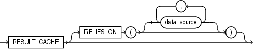

Indicates to store the function results into the server result cache.

The `RESULT_CACHE` clause can appear in the following SQL statements:

Syntax

result\_cache\_clause::=



> ```
> RESULT_CACHE [ RELIES_ON ( [ data_source [, data_source]... ] ) ]
> ```
>
> [  
> Copyright © 1996, 2024, Oracle and/or its affiliates.](https://docs.oracle.com/en/database/oracle/oracle-database/dcommon/html/cpyr.htm)


Semantics

result\_cache\_clause

result\_cache\_clause can appear only once in the function.

RESULT\_CACHE

To make a function result-cached, include the RESULT\_CACHE clause in the function definition. If you declare the function before defining it, you must also include the RESULT\_CACHE option in the function declaration.

Restriction on RESULT\_CACHE

- `RESULT_CACHE` is disallowed on functions with `OUT` or `IN` `OUT` parameters.
- `RESULT_CACHE` is disallowed on functions with `IN` or `RETURN` parameter of (or containing) these types:
	- `BLOB`
		- `CLOB`
		- `NCLOB`
		- `REF` `CURSOR`
		- Collection
		- Object
		- Record or PL/SQL collection that contains an unsupported return type
- `RESULT_CACHE` is disallowed on function in an anonymous block.
- `RESULT_CACHE` is disallowed on pipelined table function, nested function and SQL macro.

RELIES\_ON

Specifies the data sources on which the results of the function depend. Each `data_source` is the name of either a database table or view.

Note:

- This clause is deprecated. As of Oracle Database 12c, the database detects all data sources that are queried while a result-cached function is running, and `RELIES_ON` clause does nothing.
- You cannot use `RELIES_ON` clause in a function declared in an anonymous block.

Examples

- [Examples of Result-Cached Functions](plsql-subprograms.md)