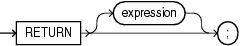

The `RETURN` statement immediately ends the execution of the subprogram or anonymous block that contains it.

In a function, the `RETURN` statement assigns a specified value to the function identifier and returns control to the invoker, where execution resumes immediately after the invocation (possibly inside the invoking statement). Every execution path in a function must lead to a `RETURN` statement (otherwise, the PL/SQL compiler issues compile-time warning PLW-05005).

In a procedure, the `RETURN` statement returns control to the invoker, where execution resumes immediately after the invocation.

In an anonymous block, the `RETURN` statement exits its own block and all enclosing blocks.

A subprogram or anonymous block can contain multiple `RETURN` statements.

Note:

The `RETURN` statement differs from the `RETURN` clause in a function heading, which specifies the data type of the return value.

Topics

Syntax

return\_statement::=



> ```
> RETURN [ expression ] ;
> ```
>
> [  
> Copyright © 1996, 2024, Oracle and/or its affiliates.](https://docs.oracle.com/en/database/oracle/oracle-database/dcommon/html/cpyr.htm)


( [expression::=](expression.md) )

Semantics

expression

Optional when the `RETURN` statement is in a pipelined table function. Required when the `RETURN` statement is in any other function. Not allowed when the `RETURN` statement is in a procedure or anonymous block.

The `RETURN` statement assigns the value of `expression` to the function identifier. Therefore, the data type of `expression` must be compatible with the data type in the `RETURN` clause of the function. For information about expressions, see " [Expression](expression.md) ".

Examples

- [Example 9-3](plsql-subprograms.md), "Execution Resumes After RETURN Statement in Function"
- [Example 9-4](plsql-subprograms.md), "Function Where Not Every Execution Path Leads to RETURN Statement"
- [Example 9-5](plsql-subprograms.md), "Function Where Every Execution Path Leads to RETURN Statement"
- [Example 9-6](plsql-subprograms.md), "Execution Resumes After RETURN Statement in Procedure"
- [Example 9-7](plsql-subprograms.md), "Execution Resumes After RETURN Statement in Anonymous Block"