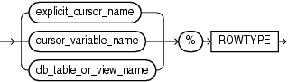

The `%ROWTYPE` attribute lets you declare a record that represents either a full or partial row of a database table or view.

For every visible column of the full or partial row, the record has a field with the same name and data type. If the structure of the row changes, then the structure of the record changes accordingly. Making an invisible column visible changes the structure of some records declared with the `%ROWTYPE` attribute.

The record fields do not inherit the constraints or initial values of the corresponding columns.

The `%ROWTYPE` attribute cannot be used if the referenced character column has a collation other than `USING_NLS_COMP`.

Topics

Syntax

rowtype\_attribute::=



> ```
> { explicit_cursor | cursor_variable | db_table_or_view } %ROWTYPE
> ```
>
> [  
> Copyright © 1996, 2024, Oracle and/or its affiliates.](https://docs.oracle.com/en/database/oracle/oracle-database/dcommon/html/cpyr.htm)


Semantics

rowtype\_attribute

explicit\_cursor\_name

Name of an explicit cursor. For every column selected by the query associated with `explicit_cursor_name`, the record has a field with the same name and data type.

cursor\_variable\_name

Name of a strong cursor variable. For every column selected by the query associated with `cursor_variable_name`, the record has a field with the same name and data type.

db\_table\_or\_view\_name

Name of a database table or view that is accessible when the declaration is elaborated. For every column of `db_table_or_view_name`, the record has a field with the same name and data type.

Examples

- [Example 6-45](plsql-collections-and-records.md), "%ROWTYPE Variable Represents Full Database Table Row"
- [Example 6-46](plsql-collections-and-records.md), "%ROWTYPE Variable Does Not Inherit Initial Values or Constraints"
- [Example 6-47](plsql-collections-and-records.md), "%ROWTYPE Variable Represents Partial Database Table Row"
- [Example 6-48](plsql-collections-and-records.md), "%ROWTYPE Variable Represents Join Row"
- [Example 6-51](plsql-collections-and-records.md), "%ROWTYPE Affected by Making Invisible Column Visible"
- [Example 6-54](plsql-collections-and-records.md), "Assigning %ROWTYPE Record to RECORD Type Record"

Related Topics

In this chapter:

- " [Cursor Variable Declaration](cursor-variable-declaration.md) "
- " [Explicit Cursor Declaration and Definition](explicit-cursor-declaration-and-definition.md) "
- " [Record Variable Declaration](record-variable-declaration.md) "
- " [%TYPE Attribute](TYPE-attribute.md) "

In other chapters:

- [About Data-Bound Collation](plsql-language-fundamentals.md)
- " [Declaring Items using the %ROWTYPE Attribute](plsql-collections-and-records.md) "
- " [%ROWTYPE Attribute and Invisible Columns](plsql-collections-and-records.md) "