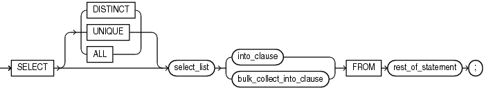

The `SELECT` `INTO` statement retrieves values from one or more database tables (as the SQL `SELECT` statement does) and stores them in variables (which the SQL `SELECT` statement does not do).

Caution:

The `SELECT` `INTO` statement with the `BULK` `COLLECT` clause is vulnerable to aliasing, which can cause unexpected results. For details, see " [SELECT BULK COLLECT INTO Statements and Aliasing](plsql-optimization-and-tuning.md) ".

See Also:

[Oracle Database SQL Language Reference](https://docs.oracle.com/pls/topic/lookup?ctx=en/database/oracle/oracle-database/21/lnpls&id=SQLRF01702) for the syntax of the SQL `SELECT` statement

Topics

Syntax

select\_into\_statement::=



> ```
> SELECT [ { DISTINCT | UNIQUE } | ALL ] select_list
>     { into_clause | bulk_collect_into_clause } FROM rest-of-statement ;
> ```
>
> [  
> Copyright © 1996, 2024, Oracle and/or its affiliates.](https://docs.oracle.com/en/database/oracle/oracle-database/dcommon/html/cpyr.htm)


( [bulk\_collect\_into\_clause::=](RETURNING-INTO-clause.md), [into\_clause::=](RETURNING-INTO-clause.md), [Oracle Database SQL Language Reference](https://docs.oracle.com/pls/topic/lookup?ctx=en/database/oracle/oracle-database/21/lnpls&id=SQLRF-GUID-CFA006CA-6FF1-4972-821E-6996142A51C6#GUID-CFA006CA-6FF1-4972-821E-6996142A51C6/I2126854) for select\_list syntax)

Semantics

select\_into\_statement

DISTINCT | UNIQUE

Specify `DISTINCT` or `UNIQUE` if you want the database to return only one copy of each set of duplicate rows selected. These two keywords are synonymous. Duplicate rows are those with matching values for each expression in the select list.

Restrictions on DISTINCT and UNIQUE Queries

- The total number of bytes in all select list expressions is limited to the size of a data block minus some overhead. This size is specified by the initialization parameter `DB_BLOCK_SIZE`.
- You cannot specify `DISTINCT` if the select\_list contains LOB columns.

ALL

(Default) Causes the database to return all rows selected, including all copies of duplicates.

select\_list

If the `SELECT` `INTO` statement returns no rows, PL/SQL raises the predefined exception `NO_DATA_FOUND`. To guard against this exception, select the result of the aggregate function `COUNT(*)`, which returns a single value even if no rows match the condition.

into\_clause

With this clause, the `SELECT` `INTO` statement retrieves one or more columns from a single row and stores them in either one or more scalar variables or one record variable. For more information, see " [into\_clause::=](RETURNING-INTO-clause.md) ".

bulk\_collect\_into\_clause

With this clause, the `SELECT` `INTO` statement retrieves an entire result set and stores it in one or more collection variables. For more information, see " [bulk\_collect\_into\_clause::=](RETURNING-INTO-clause.md) ".

rest\_of\_statement

Anything that can follow the keyword `FROM` in a SQL `SELECT` statement, described in [Oracle Database SQL Language Reference](https://docs.oracle.com/pls/topic/lookup?ctx=en/database/oracle/oracle-database/21/lnpls&id=SQLRF01702).

Examples

- [Example 3-25](plsql-language-fundamentals.md), "Assigning Value to Variable with SELECT INTO Statement"
- [Example 6-56](plsql-collections-and-records.md), "SELECT INTO Assigns Values to Record Variable"
- [Example 7-37](static-sql.md), "ROLLBACK Statement"
- [Example 7-38](static-sql.md), "SAVEPOINT and ROLLBACK Statements"
- [Example 7-43](static-sql.md), "Declaring Autonomous Function in Package"
- [Example 8-20](dynamic-sql.md), "Validation Checks Guarding Against SQL Injection"
- [Example 13-16](plsql-optimization-and-tuning.md), "Bulk-Selecting Two Database Columns into Two Nested Tables"
- [Example 13-17](plsql-optimization-and-tuning.md), "Bulk-Selecting into Nested Table of Records"
- [Example 13-21](plsql-optimization-and-tuning.md), "Limiting Bulk Selection with ROWNUM, SAMPLE, and FETCH FIRST"

Related Topics

In this chapter:

- " [Assignment Statement](assignment-statement.md) "
- " [FETCH Statement](FETCH-statement.md) "
- " [%ROWTYPE Attribute](ROWTYPE-attribute.md) "

In other chapters:

- " [Assigning Values to Variables with the SELECT INTO Statement](plsql-language-fundamentals.md) "
- " [Using SELECT INTO to Assign a Row to a Record Variable](plsql-collections-and-records.md) "
- " [Processing Query Result Sets With SELECT INTO Statements](static-sql.md) "
- " [SELECT INTO Statement with BULK COLLECT Clause](plsql-optimization-and-tuning.md) "

See Also:

[Oracle Database SQL Language Reference](https://docs.oracle.com/pls/topic/lookup?ctx=en/database/oracle/oracle-database/21/lnpls&id=SQLRF01702) for information about the SQL `SELECT` statement