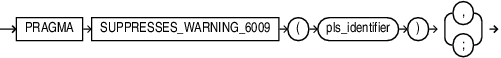

The `SUPPRESSES_WARNING_6009` pragma marks a subroutine to indicate that the `PLW-06009` warning is suppressed at its call site in an `OTHERS` exception handler. The marked subroutine has the same effect as a `RAISE` statement and suppresses the `PLW-06009` compiler warning.

The `OTHERS` exception handler does not issue the compiler warning `PLW-06009` if an exception is raised explicitly using either a `RAISE` statement or the `RAISE_APPLICATION_ERROR` procedure as the last statement. Similarly, a call to a subroutine marked with the `SUPPRESSES_WARNING_6009` pragma, from the `OTHERS` exception handler, does not issue the `PLW-06009` warning.

The `SUPPRESSES_WARNING_6009` pragma can appear in the following SQL statements:
- [CREATE FUNCTION Statement](CREATE-FUNCTION-statement.md)
- [CREATE PACKAGE Statement](CREATE-PACKAGE-statement.md)
- [CREATE PACKAGE BODY Statement](CREATE-PACKAGE-BODY-statement.md)
- [CREATE PROCEDURE Statement](CREATE-PROCEDURE-statement.md)
- [CREATE TYPE Statement](CREATE-TYPE-statement.md)
- [CREATE TYPE BODY Statement](CREATE-TYPE-BODY-statement.md)

Syntax

suppresses\_warning\_6009\_pragma::=



> PRAGMA SUPPRESS\_WARNING\_6009 Syntax Diagram Description
>
> PRAGMA SUPPRESS\_WARNING\_6009 ( pls\_identifier ) {, |; }
>
> [  
> Copyright © 1996, 2024, Oracle and/or its affiliates.](https://docs.oracle.com/en/database/oracle/oracle-database/dcommon/html/cpyr.htm)


Semantics

suppresses\_warning\_6009\_pragma

The `SUPPRESSES_WARNING_6009` pragma applies to standalone subprograms, packaged subprograms and to the methods in an Abstract Data Type definition.

For a standalone subprogram, the `SUPPRESSES_WARNING_6009` pragma may appear as the first item in the declaration block of a subprogram definition, immediately after the keyword `IS` or `AS`.

In a package specification, a package body and a type specification, the `SUPPRESSES_WARNING_6009` pragma must appear immediately after the subprogram declaration.

If the subprogram has separate declaration and definition, the `SUPPRESSES_WARNING_6009` pragma may be applied either to the subprogram declaration, or to the subprogram definition, or to both.

For overloaded subprograms, `SUPPRESSES_WARNING_6009` pragma only applies to the marked overload.

When the `SUPPRESSES_WARNING_6009` pragma is applied to a subprogram in a package specification, the subprogram is marked for use both in the package body and in the invokers of the package.

When the `SUPPRESSES_WARNING_6009` pragma is applied to a subprogram in the definition of a package body, the subprogram is marked for use only in the package body even if the subprogram is declared in the package specification.

The `SUPPRESSES_WARNING_6009` pragma applied to a subprogram in a base type object, is inherited in a derived type object unless there is an override without the pragma in the derived type object.

The `SUPPRESSES_WARNING_6009` pragma may be terminated with a `","` when applied to a subprogram in a type specification. In all other contexts, the pragma is terminated by `";"`.

The `SUPPRESSES_WARNING_6009` pragma on the subprogram provides a hint to the compiler to suppress the warning `PLW-06009` at its call site.

pls\_identifier

Identifier of the PL/SQL element to which the pragma is applied.

The identifier is a parameter to the `SUPPRESSES_WARNING_6009` pragma that must name the subprogram to which it is applied.

If the identifier in the `SUPPRESSES_WARNING_6009` does not identify a subroutine in the declaration section, the pragma has no effect.

Examples

Example 14-41 Enabling the `PLW-6009` Warning

This example shows how to set the `PLSQL_WARNINGS` parameter to enable the `PLW-6009` warning in a session for demonstration purpose.
```
ALTER SESSION SET PLSQL_WARNINGS='ENABLE:(6009)';
```

Example 14-42 SUPPRESSES\_WARNING\_6009 Pragma in a Procedure

This example shows a standalone procedure p1 marked with the `SUPPRESSES_WARNING_6009` pragma. The p1 procedure is invoked from an `OTHERS` exception handler in procedure p2, which does not raise an exception explicitly.
```
CREATE PROCEDURE p1
AUTHID DEFINER
IS
    PRAGMA SUPPRESSES_WARNING_6009(p1);
BEGIN
    RAISE_APPLICATION_ERROR(-20000, 'Unexpected error raised');
END;
/
```
The `PLW-06009` warning is not issued when compiling procedure p2.
```
CREATE PROCEDURE p2
AUTHID DEFINER
IS
BEGIN
  DBMS_OUTPUT.PUT_LINE('In procedure p2');
EXCEPTION
  WHEN OTHERS THEN
    p1;                
END p2;
/
```

Example 14-43 SUPPRESSES\_WARNING\_6009 Pragma in a Function

This example shows a standalone function f1 marked with the `SUPPRESSES_WARNING_6009` pragma. This function is invoked from an `OTHERS` exception handler in function f2, which does not explicitly have a `RAISE` statement.
```
CREATE FUNCTION f1(id NUMBER) RETURN NUMBER
AUTHID DEFINER
IS
  PRAGMA SUPPRESSES_WARNING_6009(f1);
  x NUMBER;
BEGIN
  x := id + 1;
RETURN x;
END;
/
```
The `PLW-06009` warning is not issued when compiling function f2.
```
CREATE FUNCTION f2(numval NUMBER) RETURN NUMBER
AUTHID DEFINER
IS
  i NUMBER;
BEGIN
  i := numval + 1;
  RETURN i;
EXCEPTION
  WHEN OTHERS THEN
    RETURN f1(i);
END;
/
```

Example 14-44 SUPPRESSES\_WARNING\_6009 Pragma in an Overloaded Subprogram in a Package Specification

This example shows an overloaded procedure p1, declared in a package specification. Only the second overload of p1 is marked with the `SUPPRESSES_WARNING_6009` pragma. This marked overload is invoked from the `OTHERS` exception handler in procedure p6, which does not have an explicit `RAISE` statement.
```
CREATE PACKAGE pk1 IS
   PROCEDURE p1(x NUMBER);
   PROCEDURE p1;
   PRAGMA SUPPRESSES_WARNING_6009(p1);
END;
/
```
```
CREATE OR REPLACE PACKAGE BODY pk1 IS
   PROCEDURE p1(x NUMBER) IS
   BEGIN
      DBMS_OUTPUT.PUT_LINE('In the first overload');
   END;

   PROCEDURE p1 IS
   BEGIN
      DBMS_OUTPUT.PUT_LINE('In the second overload');
      RAISE_APPLICATION_ERROR(-20000, 'Unexpected error');
   END;
END;
/
```

The procedure p6 invokes the p1 second overloaded procedure. The compiler does not issue a `PLW-06009` warning when compiling procedure p6.
```
CREATE OR REPLACE PROCEDURE p6 AUTHID DEFINER IS
j NUMBER := 5;
BEGIN
   j := j + 2;
EXCEPTION
   WHEN OTHERS THEN
       pk1.p1;
END;
/
```

Example 14-45 SUPPRESSES\_WARNING\_6009 Pragma in a Forward Declaration in a Package Body

This example shows a forward declaration subprogram marked with the `SUPPRESSES_WARNING_6009` pragma in a package body. This marked procedure pn is invoked from the `OTHERS` exception handler in procedure p5, which has no `RAISE` statement.
```
CREATE OR REPLACE PACKAGE pk2 IS
   PROCEDURE p5;
END;
/
```
The compiler does not issue a `PLW-06009` warning when creating the package body.
```
CREATE OR REPLACE PACKAGE BODY pk2 IS
   PROCEDURE pn; /* Forward declaration */
   PRAGMA SUPPRESSES_WARNING_6009(pn);

   PROCEDURE p5 IS
   BEGIN
      DBMS_OUTPUT.PUT_LINE('Computing');
   EXCEPTION 
      WHEN OTHERS THEN
         pn;
   END;

   PROCEDURE pn IS
   BEGIN
      RAISE_APPLICATION_ERROR(-20000, 'Unexpected error');
   END;
END;
/
```

Example 14-46 SUPPRESSES\_WARNING\_6009 Pragma in Object Type Methods

This example shows the `SUPPRESSES_WARNING_6009` pragma applied to a member method declared in the newid Abstract Data Type (ADT) definition. The marked procedure log\_error is invoked from the `OTHERS` exception handler in the type body, which does not have a `RAISE` statement.
```
CREATE OR REPLACE TYPE newid AUTHID DEFINER
AS OBJECT(
  ID1 NUMBER,
  MEMBER PROCEDURE incr,
  MEMBER PROCEDURE log_error,
  PRAGMA SUPPRESSES_WARNING_6009(log_error)
);
/
```
The compiler does not issue the `PLW-06009` warning when compiling the type body.
```
CREATE OR REPLACE TYPE BODY newid
AS
  MEMBER PROCEDURE incr
  IS
  BEGIN
     DBMS_OUTPUT.PUT_LINE('Computing value');
  EXCEPTION
     WHEN OTHERS THEN
        log_error;
  END;

  MEMBER PROCEDURE log_error
  IS
  BEGIN
    RAISE_APPLICATION_ERROR(-20000, 'Unexpected error');
  END;
END;
/
```