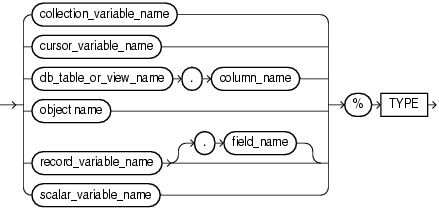

The `%TYPE` attribute lets you declare a constant, variable, collection element, record field, or subprogram parameter to be of the same data type as a previously declared variable or column (without knowing what that type is).

The `%TYPE` attribute cannot be used if the referenced character column has a collation other than `USING_NLS_COMP`.

The item declared with `%TYPE` is the referencing item, and the previously declared item is the referenced item.

The referencing item inherits the following from the referenced item:

- Data type and size
- Constraints (unless the referenced item is a column)

The referencing item does not inherit the initial value of the referenced item.

If the declaration of the referenced item changes, then the declaration of the referencing item changes accordingly.

Topics

Syntax

type\_attribute::=



> ```
> { collection_variable
> | cursor_variable
> | db_table_or_view.column
> | object
> | record_variable[.field ]
> | scalar_variable
> }
>   %TYPE
> ```
>
> [  
> Copyright © 1996, 2024, Oracle and/or its affiliates.](https://docs.oracle.com/en/database/oracle/oracle-database/dcommon/html/cpyr.htm)


Semantics

type\_attribute

collection\_variable\_name

Name of a collection variable.

Restriction on collection\_variable\_name

In a constant declaration, `collection_variable` cannot be an associative array variable.

cursor\_variable\_name

Name of a cursor variable.

db\_table\_or\_view\_name

Name of a database table or view that is accessible when the declaration is elaborated.

column\_name

Name of a column of `db_table_or_view`.

object\_name

Name of an instance of an ADT.

record\_variable\_name

Name of a record variable.

field\_name

Name of a field of `record_variable`.

scalar\_variable\_name

Name of a scalar variable.

Examples

- [Example 3-15](plsql-language-fundamentals.md), "Declaring Variable of Same Type as Column"
- [Example 3-16](plsql-language-fundamentals.md), "Declaring Variable of Same Type as Another Variable"