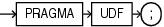

The `UDF` pragma tells the compiler that the PL/SQL unit is a user defined function that is used primarily in SQL statements, which might improve its performance.

Syntax

udf\_pragma::=



> ```
> PRAGMA UDF ;
> ```
>
> [  
> Copyright © 1996, 2024, Oracle and/or its affiliates.](https://docs.oracle.com/en/database/oracle/oracle-database/dcommon/html/cpyr.htm)
