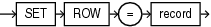
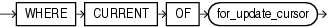

PL/SQL extends the `update_set_clause` and `where_clause` of the SQL `UPDATE` statement as follows:

- In the `update_set_clause`, you can specify a record. For each selected row, the `UPDATE` statement updates each column with the value of the corresponding record field.
- In the `where_clause`, you can specify a `CURRENT` `OF` clause, which restricts the `UPDATE` statement to the current row of the specified cursor.

See Also:

[Oracle Database SQL Language Reference](https://docs.oracle.com/pls/topic/lookup?ctx=en/database/oracle/oracle-database/21/lnpls&id=SQLRF01708) for the syntax of the SQL `UPDATE` statement

Topics

Syntax

update\_set\_clause::=



> ```
> SET ROW = record
> ```
>
> [  
> Copyright © 1996, 2024, Oracle and/or its affiliates.](https://docs.oracle.com/en/database/oracle/oracle-database/dcommon/html/cpyr.htm)


where\_clause::=



> ```
> WHERE condition CURRENT OF for_update_cursor
> ```
>
> [  
> Copyright © 1996, 2024, Oracle and/or its affiliates.](https://docs.oracle.com/en/database/oracle/oracle-database/dcommon/html/cpyr.htm)


Semantics

update\_set\_clause

record

Name of a record variable that represents a row of the item described by `dml_table_expression_clause`. That is, for every column of the row, the record must have a field with a compatible data type. If a column has a `NOT` `NULL` constraint, then its corresponding field cannot have a `NULL` value.

where\_clause

for\_update\_cursor

Name of a `FOR` `UPDATE` cursor; that is, an explicit cursor associated with a `FOR` `SELECT` `UPDATE` statement.

Examples

- [Example 6-61](plsql-collections-and-records.md), "Updating Rows with Records"

Related Topics

In this chapter:

- " [Explicit Cursor Declaration and Definition](explicit-cursor-declaration-and-definition.md) "
- " [Record Variable Declaration](record-variable-declaration.md) "
- " [%ROWTYPE Attribute](ROWTYPE-attribute.md) "

In other chapters:

- " [Updating Rows with Records](plsql-collections-and-records.md) "
- " [Restrictions on Record Inserts and Updates](plsql-collections-and-records.md) "
- " [SELECT FOR UPDATE and FOR UPDATE Cursors](static-sql.md) "