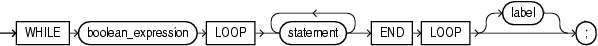

The `WHILE` `LOOP` statement runs one or more statements while a condition is `TRUE`.

Topics

The `WHILE` `LOOP` statement ends when the condition becomes `FALSE` or `NULL`, or when a statement inside the loop transfers control outside the loop or raises an exception.

Syntax

while\_loop\_statement::=



> ```
> WHILE boolean_expression
>   LOOP statement... END LOOP [ label ] ;
> ```
>
> [  
> Copyright © 1996, 2024, Oracle and/or its affiliates.](https://docs.oracle.com/en/database/oracle/oracle-database/dcommon/html/cpyr.htm)


( [boolean\_expression::=](expression.md), [statement::=](block.md) )

Semantics

while\_loop\_statement

boolean\_expression

Expression whose value is `TRUE`, `FALSE`, or `NULL`.

`boolean_expression` is evaluated at the beginning of each iteration of the loop. If its value is `TRUE`, the statements after `LOOP` run. Otherwise, control transfers to the statement after the `WHILE` `LOOP` statement.

statement

To prevent an infinite loop, at least one statement must change the value of `boolean_expression` to `FALSE` or `NULL`, transfer control outside the loop, or raise an exception. The statements that can transfer control outside the loop are:

- " [CONTINUE Statement](CONTINUE-statement.md) " (when it transfers control to the next iteration of an enclosing labeled loop)
- " [EXIT Statement](EXIT-statement.md) "
- " [GOTO Statement](GOTO-statement.md) "
- " [RAISE Statement](RAISE-statement.md) "

label

Label that identifies `while_loop_statement` (see " [statement::=](block.md) " and " [label](block.md) "). `CONTINUE`, `EXIT`, and `GOTO` statements can reference this label.

Labels improve readability, especially when `LOOP` statements are nested, but only if you ensure that the label in the `END` `LOOP` statement matches a label at the beginning of the same `LOOP` statement (the compiler does not check).

Examples

Example 14-47 WHILE LOOP Statements

The statements in the first `WHILE` `LOOP` statement never run, and the statements in the second `WHILE` `LOOP` statement run once.

```
DECLARE
  done  BOOLEAN := FALSE;
BEGIN
  WHILE done LOOP
    DBMS_OUTPUT.PUT_LINE ('This line does not print.');
    done := TRUE;  -- This assignment is not made.
  END LOOP;

  WHILE NOT done LOOP
    DBMS_OUTPUT.PUT_LINE ('Hello, world!');
    done := TRUE;
  END LOOP;
END;
/
```

Result:

```
Hello, world!
```