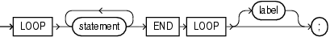

With each iteration of the basic `LOOP` statement, its statements run and control returns to the top of the loop. The `LOOP` statement ends when a statement inside the loop transfers control outside the loop or raises an exception.

Topics

Syntax

basic\_loop\_statement::=



> ```
> LOOP statement... END LOOP [ label ] ;
> ```
>
> [  
> Copyright © 1996, 2024, Oracle and/or its affiliates.](https://docs.oracle.com/en/database/oracle/oracle-database/dcommon/html/cpyr.htm)


([statement::=](block.md))

Semantics

basic\_loop\_statement

statement

To prevent an infinite loop, at least one statement must transfer control outside the loop. The statements that can transfer control outside the loop are:

- " [CONTINUE Statement](CONTINUE-statement.md) " (when it transfers control to the next iteration of an enclosing labeled loop)
- " [EXIT Statement](EXIT-statement.md) "
- " [GOTO Statement](GOTO-statement.md) "
- " [RAISE Statement](RAISE-statement.md) "

label

A label that identifies `basic_loop_statement` (see " [statement::=](block.md) " and " [label](block.md) "). `CONTINUE`, `EXIT`, and `GOTO` statements can reference this label.

Labels improve readability, especially when `LOOP` statements are nested, but only if you ensure that the label in the `END` `LOOP` statement matches a label at the beginning of the same `LOOP` statement (the compiler does not check).

Examples

Example 14-4 Nested, Labeled Basic LOOP Statements with EXIT WHEN Statements

In this example, one basic `LOOP` statement is nested inside the other, and both have labels. The inner loop has two `EXIT` `WHEN` statements; one that exits the inner loop and one that exits the outer loop.

```
DECLARE
  s  PLS_INTEGER := 0;
  i  PLS_INTEGER := 0;
  j  PLS_INTEGER;
BEGIN
  <<outer_loop>>
  LOOP
    i := i + 1;
    j := 0;
    <<inner_loop>>
    LOOP
      j := j + 1;
      s := s + i * j; -- Sum several products
      EXIT inner_loop WHEN (j > 5);
      EXIT outer_loop WHEN ((i * j) > 15);
    END LOOP inner_loop;
  END LOOP outer_loop;
  DBMS_OUTPUT.PUT_LINE
    ('The sum of products equals: ' || TO_CHAR(s));
END;
/
```

Result:

```
The sum of products equals: 166
```

Example 14-5 Nested, Unabeled Basic LOOP Statements with EXIT WHEN Statements

An `EXIT` `WHEN` statement in an inner loop can transfer control to an outer loop only if the outer loop is labeled.

In this example, the outer loop is not labeled; therefore, the inner loop cannot transfer control to it.

```
DECLARE
  i PLS_INTEGER := 0;
  j PLS_INTEGER := 0;
 
BEGIN
  LOOP
    i := i + 1;
    DBMS_OUTPUT.PUT_LINE ('i = ' || i);
    
    LOOP
      j := j + 1;
      DBMS_OUTPUT.PUT_LINE ('j = ' || j);
      EXIT WHEN (j > 3);
    END LOOP;
 
    DBMS_OUTPUT.PUT_LINE ('Exited inner loop');
 
    EXIT WHEN (i > 2);
  END LOOP;
 
  DBMS_OUTPUT.PUT_LINE ('Exited outer loop');
END;
/
```

Result:

```
i = 1
j = 1
j = 2
j = 3
j = 4
Exited inner loop
i = 2
j = 5
Exited inner loop
i = 3
j = 6
Exited inner loop
Exited outer loop
 
PL/SQL procedure successfully completed.
```