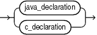
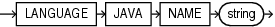
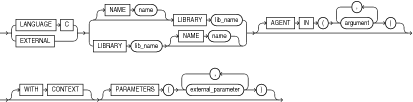
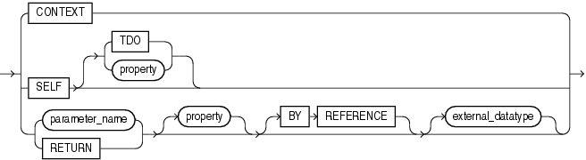

A call specification declares a Java method or a C language subprogram so that it can be invoked from PL/SQL. You can also use the SQL `CALL` statement to invoke such a method or subprogram. The call specification tells the database which Java method, or which named subprogram in which shared library, to invoke when an invocation is made. It also tells the database what type conversions to make for the arguments and return value.

Prerequisites

To invoke a call specification, you may need additional privileges, for example, `EXECUTE` privileges on a C library for a C call specification.

Syntax

call\_spec::=



> ```
> { java_declaration | c_declaration }
> ```
>
> [  
> Copyright © 1996, 2024, Oracle and/or its affiliates.](https://docs.oracle.com/en/database/oracle/oracle-database/dcommon/html/cpyr.htm)


java\_declaration::=



> ```
> LANGUAGE JAVA NAME string
> ```
>
> [  
> Copyright © 1996, 2024, Oracle and/or its affiliates.](https://docs.oracle.com/en/database/oracle/oracle-database/dcommon/html/cpyr.htm)


c\_declaration::=



> ```
> {LANGUAGE C | EXTERNAL } { [ NAME name ] LIBRARY lib_name | LIBRARY lib_name [ NAME name ] }
>    [ AGENT IN ( argument[, argument ]... ) ]
>    [ WITH CONTEXT ]
>    [ PARAMETERS ( external_parameter[, external_parameter ]... ) ]
> ```
>
> [  
> Copyright © 1996, 2024, Oracle and/or its affiliates.](https://docs.oracle.com/en/database/oracle/oracle-database/dcommon/html/cpyr.htm)


external\_parameter::=



> ```
> { CONTEXT
> | SELF [ TDO | property ]
> | { parameter | RETURN } [ property ] [ BY REFERENCE ] [ external_datatype ]
> }
> ```
>
> [  
> Copyright © 1996, 2024, Oracle and/or its affiliates.](https://docs.oracle.com/en/database/oracle/oracle-database/dcommon/html/cpyr.htm)


property::=


> ```
> { INDICATOR [ STRUCT | TDO ]
> | LENGTH
> | DURATION
> | MAXLEN
> | CHARSETID
> | CHARSETFORM
> }
> ```
>
> [  
> Copyright © 1996, 2024, Oracle and/or its affiliates.](https://docs.oracle.com/en/database/oracle/oracle-database/dcommon/html/cpyr.htm)


Semantics

call\_spec

Maps a C procedure or Java method name, parameter types, and return type to their SQL counterparts.

Call specifications can appear in PL/SQL standalone subprograms, package specifications and bodies, and type specifications and bodies. They cannot appear inside PL/SQL blocks.

java\_declaration

string

Identifies the Java implementation of the method.

c\_declaration

`LIBRARY` lib\_name

Identifies a library created by the " [CREATE LIBRARY Statement](CREATE-LIBRARY-statement.md) ".

EXTERNAL

Deprecated way of declaring a C subprogram, supported only for backward compatibility. Use `EXTERNAL` in a C call specification if it contains defaulted arguments or constrained PL/SQL types, otherwise use the `LANGUAGE` `C` syntax.

Examples

Example 14-6 External Function Example

The hypothetical following statement creates a PL/SQL standalone function `get_val` that registers the C subprogram `c_get_val` as an external function. (The parameters have been omitted from this example.)

```
CREATE FUNCTION get_val
   ( x_val IN NUMBER,
    y_val IN NUMBER,
    image IN LONG RAW )
   RETURN BINARY_INTEGER AS LANGUAGE C
      NAME "c_get_val"
      LIBRARY c_utils
      PARAMETERS (...);
```