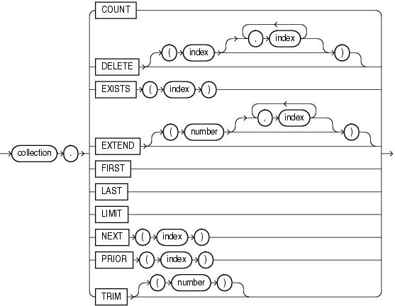

A collection method is a PL/SQL subprogram that either returns information about a collection or operates on a collection.

Topics

Syntax

collection\_method\_call::=



> ```
> collection.{ COUNT
>            | DELETE [ ( index [, index ]... ) ]
>            | EXISTS [ ( index ) ]
>            | EXTEND [ ( index [, index ]... ) ]
>            | FIRST
>            | LAST
>            | LIMIT
>            | NEXT ( index )
>            | PRIOR ( index )
>            | TRIM ( number )
>            }
> ```


Semantics

collection\_method\_call

collection

Name of the collection whose method you are invoking.

COUNT

Function that returns the number of elements in the collection, explained in " [COUNT Collection Method](plsql-collections-and-records.md) ".

DELETE

Procedure that deletes elements from the collection, explained in " [DELETE Collection Method](plsql-collections-and-records.md) ".

Restriction on DELETE

If `collection` is a varray, you cannot specify indexes with `DELETE`.

index

Numeric expression whose data type either is `PLS_INTEGER` or can be implicitly converted to `PLS_INTEGER` (for information about the latter, see " [s](plsql-data-types.md) ").

EXISTS

Function that returns `TRUE` if the `index` th element of the collection exists and `FALSE` otherwise, explained in " [EXISTS Collection Method](plsql-collections-and-records.md) ".

EXTEND

Procedure that adds elements to the end of the collection, explained in " [EXTEND Collection Method](plsql-collections-and-records.md) ".

Restriction on EXTEND

You cannot use `EXTEND` if `collection` is an associative array.

FIRST

Function that returns the first index in the collection, explained in " [FIRST and LAST Collection Methods](plsql-collections-and-records.md) ".

LAST

Function that returns the last index in the collection, explained in " [FIRST and LAST Collection Methods](plsql-collections-and-records.md) ".

LIMIT

Function that returns the maximum number of elements that the collection can have. If the collection has no maximum size, then `LIMIT` returns `NULL`. For an example, see " [LIMIT Collection Method](plsql-collections-and-records.md) ".

NEXT

Function that returns the index of the succeeding existing element of the collection, if one exists. Otherwise, `NEXT` returns `NULL`. For more information, see " [PRIOR and NEXT Collection Methods](plsql-collections-and-records.md) ".

PRIOR

Function that returns the index of the preceding existing element of the collection, if one exists. Otherwise, `NEXT` returns `NULL`. For more information, see " [PRIOR and NEXT Collection Methods](plsql-collections-and-records.md) ".

TRIM

Procedure that deletes elements from the end of a collection, explained in " [TRIM Collection Method](plsql-collections-and-records.md) ".

Restriction on TRIM

You cannot use `TRIM` if `collection` is an associative array.

number

Number of elements to delete from the end of a collection. Default: one.

Examples

- [Example 6-23](plsql-collections-and-records.md), "DELETE Method with Nested Table"
- [Example 6-24](plsql-collections-and-records.md), "DELETE Method with Associative Array Indexed by String"
- [Example 6-25](plsql-collections-and-records.md), "TRIM Method with Nested Table"
- [Example 6-26](plsql-collections-and-records.md), "EXTEND Method with Nested Table"
- [Example 6-27](plsql-collections-and-records.md), "EXISTS Method with Nested Table"
- [Example 6-28](plsql-collections-and-records.md), "FIRST and LAST Values for Associative Array Indexed by PLS\_INTEGER"
- [Example 6-29](plsql-collections-and-records.md), "FIRST and LAST Values for Associative Array Indexed by String"
- [Example 6-30](plsql-collections-and-records.md), "Printing Varray with FIRST and LAST in FOR LOOP"
- [Example 6-31](plsql-collections-and-records.md), "Printing Nested Table with FIRST and LAST in FOR LOOP"
- [Example 6-32](plsql-collections-and-records.md), "COUNT and LAST Values for Varray"
- [Example 6-33](plsql-collections-and-records.md), "COUNT and LAST Values for Nested Table"
- [Example 6-34](plsql-collections-and-records.md), "LIMIT and COUNT Values for Different Collection Types"
- [Example 6-35](plsql-collections-and-records.md), "PRIOR and NEXT Methods"
- [Example 6-36](plsql-collections-and-records.md), "Printing Elements of Sparse Nested Table"