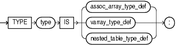
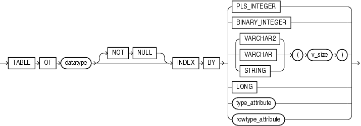
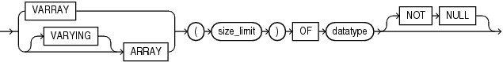
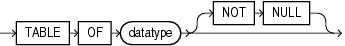
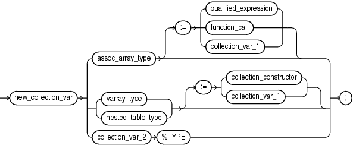

A collection variable is a composite variable whose internal components, called elements, have the same data type.

The value of a collection variable and the values of its elements can change.

You reference an entire collection by its name. You reference a collection element with the syntax `collection` `(``index``)`.

PL/SQL has three kinds of collection types:

- Associative array (formerly called PL/SQL table or index-by table)
- Variable-size array (varray)
- Nested table

An associative array can be indexed by either a string type or `PLS_INTEGER`. Varrays and nested tables are indexed by integers.

You can create a collection variable in either of these ways:

- Define a collection type and then declare a variable of that type.
- Use `%TYPE` to declare a collection variable of the same type as a previously declared collection variable.

Note:

This topic applies to collection types that you define inside a PL/SQL block or package, which differ from standalone collection types that you create with the " [CREATE TYPE Statement](CREATE-TYPE-statement.md) ".

In a PL/SQL block or package, you can define all three collection types. With the `CREATE` `TYPE` statement, you can create nested table types and `VARRAY` types, but not associative array types.

Topics

Syntax

collection\_type\_definition::=



> ```
> TYPE type IS 
>    { assoc_array_type_def
>    | varray_type_def
>    | nested_table_type_def
>    } ;
> ```
>
> [  
> Copyright © 1996, 2024, Oracle and/or its affiliates.](https://docs.oracle.com/en/database/oracle/oracle-database/dcommon/html/cpyr.htm)


assoc\_array\_type\_def::=



> ```
> TABLE OF datatype [ NOT NULL ]
> INDEX BY { PLS_INTEGER | BINARY_INTEGER | VARCHAR2 ( v_size ) | data_type }
> ```
>
> [  
> Copyright © 1996, 2024, Oracle and/or its affiliates.](https://docs.oracle.com/en/database/oracle/oracle-database/dcommon/html/cpyr.htm)


([datatype::=](datatype-attribute.md), [rowtype\_attribute::=](ROWTYPE-attribute.md), [type\_attribute::=](TYPE-attribute.md))

varray\_type\_def::=



> ```
> { VARRAY | [ VARYING ] ARRAY } ( size_limit )
>   OF datatype [ NOT NULL ]
> ```
>
> [  
> Copyright © 1996, 2024, Oracle and/or its affiliates.](https://docs.oracle.com/en/database/oracle/oracle-database/dcommon/html/cpyr.htm)


([datatype::=](datatype-attribute.md))

nested\_table\_type\_def::=



> ```
> TABLE OF datatype [ NOT NULL ]
> ```
>
> [  
> Copyright © 1996, 2024, Oracle and/or its affiliates.](https://docs.oracle.com/en/database/oracle/oracle-database/dcommon/html/cpyr.htm)


([datatype::=](datatype-attribute.md))

collection\_variable\_decl::=



> new\_collection\_var
>
> { assoc\_array\_type \[:= qualified\_expression | function\_call | collection\_var\_1 \]
>
> | ({varray\_type | nested\_table\_type \[:= { collection\_constructor | collection\_var\_1 } \]
>
> | collection\_var\_2%TYPE };
>
> [  
> Copyright © 1996, 2024, Oracle and/or its affiliates.](https://docs.oracle.com/en/database/oracle/oracle-database/dcommon/html/cpyr.htm)


([collection\_constructor::=](expression.md), [function\_call::=](expression.md), [qualified\_expression::=](qualified-expression.md))

Semantics

collection\_type\_definition

type

Name of the collection type that you are defining.

assoc\_array\_type\_def

Type definition for an associative array.

Restriction on assoc\_array\_type\_def

Can appear only in the declarative part of a block, subprogram, package specification, or package body.

datatype

Data type of the elements of the associative array. `datatype` can be any PL/SQL data type except `REF` `CURSOR`.

NOT NULL

Imposes the `NOT` `NULL` constraint on every element of the associative array. For information about this constraint, see " [NOT NULL Constraint](plsql-language-fundamentals.md) ".

{ PLS\_INTEGER | BINARY\_INTEGER }

Specifies that the data type of the indexes of the associative array is `PLS_INTEGER`.

{ VARCHAR2 | VARCHAR | STRING } (v\_size)

Specifies that the data type of the indexes of the associative array is `VARCHAR2` (or its subtype `VARCHAR` or `STRING`) with length `v_size`.

You can populate an element of the associative array with a value of any type that can be converted to `VARCHAR2` with the `TO_CHAR` function (described in [Oracle Database SQL Language Reference)](https://docs.oracle.com/pls/topic/lookup?ctx=en/database/oracle/oracle-database/21/lnpls&id=SQLRF06128).

Caution:

Associative arrays indexed by strings can be affected by National Language Support (NLS) parameters. For more information, see " [NLS Parameter Values Affect Associative Arrays Indexed by String](plsql-collections-and-records.md) ".

LONG

Specifies that the data type of the indexes of the associative array is `LONG`, which is equivalent to `VARCHAR2(32760)`.

Note:

Oracle supports `LONG` only for backward compatibility with existing applications. For new applications, use `VARCHAR2(32760)`.

type\_attribute, rowtype\_attribute

Specifies that the data type of the indexes of the associative array is a data type specified with either `%ROWTYPE` or `%TYPE`. This data type must represent either `PLS_INTEGER`, `BINARY_INTEGER`, or `VARCHAR2(`v\_size`)`.

varray\_type\_def

Type definition for a variable-size array.

size\_limit

Maximum number of elements that the varray can have. `size_limit` must be an integer literal in the range from 1 through 2147483647.

datatype

Data type of the varray element. `datatype` can be any PL/SQL data type except `REF` `CURSOR`.

NOT NULL

Imposes the `NOT` `NULL` constraint on every element of the varray. For information about this constraint, see " [NOT NULL Constraint](plsql-language-fundamentals.md) ".

nested\_table\_type\_def

Type definition for a nested table.

datatype

Data type of the elements of the nested table. `datatype` can be any PL/SQL data type except `REF` `CURSOR` or `NCLOB`.

If `datatype` is a scalar type, then the nested table has a single column of that type, called `COLUMN_VALUE`.

If `datatype` is an ADT, then the columns of the nested table match the name and attributes of the ADT.

NOT NULL

Imposes the `NOT` `NULL` constraint on every element of the nested table. For information about this constraint, see " [NOT NULL Constraint](plsql-language-fundamentals.md) ".

collection\_variable\_decl

new\_collection\_var

Name of the collection variable that you are declaring.

assoc\_array\_type

Name of a previously defined associative array type; the data type of `new_collection_var`.

varray\_type

Name of a previously defined `VARRAY` type; the data type of `new_collection_var`.

nested\_table\_type

Name of a previously defined nested table type; the data type of `new_collection_var`.

collection\_constructor

Collection constructor for the data type of `new_collection_var`, which provides the initial value of `new_collection_var`.

collection\_var\_1

Name of a previously declared collection variable of the same data type as `new_collection_var`, which provides the initial value of `new_collection_var`.

Note:

`collection_var_1` and `new_collection_var` must have the same data type, not only elements of the same type.

collection\_var\_2

Name of a previously declared collection variable.

%TYPE

See " [%TYPE Attribute](TYPE-attribute.md) ".

Examples

- [Example 6-1](plsql-collections-and-records.md), "Associative Array Indexed by String"
- [Example 6-2](plsql-collections-and-records.md), "Function Returns Associative Array Indexed by PLS\_INTEGER"
- [Example 6-4](plsql-collections-and-records.md), "Varray (Variable-Size Array)"
- [Example 6-5](plsql-collections-and-records.md), "Nested Table of Local Type"
- [Example 6-17](plsql-collections-and-records.md), "Two-Dimensional Varray (Varray of Varrays)"
- [Example 6-18](plsql-collections-and-records.md), "Nested Tables of Nested Tables and Varrays of Integers"