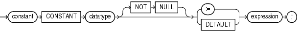

A constant holds a value that does not change. A constant declaration specifies the name, data type, and value of the constant and allocates storage for it. The declaration can also impose the `NOT` `NULL` constraint.

Topics

Syntax

constant\_declaration::=



> ```
> constant CONSTANT datatype [NOT NULL] { := | DEFAULT } expression ;
> ```
>
> [  
> Copyright © 1996, 2024, Oracle and/or its affiliates.](https://docs.oracle.com/en/database/oracle/oracle-database/dcommon/html/cpyr.htm)


([datatype::=](datatype-attribute.md), [expression::=](expression.md))

Semantics

constant\_declaration

constant

Name of the constant that you are declaring.

datatype

Data type for which a variable can be declared with an initial value.

NOT NULL

Imposes the `NOT` `NULL` constraint on the constant.

For information about this constraint, see " [NOT NULL Constraint](plsql-language-fundamentals.md) ".

expression

Initial value for the constant. expression must have a data type that is compatible with datatype. When constant\_declaration is elaborated, the value of expression is assigned to constant.

Examples

- [Example 3-12](plsql-language-fundamentals.md), "Constant Declarations"
- [Example 3-13](plsql-language-fundamentals.md), "Variable and Constant Declarations with Initial Values"