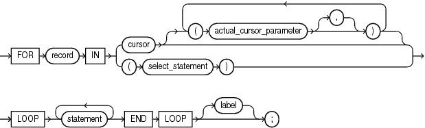

The cursor `FOR` `LOOP` statement implicitly declares its loop index as a record variable of the row type that a specified cursor returns, and then opens a cursor.

With each iteration, the cursor `FOR` `LOOP` statement fetches a row from the result set into the record. When there are no more rows to fetch, the cursor `FOR` `LOOP` statement closes the cursor. The cursor also closes if a statement inside the loop transfers control outside the loop or raises an exception.

Topics

Syntax

cursor\_for\_loop\_statement::=



> ```
> [ FOR record IN
>   { cursor [ ( cursor_parameter_dec
>                [ [,] cursor_parameter_dec ]... )]
>   | ( select_statement )
>   }
>     LOOP statement... END LOOP [label] ;
> ```
>
> [  
> Copyright © 1996, 2024, Oracle and/or its affiliates.](https://docs.oracle.com/en/database/oracle/oracle-database/dcommon/html/cpyr.htm)


([statement::=](block.md))

Semantics

cursor\_for\_loop\_statement

record

Name for the loop index that the cursor `FOR` `LOOP` statement implicitly declares as a `%ROWTYPE` record variable of the type that `cursor` or `select_statement` returns.

`record` is local to the cursor `FOR` `LOOP` statement. Statements inside the loop can reference `record` and its fields. They can reference virtual columns only by aliases. Statements outside the loop cannot reference `record`. After the cursor `FOR` `LOOP` statement runs, `record` is undefined.

cursor

Name of an explicit cursor (not a cursor variable) that is not open when the cursor `FOR` `LOOP` is entered.

actual\_cursor\_parameter

Actual parameter that corresponds to a formal parameter of `cursor`.

select\_statement

SQL `SELECT` statement (not PL/SQL `SELECT` `INTO` statement). For `select_statement`, PL/SQL declares, opens, fetches from, and closes an implicit cursor. However, because `select_statement` is not an independent statement, the implicit cursor is internal—you cannot reference it with the name `SQL`.

See Also:

[Oracle Database SQL Language Reference](https://docs.oracle.com/pls/topic/lookup?ctx=en/database/oracle/oracle-database/21/lnpls&id=SQLRF01702) for `SELECT` statement syntax

label

Label that identifies `cursor_for_loop_statement` (see " [statement::=](block.md) " and " [label](block.md) "). `CONTINUE`, `EXIT`, and `GOTO` statements can reference this label.

Labels improve readability, especially when `LOOP` statements are nested, but only if you ensure that the label in the `END` `LOOP` statement matches a label at the beginning of the same `LOOP` statement (the compiler does not check).

Examples

- [Example 7-18](static-sql.md), "Implicit Cursor FOR LOOP Statement"
- [Example 7-19](static-sql.md), "Explicit Cursor FOR LOOP Statement"
- [Example 7-20](static-sql.md), "Passing Parameters to Explicit Cursor FOR LOOP Statement"
- [Example 7-21](static-sql.md), "Cursor FOR Loop References Virtual Columns"

Related Topics

In this chapter:

- " [Basic LOOP Statement](basic-LOOP-statement.md) "
- " [CONTINUE Statement](CONTINUE-statement.md) "
- " [EXIT Statement](EXIT-statement.md) "
- " [Explicit Cursor Declaration and Definition](explicit-cursor-declaration-and-definition.md) "
- " [FETCH Statement](FETCH-statement.md) "
- " [FOR LOOP Statement](FOR-LOOP-statement.md) "
- " [FORALL Statement](FORALL-statement.md) "
- " [OPEN Statement](OPEN-statement.md) "
- " [WHILE LOOP Statement](WHILE-LOOP-statement.md) "

In other chapters:

- " [Processing Query Result Sets With Cursor FOR LOOP Statements](static-sql.md) "